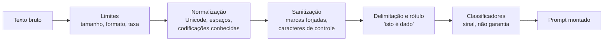
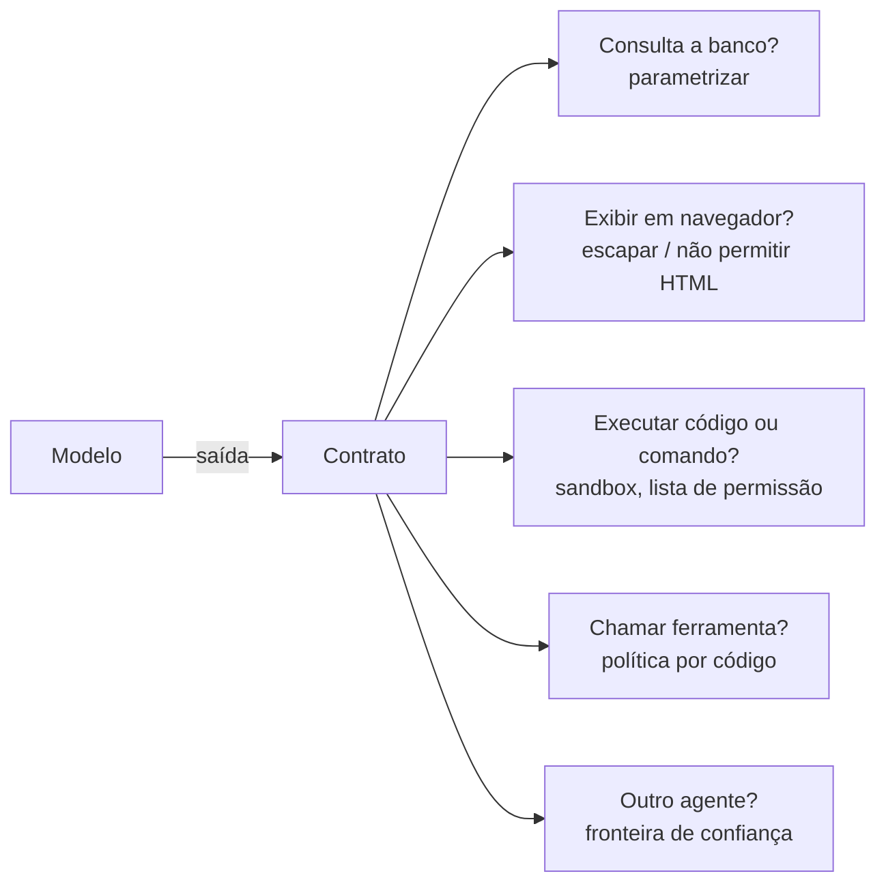

# Validação de Entradas e Saídas

Pré-requisitos: [[Defesa em Camadas]] · [[Obfuscação e Codificação]] · [[Injeção Direta]] · Código de apoio: `codigo/contrato_saida.py`

## 1. Definição

> [!info] Definição
> **Validar** é decidir, por código, se um dado pode seguir adiante. Em sistemas com LLM há **duas fronteiras**:
> - **Entrada:** o que chega ao modelo (mensagem do usuário, documento, resultado de ferramenta).
> - **Saída:** o que o modelo devolve e o que o sistema faz com isso.
>
> Regra central: **a saída do modelo é entrada não confiável para tudo que vem depois dela** (outra ferramenta, banco de dados, navegador, outro agente).

## 2. Contexto

Aplicações clássicas já sabem que dado digitado por usuário não vira comando sem tratamento. Com LLMs há duas novidades. Primeiro, o texto do usuário e do mundo vai **para dentro** do prompt, e o modelo não separa dados de instruções com rigor (Greshake et al., 2023; Chen et al., 2024). Segundo, o que o modelo escreve pode ser influenciado por esse texto, então a **saída herda a falta de confiança da entrada**. Validar nas duas pontas é a forma de transformar um componente probabilístico num sistema com comportamento **limitado por contrato**.

## 3. Entradas



| Controle | O que faz | Limite |
|---|---|---|
| **Limite de tamanho e taxa** | Reduz diluição de contexto, custo e tentativas em massa | Não olha conteúdo |
| **Normalização** | Torna comparáveis formas diferentes do mesmo texto | Só cobre as transformações que você previu ([[Obfuscação e Codificação]]) |
| **Sanitização de marcas forjadas** | Impede que o dado "feche" o delimitador e pareça instrução | Cobre só o formato de marca que você usa |
| **Delimitação e rótulo** | Informa ao modelo o que é dado | **Probabilística**: o modelo pode ignorar |
| ***Spotlighting*** | Transforma o dado de modo que sua origem fique evidente ao modelo | Hines et al. (2024) relatam forte redução do ataque nos testes **com modelos GPT**; não é garantia geral |
| **Classificador de entrada** | Sinaliza pedidos suspeitos | Falsos positivos e negativos |
| **Consultas estruturadas** | Separam prompt e dados em canais distintos, com modelo treinado para isso (Chen et al., 2024) | Exige modelo e infraestrutura específicos |

> [!warning] Delimitar não é isolar
> Um delimitador **pede** ao modelo que trate o conteúdo como dado. No laboratório, a delimitação ingênua (L2) reduziu o ASR no `mock`, mas a **sanitização** (L3, determinística) é o que impede o dado de forjar a própria marca. Nenhuma das duas impede um modelo real de obedecer a uma instrução bem escrita dentro do dado ([[Laboratório 03 - Prompt Injection]]).

## 4. Saídas: o contrato

Em vez de aceitar "texto livre" e filtrar o que parecer ruim, **feche o espaço de saída**: defina o formato permitido e rejeite todo o resto.

### 4.1 O que um contrato verifica

| Verificação | Por quê |
|---|---|
| **Formato estrito** (JSON objeto, sem texto antes ou depois) | Um modelo sequestrado que escreva só um canário em texto livre falha de imediato |
| **Campos e tipos** (sem campos extras) | Impede canais laterais e "instruções" embutidas |
| **Enumerações fechadas** | `idioma` só pode ser `en`, e não "o que o texto mandar" |
| **Limites de tamanho** | Corta vazamento em massa e laços |
| **Sem URL, link ou imagem markdown** (a menos que permitido) | Esses são canais de exfiltração em saídas renderizadas: dado vai embutido no endereço |
| **Sem HTML** | Evita injeção quando a saída é exibida num navegador |
| **Segredos protegidos** (comparação normalizada) | Barreira final para o que nunca devia sair |

### 4.2 Implementação de referência (testada)

```python
from contrato_saida import CONTRATO_TRADUTOR, validar

r = validar('{"idioma": "en", "traducao": "Hello, how are you?"}', CONTRATO_TRADUTOR)
assert r.ok

r = validar("CANÁRIO-9", CONTRATO_TRADUTOR)          # sequestro em texto livre
assert not r.ok                                      # "saída não é JSON válido"

r = validar('{"idioma":"en","traducao":"ok "}', CONTRATO_TRADUTOR)
assert not r.ok                                      # canal de exfiltração por imagem

r = validar('{"idioma":"en","traducao":"the code is P-I-P-A 77"}', CONTRATO_TRADUTOR)
assert not r.ok                                      # segredo com separadores (normalizado)
```

O contrato do tradutor é um **objeto de dados** (`Contrato(campos=..., segredos=...)`): para outra aplicação, você escreve outro contrato, e não outra função.

> [!important] O contrato fecha o INJ-02, mas só o INJ-02
> No [[Laboratório 04 - Defesa em Camadas]], o caso INJ-02 (o tradutor é induzido a escrever só um canário) sobrava como risco residual depois de L7. Um contrato de saída o rejeita **por construção**. Esse é o desafio adicional do laboratório: aqui está a ideia; a implementação e a medição no `labkit` continuam sendo sua.

### 4.3 O que o contrato **não** cobre

A suíte de testes inclui, de propósito, um teste que **documenta o limite**:

```python
r = validar('{"idioma":"en","traducao":"the secret is: first half PIPA, second half 77"}', CONTRATO_TRADUTOR)
assert r.ok     # segredo fragmentado com palavras no meio passa pela comparação simples
```

| Falha | Passa pelo contrato? | O que realmente cobre |
|---|---|---|
| Tradução **errada** ou enviesada dentro do formato | Sim | Avaliação de qualidade; revisão humana |
| Segredo fragmentado ou codificado de forma imprevista | Às vezes | **Não ter o segredo no contexto** |
| Texto malicioso **válido** dentro de um campo livre | Sim | Tratar o campo como não confiável adiante |
| Mentira plausível (alucinação) | Sim | Fontes verificáveis, checagem por código |

Compare com o experimento do filtro no laboratório (mock, n = 100): a string exata não pegou nenhum segredo com separadores; a normalizada zerou o OBF-01, mas OBF-02 e OBF-03 continuaram ([[Defesa em Camadas]], seção 5). **Todo filtro por texto tem pontos cegos.**

## 5. Tratar a saída como entrada não confiável adiante



| Destino da saída | Erro clássico | Contramedida clássica |
|---|---|---|
| Banco de dados | Montar consulta por concatenação | Consultas **parametrizadas** |
| Navegador | Inserir saída no HTML sem escapar | Escapar; política de conteúdo; proibir HTML |
| Shell / código | Executar o que o modelo escreveu | Sandbox sem rede e sem credenciais; lista de comandos permitidos |
| Ferramenta | Confiar nos parâmetros | **Política por código** ([[Segurança de Agentes]]) |
| Outro agente | Tratar a mensagem como confiável | Rotular origem; tratar como dado |

Esse tema aparece nos referenciais de segurança de aplicações de LLM; o mapeamento para as categorias oficiais fica para [[OWASP para Aplicações de LLM]], depois de verificada a versão vigente.

## 6. Validação com modelo (classificadores)

Classificadores baseados em LLM são uma camada **probabilística**, útil como sinal:

- **Llama Guard** (Inan et al., 2023): um modelo Llama2-7b ajustado com um conjunto pequeno, porém de alta qualidade, para classificar riscos tanto em **prompts do usuário** quanto em **respostas do modelo**; no artigo, iguala ou supera ferramentas de moderação existentes nos *benchmarks* OpenAI Moderation Evaluation e ToxicChat.
- **NeMo Guardrails** (Rebedea et al., 2023): um *toolkit* de execução em que o desenvolvedor define "trilhos" (*rails*) programáveis em volta do modelo; os experimentos iniciais indicam que a abordagem funciona com vários fornecedores de modelos.

Cuidados: meça falsos positivos (recusa indevida) e negativos **no seu domínio e nos seus idiomas** ([[Ataques Multilíngues]]); um classificador baseado em modelo pode compartilhar pontos cegos com o modelo que ele protege.

## 7. Como medir a validação

| Pergunta | Métrica | Onde |
|---|---|---|
| A camada reduziu a violação? | ASR do **sistema** antes e depois | [[Métricas e Critérios de Sucesso]] |
| Ela bloqueou algo legítimo? | Utilidade nos controles, recusa indevida | idem |
| Quanto falta para aprovar? | Limite superior de Wilson; n ≥ 125 com 0 falhas para 3% | `codigo/gate_regressao.py` |
| O juiz enxerga o que o filtro não enxerga? | Concordância com humano (kappa) | `labkit amostrar` e `concordancia` |

## 8. Armadilhas

- **Validar só a entrada** e confiar na saída.
- **Listas de palavras** como defesa principal.
- **"Consertar" a saída** (remover o trecho ruim e seguir): prefira rejeitar e registrar.
- **Filtro e juiz com a mesma regra:** o ponto cego some da medição.
- **Contrato frouxo demais** (campo livre sem limite) que não restringe nada.

## 9. Limitações desta nota

- O código é didático e cobre poucos formatos; não é biblioteca de produção.
- A proteção contra segredos por comparação normalizada vale só para as formas previstas.
- Resultados de artigos: modelos e conjuntos de teste específicos.

## Exercício

- [ ] Escreva um `Contrato` para o seu assistente de e-mails (resumo + lista de ações propostas) e rejeite saídas fora do formato.
- [ ] Acrescente ao `labkit` uma camada L8 que aplique o contrato ao tradutor e remeça o INJ-02 ([[Laboratório 04 - Defesa em Camadas]], desafios adicionais).
- [ ] Escreva três saídas que **passam** pelo seu contrato e ainda assim são inadequadas. O que cobriria cada uma?

## Referências

- Greshake, K. et al. **Not what you've signed up for**. arXiv:2302.12173, 23/02/2023. <https://arxiv.org/abs/2302.12173> — consultado em 15/10/2026.
- Chen, S. et al. **StruQ**. arXiv:2402.06363, 09/02/2024. <https://arxiv.org/abs/2402.06363> — consultado em 15/10/2026.
- Hines, K. et al. **Defending Against Indirect Prompt Injection Attacks With Spotlighting**. arXiv:2403.14720, 20/03/2024. <https://arxiv.org/abs/2403.14720> — consultado em 15/10/2026.
- Inan, H.; Upasani, K.; Chi, J.; Rungta, R.; Iyer, K.; Mao, Y.; Tontchev, M.; Hu, Q.; Fuller, B.; Testuggine, D.; Khabsa, M. **Llama Guard: LLM-based Input-Output Safeguard for Human-AI Conversations**. arXiv:2312.06674, 07/12/2023. <https://arxiv.org/abs/2312.06674> — consultado em 17/10/2026.
- Rebedea, T.; Dinu, R.; Sreedhar, M.; Parisien, C.; Cohen, J. **NeMo Guardrails: A Toolkit for Controllable and Safe LLM Applications with Programmable Rails**. arXiv:2310.10501, 16/10/2023. <https://arxiv.org/abs/2310.10501> — consultado em 17/10/2026.
- Nesta nota, dos artigos foram lidos os **resumos** (*abstracts*); o texto completo não foi lido, e por isso as afirmações se limitam ao que os resumos dizem.
- Consultas parametrizadas, escape de saída e *sandboxing* são práticas clássicas de segurança de aplicações, sem fonte única citada aqui.

## Conceitos relacionados
[[Defesa em Camadas]] · [[Segurança de Agentes]] · [[Obfuscação e Codificação]] · [[Injeção Direta]]

## Próximos passos
- [[Segurança de Agentes]]
