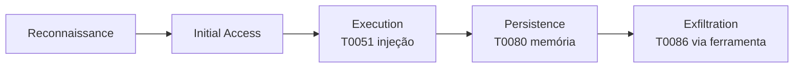

# MITRE ATLAS

Pré-requisitos: [[OWASP para Aplicações de LLM]] · [[Taxonomia de Ataques]]

> [!info] O que é
> ATLAS (*Adversarial Threat Landscape for AI Systems*) é uma base de conhecimento de **táticas, técnicas, mitigações e estudos de caso** de ataques a sistemas de IA, no estilo ATT&CK. Descreve **o que o adversário faz e em que fase**.

> [!important] Versão consultada
> Os números abaixo vêm do arquivo de dados oficial `ATLAS-latest.yaml` (repositório público de dados do ATLAS), lido em **19/10/2026**: **coleção 2026.09** (modificada em 15/09/2026), **formato 6.0.0**. Um resumo web que li antes indicava 2026.05; **prevalece o arquivo**. Os números mudam a cada versão.

## Tamanho da base nessa versão

| Item | Quantidade |
|---|---|
| Táticas | 16 |
| Técnicas (incluindo subtécnicas) | 208 (120 técnicas + 88 subtécnicas) |
| Mitigações | 40 |
| Estudos de caso | 73 (50 *Exercise*, 23 *Incident*) |

## Táticas (nomes oficiais, em inglês)

AI Model Access · AI Attack Adaptation · Reconnaissance · Resource Development · Initial Access · Execution · Persistence · Defense Evasion · Discovery · Collection · Exfiltration · Impact · Privilege Escalation · Credential Access · Command and Control · Lateral Movement.

## Técnicas mais ligadas ao curso

| ID | Técnica | Tática(s) | Maturidade | Nota do curso |
|---|---|---|---|---|
| AML.T0051 | LLM Prompt Injection (subtécnicas: Direct `.000`, Indirect `.001`, Triggered `.002`) | Execution | Realized | [[Injeção Direta]] · [[Injeção Indireta]] |
| AML.T0054 | LLM Jailbreak | Defense Evasion, Privilege Escalation | Realized | [[O que é AI Jailbreaking]] |
| AML.T0056 | Extract LLM System Prompt | Exfiltration | Feasible | [[Ataques Diretos]] |
| AML.T0068 | LLM Prompt Obfuscation | Defense Evasion | Realized | [[Obfuscação e Codificação]] |
| AML.T0065 | LLM Prompt Crafting | AI Attack Adaptation | Realized | [[Ataques Adaptativos e Transferência]] |
| AML.T0070 | RAG Poisoning | Persistence | Demonstrated | [[Injeção Indireta]] |
| AML.T0080 | AI Agent Context Poisoning (`.000` Memory) | Persistence | Realized | [[Ataques Contra Agentes de IA]] |
| AML.T0053 | AI Agent Tool Invocation | Execution, Lateral Movement, Privilege Escalation | Demonstrated | [[Segurança de Agentes]] |
| AML.T0086 | Exfiltration via AI Agent Tool Invocation | Exfiltration | Realized | [[Segurança de Agentes]] |

"Maturidade" é o rótulo do próprio ATLAS (por exemplo *Feasible*, *Demonstrated*, *Realized*), indicando até onde a técnica foi observada.

## Mitigações do ATLAS que se mapeiam às defesas do curso

| ID | Mitigação (ATLAS) | Equivalente no curso |
|---|---|---|
| AML.M0020 | Generative AI Guardrails | [[Alinhamento e Guardrails]] |
| AML.M0021 | Generative AI Guidelines | prompt reforçado ([[Defesa em Camadas]]) |
| AML.M0022 | Generative AI Model Alignment | [[Alinhamento e Guardrails]] |
| AML.M0024 | AI Telemetry Logging | [[Monitoramento e Resposta]] |
| AML.M0026 / M0028 | Privileged / AI Agent Tools Permissions Configuration | política de ferramentas ([[Segurança de Agentes]]) |
| AML.M0029 | Human In-the-Loop for AI Agent Actions | confirmação humana |
| AML.M0030 | Restrict AI Agent Tool Invocation on Untrusted Data | triângulo de risco ([[Conceitos Fundamentais]]) |
| AML.M0033 | Input and Output Validation for AI Agent Components | [[Validação de Entradas e Saídas]] |
| AML.M0035 | AI Red Team | [[Metodologia de Testes]] |

Segundo as relações do arquivo, T0051 é mitigada por M0019, M0020, M0021, M0022, M0024, M0033 e M0035; T0086 por M0024, M0026–M0030, M0032 e M0033.

## Estudos de caso úteis para leitura (todos classificados como *Exercise* nesta versão)

| ID | Título | Data no ATLAS |
|---|---|---|
| AML.CS0016 | Achieving Code Execution in MathGPT via Prompt Injection | 28/01/2023 |
| AML.CS0020 | Indirect Prompt Injection Threats: Bing Chat Data Pirate | 01/2023 |
| AML.CS0035 | Data Exfiltration from Slack AI via Indirect Prompt Injection | 20/08/2024 |
| AML.CS0040 | Hacking ChatGPT's Memories with Prompt Injection | 02/2024 |
| AML.CS0046 | Data Destruction via Indirect Prompt Injection Targeting Claude Computer-Use | 24/10/2024 |
| AML.CS0059 | EchoLeak: Zero-Click Prompt Injection Targeting M365 Copilot for Data Exfiltration | 25/05/2025 |

> [!note] Escolha e leitura
> Escolhi esses casos pelo título e pela data; **não reproduzo aqui seus detalhes técnicos**. Leia o texto de cada caso no site do ATLAS antes de usá-lo em relatório.

O diagrama é uma **leitura didática** de uma cadeia plausível, não uma sequência oficial do ATLAS.

## Como usar

1. Em cada achado do [[Relatório de Vulnerabilidades]], cite o ID da técnica e a tática.
2. Use a coluna de mitigações para ligar o achado a controles.
3. Registre a **versão do ATLAS** usada, pois IDs e nomes evoluem.

## Exercícios

- [ ] Para os 5 laboratórios, escolha a técnica ATLAS mais próxima de cada um e justifique o que **não** se encaixa.
- [ ] Leia um estudo de caso e desenhe a cadeia com o triângulo de risco.

## Referências

- MITRE. **ATLAS**: dados oficiais, `ATLAS-latest.yaml`, coleção 2026.09, formato 6.0.0 (repositório público `mitre-atlas/atlas-data`). Site: <https://atlas.mitre.org/> — consultado em 19/10/2026.

> [!note] Status do conhecimento
> **Verificado no arquivo primário** (contagens, IDs, nomes, relações, datas dos casos). Descrições longas não foram transcritas.

## Próximos passos
- [[Artigos Científicos]]
