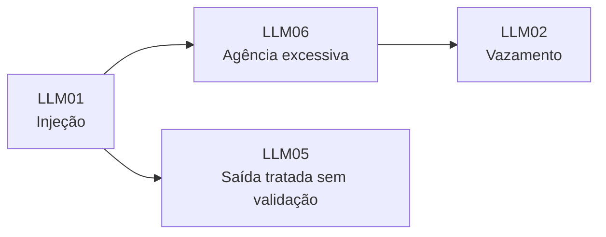

# OWASP Top 10 para Aplicações de LLM (edição 2025)

Pré-requisitos: [[Taxonomia de Ataques]] · [[Conceitos Fundamentais]]

> [!info] O que é
> Lista de riscos mantida pelo projeto OWASP GenAI Security Project, voltada a quem **constrói e avalia** aplicações com LLM. É uma lista de **categorias de risco**, não um catálogo de técnicas: serve para organizar relatórios e priorizar controles ([[Relatório de Vulnerabilidades]]).

## As dez categorias (edição 2025)

| ID | Nome | Onde aparece no curso |
|---|---|---|
| LLM01 | Prompt Injection | [[Jailbreak vs Prompt Injection]] · [[Conceitos Fundamentais]] · [[Injeção Direta]] · [[Injeção Indireta]] · [[Laboratório 03 - Prompt Injection]] |
| LLM02 | Sensitive Information Disclosure | [[Ataques Diretos]] (canário) · [[Validação de Entradas e Saídas]] |
| LLM03 | Supply Chain | [[Ataques Contra Agentes de IA]] (ferramentas de terceiros) |
| LLM04 | Data and Model Poisoning | [[Taxonomia de Ataques]] (superfície de treino e dados) |
| LLM05 | Improper Output Handling | [[Validação de Entradas e Saídas]] (contrato de saída) |
| LLM06 | Excessive Agency | [[Segurança de Agentes]] (política de ferramentas) |
| LLM07 | System Prompt Leakage | [[System Prompt e Hierarquia de Instruções]] · [[Ataques Diretos]] |
| LLM08 | Vector and Embedding Weaknesses | [[Injeção Indireta]] (RAG) |
| LLM09 | Misinformation | [[Limitações dos Modelos]] |
| LLM10 | Unbounded Consumption | [[Monitoramento e Resposta]] (limites e alertas) |

> [!warning] O mapeamento é do curso
> A coluna "Onde aparece" é uma **organização didática minha**, não uma classificação oficial do OWASP. Alguns itens (LLM03, 04, 08, 09, 10) são tratados só de passagem neste curso, que foca em jailbreak, injeção e agentes.

## Como usar na prática

1. Ao escrever um achado, registre o **ID OWASP** como rótulo secundário, ao lado da sua taxonomia (eixos A–D).
2. Use LLM01, 05, 06 e 07 como **checklist mínimo** de uma avaliação de aplicação com agente: entrada não confiável, saída tratada como dado, privilégio das ferramentas e segredos no prompt.
3. Lembre que um mesmo incidente pode tocar várias categorias (injeção indireta → ferramenta com excesso de agência → vazamento).

## Limitações

- É lista de **riscos**, sem métrica de eficácia nem procedimento de teste.
- A ordem e os nomes mudam entre edições; confirme a edição vigente antes de citar.
- Não substitui [[MITRE ATLAS]], que descreve **comportamento do adversário** por tática e técnica.

## Exercícios

- [ ] Classifique os cinco achados do seu [[Projeto Final]] por ID OWASP e por eixos A–D; onde divergem?
- [ ] Qual categoria cobre o caso do e-mail com ferramentas simuladas ([[Laboratório 04 - Defesa em Camadas]])? Justifique.

## Referências

- OWASP GenAI Security Project. **OWASP Top 10 for LLM Applications 2025**. <https://genai.owasp.org/llm-top-10/> — consultado em 19/10/2026 (lista de dez entradas e definições conferidas na fonte; detalhes de cada página não reproduzidos aqui).

> [!note] Status do conhecimento
> **Referência vigente em 19/10/2026**; sujeita a nova edição.

## Próximos passos
- [[MITRE ATLAS]]
