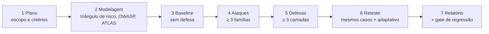

# Projeto Final

Pré-requisitos: [[Questionário de Fundamentos]] (≥ 80%) · [[Desafios Práticos]] (ao menos 6 concluídos).

## Objetivo

Realizar uma **avaliação de segurança completa e documentada** de um assistente de LLM de brinquedo, endurecê-lo e demonstrar com números a mudança de risco.

> [!warning] Escopo e ética
> Alvo próprio e fictício (assistente da Biblioteca, tradutor ou assistente de e-mail com ferramentas simuladas). Canários inofensivos. Sem dados reais, sem terceiros. Se usar um modelo real via API, use sua própria conta e respeite os termos de uso do provedor.

## Fluxo

## Entregáveis

1. **Plano de avaliação** ([[Planejamento de Avaliações]]): escopo, regras, critérios de sucesso por código, orçamento de tentativas.
2. **Modelagem de ameaças:** fontes de texto, confiança, capacidades, triângulo de risco; rótulos [[OWASP para Aplicações de LLM]] e [[MITRE ATLAS]] (cite a versão usada).
3. **Baseline** e **suíte de ataque** com pelo menos três famílias (ex.: direta, multilíngue/obfuscação, indireta).
4. **Defesas em pelo menos três camadas** ([[Defesa em Camadas]]), das quais uma obrigatoriamente **fora do modelo** (política de ferramentas ou contrato de saída).
5. **Reteste** com os mesmos casos e uma rodada **adaptativa** (ataques ajustados à defesa, rotulada como tal).
6. **Relatório de vulnerabilidades** ([[Relatório de Vulnerabilidades]]) com pelo menos 3 achados.
7. **Plano de monitoramento:** 2 regras de alerta e o gate de regressão ([[Monitoramento e Resposta]]).
8. **Seção de limitações:** o que não foi testado e por que as conclusões não generalizam.

## Rubrica (100 pontos)

| Critério | Pontos |
|---|---|
| Plano e escopo claros, ética respeitada | 10 |
| Modelagem de ameaças e mapeamento OWASP/ATLAS correto | 15 |
| Rigor experimental (critério por código, repetições, controles) | 20 |
| Estatística correta (Wilson, tamanho de amostra, comparação) | 15 |
| Qualidade das defesas e presença de controle externo ao modelo | 15 |
| Utilidade medida (recusa indevida) | 5 |
| Reteste adaptativo honesto | 10 |
| Relatório, reprodutibilidade e limitações | 10 |

Aprovação: ≥ 70. Penalizações: conclusões sobre modelos reais baseadas só em `mock` (−10); "seguro" afirmado por ausência de falhas sem intervalo (−10); referência sem fonte verificável (−5 cada).

## Cronograma sugerido

| Semana | Atividade |
|---|---|
| 1 | Plano, modelagem, baseline |
| 2 | Suíte de ataque e primeiros achados |
| 3 | Defesas e reteste |
| 4 | Relatório, monitoramento, revisão por um colega |

## Autoavaliação final

- [ ] Alguém reproduz meus números só com o relatório?
- [ ] Cada afirmação tem dado ou referência verificada?
- [ ] Declarei o que meu resultado **não** prova?

> [!note] Status do conhecimento
> Projeto didático; os métodos valem para avaliações reais, mas os números do curso não.

## Próximos passos
Volte ao [[00 - Índice Jailbreaking]] e revise a trilha de estudo. Reavalie o conteúdo a cada nova versão de modelo.
