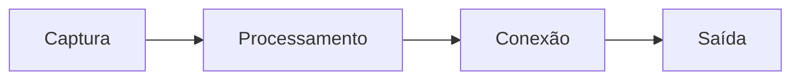
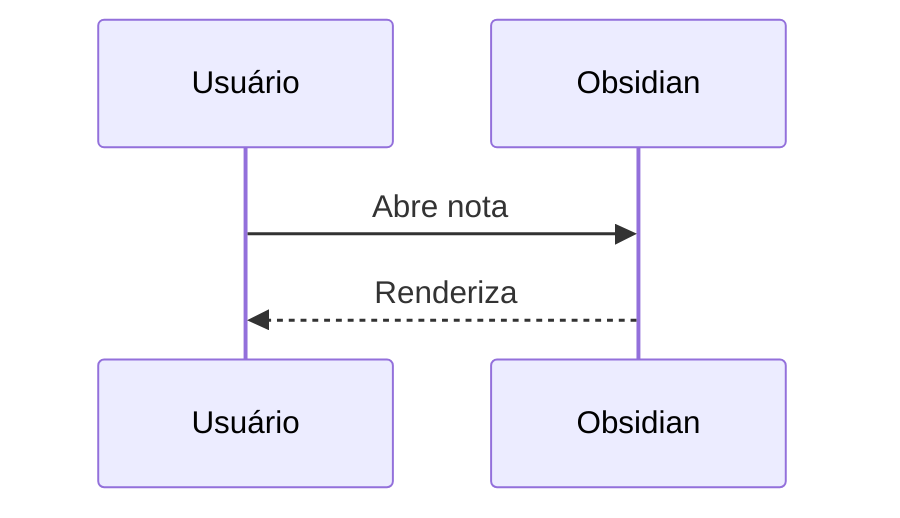

# Diagramas Mermaid

Escreva diagramas como texto dentro de um bloco `mermaid`.

## Fluxograma
````markdown

````

## Sequência
````markdown

````

## Outros tipos
`classDiagram`, `stateDiagram-v2`, `gantt`, `pie`, `erDiagram`, `mindmap`, `timeline`.

> [!info] Links internos
> Em diagramas Mermaid, nós podem receber a classe `internal-link` para apontar para notas.
>
> > [!question] Verificar na documentação oficial
> > Confirme a sintaxe atual de links internos em Mermaid na documentação do Obsidian.

## Mermaid × Canvas
Mermaid é texto versionável e rápido; [[Canvas]] é visual e livre. Escolha conforme o objetivo.

## Veja também
- [[Blocos de código]]
- [[Excalidraw]]

## Exercício
Desenhe seu fluxo de [[Captura, processamento, conexão e saída]] em um fluxograma Mermaid.
