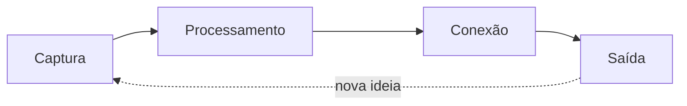

# Captura, processamento, conexão e saída

| Etapa | Objetivo | Ferramentas |
|---|---|---|
| **Captura** | guardar rápido, sem organizar | [[Notas diárias]], [[QuickAdd]], [[Captura rápida e compartilhamento]] |
| **Processamento** | reescrever e atomizar | [[Notas atômicas]], [[Templates]] |
| **Conexão** | ligar a outras ideias | [[Wikilinks e links Markdown]], [[MOCs]], [[Graph view]] |
| **Saída** | produzir algo | textos, projetos, apresentações ([[Slides]]) |

## Rotina sugerida
- **Diária:** capturar; revisar a caixa de entrada.
- **Semanal:** processar e conectar ([[Periodic Notes]]).
- **Mensal:** limpar links e MOCs ([[Links não resolvidos]]).

> [!tip] Não pule a saída
> Notas só valem quando alimentam algo: um texto, uma decisão, um projeto.

## Veja também
- [[Second brain]]
- [[Fluxo de estudos acadêmicos]]

## Exercício
Aplique as quatro etapas a um artigo que você leu esta semana.
