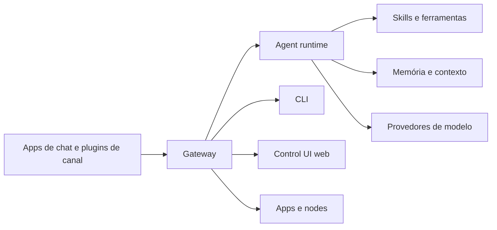

# Home - OpenClaw

> [!info] Sobre este vault
> Material em português do Brasil para estudar o **OpenClaw**, assistente de IA open source e autohospedado criado por Peter Steinberger (antes chamado Clawdbot e Moltbot), do zero ao avançado. O conteúdo segue a documentação oficial em [docs.openclaw.ai](https://docs.openclaw.ai); veja as fontes em [[Fontes]].

> [!warning] Projeto em evolução rápida
> O OpenClaw usa versionamento por calendário e muda com frequência. Sempre confirme comandos, chaves de configuração e requisitos na documentação oficial antes de aplicar. Ao consultar a doc em 27/10/2026, a versão mais recente listada era a v2026.10.x (a página inicial e o menu lateral divergiam entre v2026.10.7 e v2026.10.8).

## Comece por aqui

1. [[Trilha de aprendizado - OpenClaw]]: roteiros por perfil.
2. Escolha uma pasta abaixo e abra o MOC dela.

## Trilhas

| Trilha | Para quem | Pastas principais |
|---|---|---|
| Iniciante | Quem nunca usou agentes de IA | [[MOC - Visão Geral\|01]], [[MOC - História e Ecossistema\|02]], [[MOC - Fundamentos de Agentes de IA\|03]], [[MOC - Casos de Uso - OpenClaw\|17]] |
| Operador | Quem vai instalar e manter | [[MOC - Instalação e Configuração - OpenClaw\|13]], [[MOC - Gateway\|05]], [[MOC - Operação e Manutenção\|14]], [[MOC - Troubleshooting e FAQ\|20]] |
| Segurança | Quem precisa proteger o ambiente | [[MOC - Segurança e Hardening\|15]], [[MOC - Ameaças e Riscos\|16]], [[MOC - Arquitetura\|04]] |
| Desenvolvedor de skills | Quem cria extensões | [[MOC - Skills\|10]], [[MOC - Ferramentas e MCP\|11]], [[MOC - Automação e Agendamento\|12]], [[MOC - Projetos Práticos - OpenClaw\|18]] |

Detalhes e ordem de leitura em [[Trilha de aprendizado - OpenClaw]].

## Mapa do vault

| Pasta | MOC | Escopo |
|---|---|---|
| 01 | [[MOC - Visão Geral\|Visão Geral]] | O que é o OpenClaw, para quem serve e como ele se diferencia de chatbots e de outros agentes. |
| 02 | [[MOC - História e Ecossistema\|História e Ecossistema]] | Linha do tempo Clawdbot, Moltbot, OpenClaw, fundação, licença MIT e ecossistema (ClawHub, plugins). |
| 03 | [[MOC - Fundamentos de Agentes de IA\|Fundamentos de Agentes de IA]] | Conceitos gerais: LLMs, ferramentas, ReAct, memória e contexto, base para entender o OpenClaw. |
| 04 | [[MOC - Arquitetura\|Arquitetura]] | Visão em camadas: adaptadores de canal, Gateway, agent runtime, skills e memória. |
| 05 | [[MOC - Gateway\|Gateway]] | O processo Gateway: protocolo, configuração, serviço em segundo plano, Control UI e acesso remoto. |
| 06 | [[MOC - Agent Runtime e Loop ReAct\|Agent Runtime e Loop ReAct]] | Montagem de contexto, system prompt, workspace, sessões, loop do agente e roteamento multiagente. |
| 07 | [[MOC - Canais e Mensageria\|Canais e Mensageria]] | Canais suportados, pareamento, autorização de remetentes, grupos e roteamento. |
| 08 | [[MOC - Provedores e Modelos\|Provedores e Modelos]] | Provedores de modelos, autenticação, failover, modelos locais, custo e escolha de modelo. |
| 09 | [[MOC - Memória e Contexto\|Memória e Contexto]] | Memória persistente, janela de contexto, compactação, busca e boas práticas. |
| 10 | [[MOC - Skills\|Skills]] | O que são skills, estrutura, instalação, escrita de skills próprias e auditoria de terceiros. |
| 11 | [[MOC - Ferramentas e MCP\|Ferramentas e MCP]] | Ferramentas nativas, navegador, shell, arquivos, plugins e integração com MCP. |
| 12 | [[MOC - Automação e Agendamento\|Automação e Agendamento]] | Tarefas agendadas (cron), hooks, webhooks e ordens permanentes. |
| 13 | [[MOC - Instalação e Configuração - OpenClaw\|Instalação e Configuração]] | Instalação em macOS, Linux, Windows, VPS e Docker; onboarding e configuração inicial. |
| 14 | [[MOC - Operação e Manutenção\|Operação e Manutenção]] | Logs, atualização, backup, monitoramento e controle de custos de API. |
| 15 | [[MOC - Segurança e Hardening\|Segurança e Hardening]] | Modelo de confiança, auditoria, isolamento, mínimo privilégio, segredos, checklist e resposta a incidentes. |
| 16 | [[MOC - Ameaças e Riscos\|Ameaças e Riscos]] | Skills maliciosas, prompt injection indireto, exposição do Gateway e permissões excessivas, com foco em defesa. |
| 17 | [[MOC - Casos de Uso - OpenClaw\|Casos de Uso]] | Cenários reais de uso pessoal e de equipe. |
| 18 | [[MOC - Projetos Práticos - OpenClaw\|Projetos Práticos]] | Projetos passo a passo com objetivo, pré-requisitos, validação e extensões. |
| 19 | [[MOC - Comparações\|Comparações]] | OpenClaw frente a chatbots, Claude Code, AutoGPT e agentes em nuvem. |
| 20 | [[MOC - Troubleshooting e FAQ\|Troubleshooting e FAQ]] | Diagnóstico de problemas, perguntas frequentes e glossário. |

## Outros

- [[MOC - Anexos|Canvas]]: três quadros visuais (arquitetura, trilha de estudos e defesa em camadas).
- [[Glossário#OpenClaw]], [[Cheatsheets]] e [[Flashcards - OpenClaw]]: consulta e revisão.
- Templates: ver [[MOC - Templates]].
- Fontes consultadas: [[Fontes]].

## Visão geral em um diagrama

> [!tip] Diagrama baseado na doc oficial
> O fluxo acima segue o diagrama "How it works" da página inicial da documentação, ampliado com os componentes do agente. A arquitetura é detalhada em [[MOC - Arquitetura|Arquitetura]].
