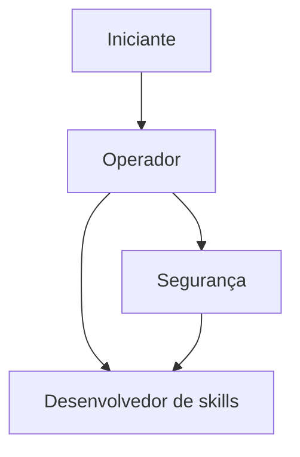

# Trilha de aprendizado - OpenClaw

## Objetivo

Oferecer quatro roteiros de leitura, cada um para um perfil, indicando a ordem sugerida das pastas.

## Os roteiros

### Trilha Iniciante

**Para quem:** quem está começando e quer entender o que é o OpenClaw antes de instalar.

1. [[MOC - Visão Geral|Visão Geral]]: o que é e para que serve.
2. [[MOC - História e Ecossistema|História e Ecossistema]]: de onde veio e como a comunidade cresceu.
3. [[MOC - Fundamentos de Agentes de IA|Fundamentos de Agentes de IA]]: conceitos de base.
4. [[MOC - Casos de Uso - OpenClaw|Casos de Uso]]: ideias concretas.
5. [[MOC - Comparações|Comparações]]: como se compara a outras ferramentas.

### Trilha Operador (instalar e manter)

**Para quem:** quem vai colocar o OpenClaw para rodar e mantê-lo saudável.

1. [[MOC - Instalação e Configuração - OpenClaw|Instalação e Configuração]]: instalação, onboarding e primeiros passos.
2. [[MOC - Gateway|Gateway]]: o processo central e seu serviço.
3. [[MOC - Canais e Mensageria|Canais e Mensageria]]: conectar Telegram, Discord e outros.
4. [[MOC - Provedores e Modelos|Provedores e Modelos]]: escolher e configurar modelos.
5. [[MOC - Operação e Manutenção|Operação e Manutenção]]: logs, atualização, backup e custos.
6. [[MOC - Troubleshooting e FAQ|Troubleshooting e FAQ]]: quando algo dá errado.

### Trilha Segurança

**Para quem:** quem precisa avaliar riscos e proteger o ambiente.

1. [[MOC - Arquitetura|Arquitetura]]: onde ficam as fronteiras de confiança.
2. [[MOC - Segurança e Hardening|Segurança e Hardening]]: controles e checklists.
3. [[MOC - Ameaças e Riscos|Ameaças e Riscos]]: skills maliciosas, prompt injection e exposição.
4. [[MOC - Operação e Manutenção|Operação e Manutenção]]: monitoramento e resposta a incidentes.

### Trilha Desenvolvedor de skills

**Para quem:** quem quer estender o agente.

1. [[MOC - Agent Runtime e Loop ReAct|Agent Runtime e Loop ReAct]]: como o agente decide e age.
2. [[MOC - Skills|Skills]]: estrutura, instalação e escrita.
3. [[MOC - Ferramentas e MCP|Ferramentas e MCP]]: ferramentas e integrações.
4. [[MOC - Automação e Agendamento|Automação e Agendamento]]: hooks, cron e webhooks.
5. [[MOC - Projetos Práticos - OpenClaw|Projetos Práticos]]: projetos para consolidar.
6. [[MOC - Segurança e Hardening|Segurança e Hardening]]: como auditar e limitar o que sua skill faz.

## Ordem sugerida, em diagrama

> [!tip] Segurança primeiro
> Mesmo quem segue a trilha de Operador deve ler Segurança e Hardening antes de conectar contas reais ou expor o Gateway.

## Material de apoio

- [[Glossário#OpenClaw]] para termos, [[Cheatsheets]] para comandos e [[Flashcards - OpenClaw]] para revisão.
- Quadros visuais em [[MOC - Anexos|Canvas]].

## Armadilhas comuns

- Pular a trilha de segurança porque "é só um teste".
- Ler apenas guias de terceiros e ignorar a documentação oficial.

## Resumo

- Quatro trilhas: Iniciante, Operador, Segurança e Desenvolvedor de skills.
- Todas passam por Segurança em algum ponto.

## Relacionados

- [[Home - OpenClaw]]
- [[Fontes]]
- [[MOC - Visão Geral|Visão Geral]]

## Exercícios

1. Qual trilha combina com você hoje e por quê?
2. Quais pastas as trilhas Operador e Segurança têm em comum?
3. Por que ler Segurança antes de expor o Gateway?
