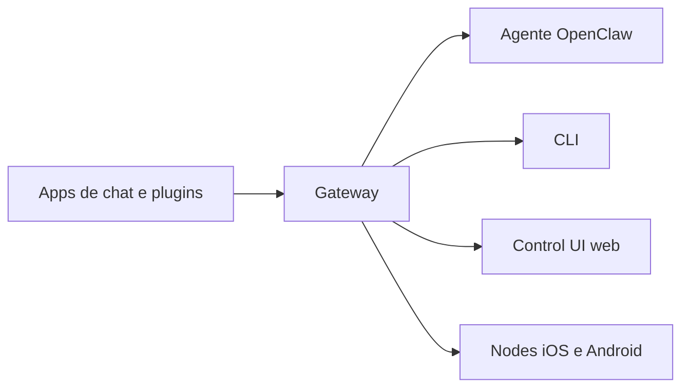

# O que é o OpenClaw

## Objetivo

Ao final desta nota você consegue explicar, em duas frases, o que é o OpenClaw e quais são as suas peças principais.

## Explicação

Segundo a documentação oficial, o OpenClaw é um **gateway autohospedado** que conecta aplicativos de chat (Discord, Google Chat, iMessage, Matrix, Microsoft Teams, Signal, Slack, Telegram, WhatsApp, Zalo e outros, via plugins de canal) a **agentes de IA**. Você executa **um único processo Gateway** na sua máquina ou em um servidor, e ele vira a ponte entre as suas conversas e um assistente sempre disponível.

O slogan do projeto resume a proposta: seu assistente de IA, no seu hardware, em todos os apps de chat que você já usa. Um Gateway, qualquer modelo, qualquer dispositivo, sem um serviço hospedado no meio.

As peças principais são:

- **Gateway**: processo de longa duração que mantém as conexões com os canais e é a fonte de verdade de sessões e roteamento.
- **Agente**: o runtime que recebe a mensagem, monta o contexto, chama o modelo e executa ferramentas.
- **Clientes**: CLI, Control UI (painel web) e app de menu no macOS.
- **Nodes**: dispositivos (iOS, Android, macOS, headless) pareados ao Gateway para câmera, tela e comandos de dispositivo.
- **Skills e plugins**: extensões que ensinam procedimentos ao agente ou adicionam canais, provedores e ferramentas.



## Exemplo prático

Depois de instalado, o painel web abre com um comando e fica por padrão em um endereço local:

```bash
openclaw dashboard
```

O endereço local padrão da Control UI é `http://127.0.0.1:18789/`. Escrever "olá" ali já aciona o agente; conectar um canal como o Telegram permite conversar pelo celular.

> [!info] Licença e governança
> A documentação descreve o projeto como licenciado sob MIT e desenvolvido pela OpenClaw Foundation, uma entidade 501(c)(3) independente. Detalhes em [[Licença MIT e OpenClaw Foundation]].

## Armadilhas comuns

- Achar que o OpenClaw é um modelo de IA. Ele não é: ele **usa** modelos de provedores (ou locais).
- Confundir o produto com o nome antigo. Clawdbot e Moltbot são nomes anteriores do mesmo projeto, ver [[Linha do tempo Clawdbot, Moltbot e OpenClaw]].
- Supor que "autohospedado" significa "seguro por padrão". O agente pode ter acesso amplo à máquina; leia [[MOC - Segurança e Hardening|Segurança e Hardening]].

## Resumo

- OpenClaw = Gateway autohospedado entre apps de chat e agentes de IA.
- Um processo Gateway por host; Control UI local em `127.0.0.1:18789`.
- Modelos, canais e skills são intercambiáveis.
- Código aberto sob MIT, mantido por uma fundação.

## Relacionados

- [[O OpenClaw versus um chatbot]]
- [[Para quem é o OpenClaw e o que ele exige]]
- [[Principais capacidades do OpenClaw]]
- [[Licença MIT e OpenClaw Foundation]]
- [[MOC - Visão Geral|MOC da pasta]]

## Exercícios

1. Em uma frase, o que é o OpenClaw?
2. Cite três das peças que compõem a visão geral (Gateway, agente, clientes, nodes, skills).
3. O OpenClaw é um modelo de linguagem? Justifique.
4. Qual é o endereço local padrão da Control UI?
