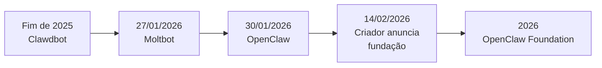

# Linha do tempo Clawdbot, Moltbot e OpenClaw

## Objetivo

Conhecer a sequência de nomes e marcos do projeto para reconhecer materiais antigos e entender o contexto atual.

## Explicação

Esta linha do tempo vem de reportagens e blogs, não da documentação oficial. Onde as fontes divergem, isso é sinalizado.



| Data | Marco | Fonte |
|---|---|---|
| Fim de 2025 | Peter Steinberger cria o projeto como Clawdbot, um assistente pessoal que se conecta a apps de chat | Morph; blog Jitendra Zaa |
| 27/01/2026 | Após um pedido da Anthropic por motivo de marca (o nome "Clawd" lembra "Claude"), o projeto vira Moltbot, referência à muda dos lagostins | Morph; AlternativeTo |
| 30/01/2026 | Novo nome: OpenClaw, depois de buscas de marca e reserva de domínios | Morph; Storyboard18 |
| 14/02/2026 | Steinberger anuncia em seu blog que vai trabalhar na OpenAI e que o projeto migrará para uma fundação, aberta e independente | steipete.me |
| 08/07/2026 | Um blog brasileiro cita o anúncio de que a OpenClaw Foundation, entidade sem fins lucrativos 501(c)(3), passa a manter o projeto | Hora de Codar (terceiro) |

O nome atual une "Open" (código aberto) a "Claw" (a herança do lagostim). A mascote lagosta permanece: no período Moltbot ela chamou-se Molty, e esse nome ainda aparece no assistente da documentação.

> [!warning] Datas e detalhes de terceiros
> Reportagens divergem em minúcias (por exemplo, quem foi consultado nas buscas de marca). A fundação aparece em dois momentos: o anúncio do criador em fevereiro e a formalização relatada em julho. Para o estado atual, a fonte de verdade é o rodapé da documentação oficial, que descreve o OpenClaw como projeto da OpenClaw Foundation. Confirme datas em `openclaw.ai` e no GitHub.

## Exemplo prático

Você encontra um tutorial que manda executar `clawdbot onboard`. Use a linha do tempo para classificar: é material anterior a 27/01/2026. O comando atual da documentação é `openclaw onboard`, e `openclaw onboard --install-daemon` também aparece em guias e no `skill.md` oficial. Não copie comandos antigos; confirme tudo na doc.

```bash
openclaw onboard --classic
```

## Armadilhas comuns

- Misturar nomes de pacotes e domínios antigos com os atuais; veja [[Nomes antigos, domínios falsos e como verificar a fonte]].
- Tratar a data do anúncio da fundação como a data da constituição jurídica.
- Citar números de estrelas do GitHub de memória; eles mudam, ver [[Crescimento da comunidade e ritmo de releases]].

## Resumo

- Clawdbot (fim de 2025) → Moltbot (27/01/2026) → OpenClaw (30/01/2026).
- O primeiro rebrand veio de uma questão de marca com a Anthropic.
- Em fevereiro de 2026 o criador anunciou o caminho para uma fundação.
- Tutoriais anteriores a 27/01/2026 usam nomes e comandos defasados.

## Relacionados

- [[O que é o OpenClaw]]
- [[Licença MIT e OpenClaw Foundation]]
- [[Crescimento da comunidade e ritmo de releases]]
- [[Nomes antigos, domínios falsos e como verificar a fonte]]

## Exercícios

1. Em que ordem o projeto teve seus três nomes e em que datas mudou?
2. Qual foi o motivo do primeiro rebrand?
3. Que fontes desta nota são de terceiros e por que isso importa?
4. Como saber se um tutorial é anterior ao nome OpenClaw?
