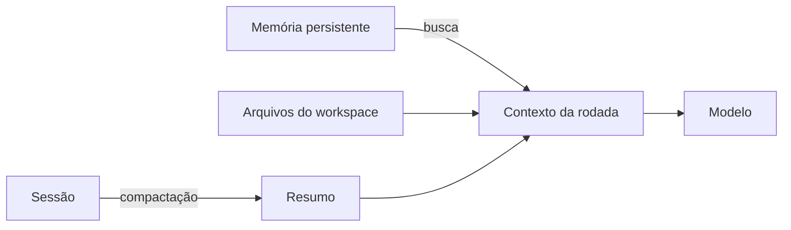

# Memória e contexto em agentes

## Objetivo

Distinguir os tipos de memória de um agente e entender por que decidir **o que entra no contexto** é a parte mais importante do desenho.

## Explicação

Um modelo não tem memória própria entre chamadas. Tudo que ele "lembra" foi colocado no contexto da chamada atual. Agentes resolvem isso com camadas:

| Camada | O que guarda | Duração |
|---|---|---|
| Contexto da rodada | Prompt, histórico recente, resultados de ferramentas | Uma chamada |
| Sessão | Transcrição e estado de uma conversa | Enquanto a sessão existir |
| Memória persistente | Fatos e preferências que sobrevivem entre sessões | Longa |
| Arquivos do workspace | Instruções e perfil escritos em disco | Longa, editáveis por você |

A documentação do OpenClaw trata esses assuntos em páginas de sessões, memória (visão geral, arquitetura, busca e memória ativa), compactação e poda de sessão. Em instalações padrão, o diretório de trabalho do agente fica em `~/.openclaw/workspace/` e o perfil do usuário em `~/.openclaw/workspace/USER.md`, segundo o `skill.md` oficial.



**Compactação** resume trechos antigos para liberar espaço; **poda** remove conteúdo de menor valor (por exemplo, saídas longas de ferramentas); **busca de memória** traz de volta só o que for relevante. Cada uma troca fidelidade por espaço.

> [!warning] Memória é superfície de ataque
> Se o agente grava na memória conteúdo vindo de fora (uma página, um e-mail), uma instrução maliciosa pode persistir e voltar em sessões futuras. Trate o que é gravado como dado não confiável e revise a memória periodicamente. Há mais em [[Confiança, permissões e riscos de agentes]].

## Exemplo prático

Para inspecionar o que o agente guarda em disco, abra o diretório do workspace e leia os arquivos de texto. Eles são seus:

```bash
ls ~/.openclaw/workspace/
```

Apague o que for sensível ou errado. O comportamento do agente na próxima rodada reflete o que está ali.

## Armadilhas comuns

- Achar que "o agente lembra" porque o assunto foi tratado em outra sessão: só lembra o que foi gravado ou carregado.
- Deixar segredos em arquivos de memória em texto simples.
- Nunca revisar a memória e acumular fatos desatualizados.

## Resumo

- Modelos não têm memória própria; tudo vem do contexto.
- Camadas: rodada, sessão, memória persistente, workspace.
- Compactação, poda e busca gerenciam o espaço.
- Memória persistente é útil e também um vetor de persistência de ataques.

## Relacionados

- [[Modelos de linguagem, tokens e janela de contexto]]
- [[O padrão ReAct]]
- [[O que é um agente de IA]]
- [[Confiança, permissões e riscos de agentes]]
- [[MOC - Memória e Contexto|Memória e Contexto]]

## Exercícios

1. Por que um modelo "não lembra" entre chamadas?
2. Quais são as quatro camadas de memória descritas?
3. Qual a diferença entre compactação e poda?
4. Por que gravar conteúdo externo na memória é arriscado?
