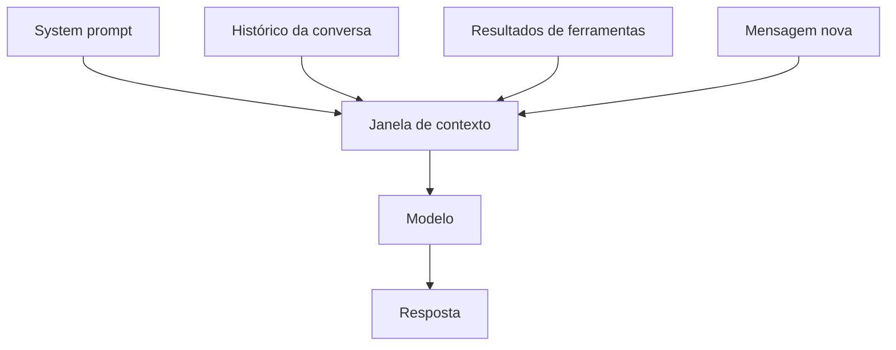

# Modelos de linguagem, tokens e janela de contexto

## Objetivo

Entender três ideias que explicam custo, limites e falhas de qualquer agente: modelo, token e janela de contexto.

## Explicação

**Modelo de linguagem (LLM).** Programa treinado para prever o próximo trecho de texto. Quando instruído, ele também consegue pedir ferramentas, como visto em [[Uso de ferramentas e tool calling]]. O OpenClaw não traz modelo próprio: ele se conecta a provedores (Anthropic, OpenAI, Google e muitos outros) ou a backends locais.

**Token.** Unidade de texto que o modelo processa, geralmente um pedaço de palavra. Provedores cobram por token de entrada e de saída, e os limites também são medidos em tokens. Como regra de bolso, textos em português consomem um pouco mais tokens por palavra que em inglês; meça no seu provedor em vez de estimar.

**Janela de contexto.** É o total de tokens que o modelo consegue considerar de uma vez: instruções, histórico, resultados de ferramentas e a resposta. Quando o histórico cresce além do limite, algo precisa ser **resumido ou descartado**. A documentação do OpenClaw trata isso em temas como contexto, compactação (compaction) e poda de sessão (session pruning).



**Por que isso importa para o OpenClaw.** Cada rodada do agente reenvia contexto. Muitas ferramentas, saídas longas e histórico grande elevam o custo e podem degradar a qualidade. A documentação mantém páginas sobre uso de tokens, custos de API e cache de prompt; elas são retomadas em [[MOC - Operação e Manutenção|Operação e Manutenção]].

## Exemplo prático

Cálculo de ordem de grandeza (ilustrativo):

```python
tokens_contexto = 12_000      # prompt + histórico + resultados
tokens_resposta = 800
rodadas = 5                   # o agente chamou ferramentas 4 vezes
total_entrada = tokens_contexto * rodadas
print(total_entrada, tokens_resposta * rodadas)
```

O agente pagou 60.000 tokens de entrada para uma única tarefa, porque o contexto foi reenviado a cada rodada. Cache de prompt e contexto enxuto reduzem esse efeito.

## Armadilhas comuns

- Achar que "janela maior" resolve tudo: mais contexto também significa mais custo e mais ruído.
- Colar arquivos enormes no chat sem necessidade.
- Ignorar que resultados de ferramentas ocupam contexto.

## Resumo

- LLM prevê texto; o OpenClaw usa modelos de provedores ou locais.
- Token é a unidade de custo e de limite.
- Janela de contexto reúne tudo que o modelo vê em uma rodada.
- Contexto cresce a cada rodada e precisa ser gerenciado.

## Relacionados

- [[Memória e contexto em agentes]]
- [[O que é um agente de IA]]
- [[Uso de ferramentas e tool calling]]
- [[MOC - Provedores e Modelos|Provedores e Modelos]]
- [[MOC - Memória e Contexto|Memória e Contexto]]

## Exercícios

1. O que é um token e por que importa para custo?
2. O que compõe a janela de contexto em uma rodada do agente?
3. Por que o custo cresce a cada rodada de um agente?
4. Cite duas formas de reduzir o consumo de contexto.
