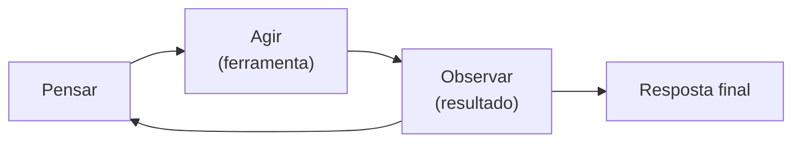

# O padrão ReAct

## Objetivo

Entender o padrão ReAct e reconhecê-lo no laço do agente do OpenClaw.

## Explicação

**ReAct** vem de *Reasoning and Acting*. O artigo "ReAct: Synergizing Reasoning and Acting in Language Models" (Yao e colegas, submetido em 6 de outubro de 2022) mostra que **intercalar raciocínio e ações** permite ao modelo planejar, acompanhar o progresso, ajustar planos e buscar informação externa, o que reduz alucinações em relação a abordagens só de raciocínio ou só de ação.

O ciclo conceitual:

1. **Pensar**: o que preciso saber ou fazer agora?
2. **Agir**: chamar uma ferramenta.
3. **Observar**: ler o resultado.
4. Repetir até poder responder.



**No OpenClaw.** A documentação do laço do agente descreve, em alto nível, a sequência de uma execução:

| Etapa | O que acontece |
|---|---|
| Entrada | A chamada `agent` (RPC do Gateway) ou o comando `openclaw agent` valida parâmetros e resolve a sessão |
| Aceite | Responde imediatamente com um identificador de execução (`runId`) |
| Preparação | Resolve modelo e padrões de raciocínio, carrega o snapshot de skills |
| Execução | O runtime embutido monta a sessão, assina os eventos, faz streaming de trechos do assistente e das ferramentas e aplica um timeout |
| Eventos | Mapeados para fluxos `assistant`, `tool` e `lifecycle` (fases `start`, `finishing`, `end` ou `error`) |
| Espera | `agent.wait` devolve o resultado final: `ok`, `error` ou `timeout` |

Os detalhes da montagem de contexto, do streaming e da fila de execuções são vistos na pasta [[MOC - Agent Runtime e Loop ReAct|Agent Runtime e Loop ReAct]].

> [!info] Raciocínio explícito varia por modelo
> Muitos modelos atuais raciocinam internamente e emitem chamadas de ferramenta nativas. O OpenClaw expõe níveis de raciocínio (thinking levels) configuráveis. O padrão ReAct continua válido como modelo mental, mesmo quando o "pensar" não aparece como texto.

## Exemplo prático

Tarefa: "Qual a versão mais recente do OpenClaw?"

```markdown
Pensar:   preciso de dado atual; vou consultar a documentação.
Agir:     web_fetch("https://docs.openclaw.ai/releases")
Observar: página lista a versão mais recente.
Pensar:   tenho o dado; posso responder.
Responder: "A mais recente listada é ..."
```

O exemplo é conceitual, mas reflete a ordem real: pensar, chamar, observar, concluir.

## Armadilhas comuns

- Laços sem limite: sem timeout e detecção de repetição, um agente pode girar indefinidamente. A documentação cita detecção de loop de ferramentas.
- Acreditar que o "raciocínio" mostrado é prova de acerto.
- Confundir o laço do agente com o Gateway: o Gateway recebe e roteia; o runtime executa o laço.

## Resumo

- ReAct: intercalar raciocínio, ação e observação.
- Reduz alucinação ao trazer informação externa.
- No OpenClaw, uma execução tem `runId`, eventos de assistente, ferramenta e ciclo de vida, e termina em `ok`, `error` ou `timeout`.

## Relacionados

- [[O que é um agente de IA]]
- [[Uso de ferramentas e tool calling]]
- [[Memória e contexto em agentes]]
- [[Confiança, permissões e riscos de agentes]]

## Exercícios

1. O que significa ReAct e quem propôs o padrão?
2. Descreva o ciclo pensar, agir, observar.
3. Que identificador o OpenClaw retorna ao aceitar uma execução?
4. Quais são os resultados finais possíveis de `agent.wait`?
5. Por que limites de tempo são importantes em um laço de agente?
