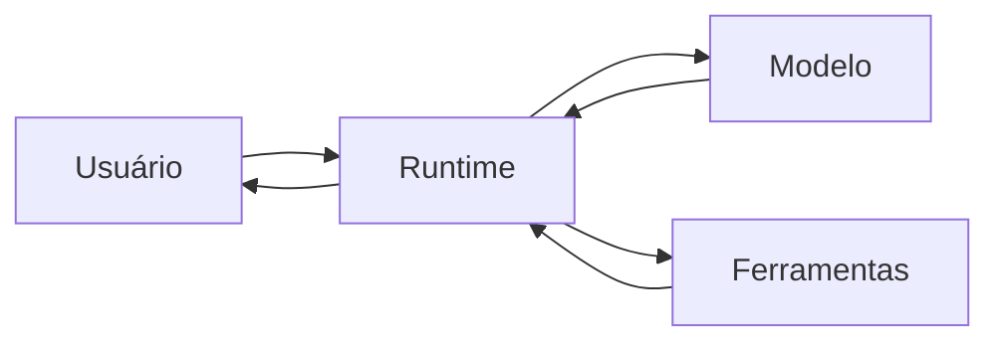

# O que é um agente de IA

## Objetivo

Definir "agente de IA" de forma prática e identificar os componentes que qualquer agente, inclusive o OpenClaw, precisa ter.

## Explicação

Um **agente de IA** é um sistema em que um modelo de linguagem não apenas responde, mas **decide o que fazer a seguir** para cumprir um objetivo: escolhe ferramentas, observa resultados e repete até concluir ou desistir. A diferença para um chatbot está no ciclo de ação, não no tamanho do modelo; veja [[O OpenClaw versus um chatbot]].

Todo agente tem cinco componentes:

| Componente | Função | No OpenClaw |
|---|---|---|
| Modelo | Raciocina e decide | Um provedor de modelos configurado, ou modelo local |
| Instruções | Dizem quem o agente é e como deve agir | System prompt e arquivos do workspace |
| Ferramentas | Ações no mundo (comandos, navegador, arquivos, busca) | Ferramentas nativas, plugins e skills |
| Memória e contexto | O que o agente "sabe" agora e do passado | Sessões, contexto e memória persistente |
| Laço de controle | Orquestra: monta contexto, chama o modelo, executa ferramentas | O agent runtime, ver [[O padrão ReAct]] |

**Níveis de autonomia.** Na prática, a autonomia é um espectro: o agente pode só sugerir comandos, pedir aprovação a cada ação ou executar por conta própria. O OpenClaw tem modos de permissão e aprovações de execução para ajustar esse ponto; eles são vistos em [[MOC - Segurança e Hardening|Segurança e Hardening]].

## Exemplo prático

Tarefa: "Resuma meus e-mails de hoje e me avise às 18h."

1. O agente decide que precisa de uma ferramenta de e-mail.
2. Chama a ferramenta e recebe o conteúdo.
3. Pede ao modelo um resumo.
4. Usa agendamento para enviar o aviso no horário pedido.

Nenhum desses passos foi escrito por você; o modelo os escolheu, e o runtime os executou. É esse poder de decidir que exige limites claros.

## Armadilhas comuns

- Chamar de "agente" qualquer chatbot com um prompt longo. Sem ferramentas e laço, é só conversa.
- Esperar determinismo: o mesmo pedido pode seguir caminhos diferentes.
- Dar autonomia total antes de testar o comportamento com tarefas inofensivas.

## Resumo

- Agente = modelo que decide ações, executa ferramentas e observa resultados.
- Cinco componentes: modelo, instruções, ferramentas, memória e contexto, laço de controle.
- Autonomia é um espectro que você controla.

## Relacionados

- [[O padrão ReAct]]
- [[Uso de ferramentas e tool calling]]
- [[Memória e contexto em agentes]]
- [[Confiança, permissões e riscos de agentes]]
- [[MOC - Fundamentos de Agentes de IA|MOC da pasta]]

## Exercícios

1. Qual é a diferença essencial entre agente e chatbot?
2. Liste os cinco componentes de um agente.
3. Que papel o runtime desempenha?
4. Dê um exemplo de tarefa que exige mais de uma ferramenta.
