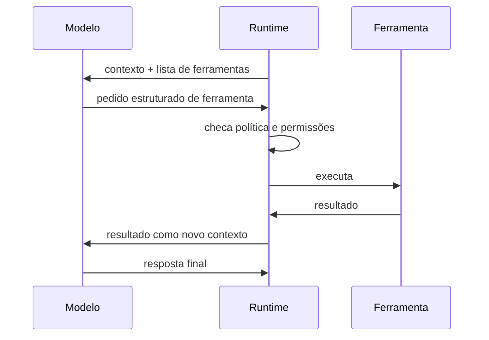

# Uso de ferramentas e tool calling

## Objetivo

Entender como um modelo, que só produz texto, consegue "agir" no mundo por meio de ferramentas.

## Explicação

O mecanismo, conhecido como **tool calling** ou function calling, tem quatro passos:

1. O runtime descreve ao modelo as ferramentas disponíveis (nome, para que servem, parâmetros).
2. O modelo, em vez de responder em texto livre, devolve um **pedido estruturado**: "chame a ferramenta X com estes argumentos".
3. O **runtime** (não o modelo) executa a ferramenta e verifica regras de permissão.
4. O resultado volta ao modelo como nova informação, e o ciclo continua.



A consequência de segurança mais importante é esta: **quem executa é o runtime, então as regras podem ser aplicadas em código**, sem depender de o modelo "obedecer". A documentação do OpenClaw defende essa ideia, ao distinguir política imposta por código de política apenas pedida no prompt. Ela aparece na prática em recursos como modos de permissão, aprovações de execução e política de ferramentas, detalhados em [[MOC - Segurança e Hardening|Segurança e Hardening]].

**Famílias de ferramentas no OpenClaw.** Segundo a documentação: execução de comandos (exec), edição por patch, navegador gerenciado, busca e leitura de páginas na web, geração de mídia, ferramentas de sessão e de subagentes, e servidores MCP conectados. Cada família é detalhada na pasta [[MOC - Ferramentas e MCP|Ferramentas e MCP]].

## Exemplo prático

Um pedido estruturado típico, em formato ilustrativo (o formato real varia por provedor):

```json
{
  "tool": "web_fetch",
  "arguments": { "url": "https://docs.openclaw.ai/" }
}
```

O nome `web_fetch` é um exemplo conceitual. Para os nomes reais das ferramentas, consulte a página de ferramentas da documentação.

## Armadilhas comuns

- Confiar que o modelo "sabe que não deve" fazer algo perigoso. A barreira confiável é a política aplicada pelo runtime.
- Habilitar ferramentas demais: cada uma aumenta a superfície de ataque.
- Ignorar que o resultado de uma ferramenta é conteúdo externo e pode conter instruções maliciosas, ver [[Confiança, permissões e riscos de agentes]].

## Resumo

- O modelo pede; o runtime executa.
- Políticas e aprovações devem ser aplicadas em código.
- Resultados de ferramentas voltam ao contexto e podem trazer conteúdo não confiável.
- Menos ferramentas, menos risco.

## Relacionados

- [[O padrão ReAct]]
- [[O que é um agente de IA]]
- [[Confiança, permissões e riscos de agentes]]
- [[Memória e contexto em agentes]]

## Exercícios

1. Quem executa a ferramenta: o modelo ou o runtime?
2. Por que isso é importante para a segurança?
3. Que famílias de ferramentas o OpenClaw lista na documentação?
4. Por que o resultado de uma ferramenta pode ser um risco?
