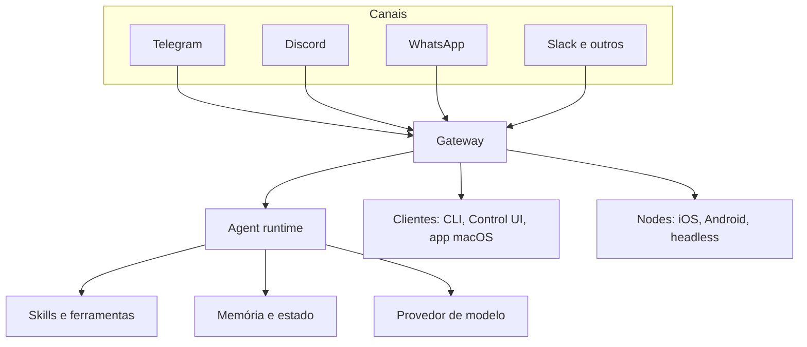

# Arquitetura em camadas do OpenClaw

## Objetivo

Ter um modelo mental em camadas do OpenClaw para localizar qualquer recurso ou problema no lugar certo.

## Explicação

A documentação descreve um **Gateway único e de longa duração** que é dono de todas as superfícies de mensagens, mais um runtime de agente embutido. Para estudar, é útil separar cinco camadas:

| Camada | Responsabilidade | Onde aprofundar |
|---|---|---|
| Adaptadores de canal | Falam com cada app de chat (Telegram, Discord, WhatsApp, Slack, Signal e outros) e normalizam mensagens | [[MOC - Canais e Mensageria\|Canais]] |
| Gateway | Mantém conexões, expõe a API WebSocket, resolve sessões e roteamento | [[MOC - Gateway\|Gateway]] |
| Agent runtime | Monta contexto, chama o modelo, executa ferramentas, faz streaming | [[MOC - Agent Runtime e Loop ReAct\|Runtime]] |
| Skills e ferramentas | Capacidades que o agente pode usar | [[MOC - Skills\|Skills]], [[MOC - Ferramentas e MCP\|Ferramentas]] |
| Memória e estado | Sessões, workspace e memória persistente em disco | [[MOC - Memória e Contexto\|Memória]] |



O ponto de partida do vocabulário é este: **o Gateway é a fonte de verdade de sessões, roteamento e conexões de canal**, e o runtime é quem executa o laço do agente. Separar as duas coisas explica por que você pode reiniciar um cliente sem perder a conversa, e por que a segurança do Gateway (quem pode conectar) é diferente da segurança do runtime (o que o agente pode fazer).

> [!info] Mapeamento aproximado
> A divisão em cinco camadas é uma ferramenta didática deste vault. A documentação organiza o conteúdo em seções (Channels, Agents, Capabilities, Models, Gateway & Ops), que correspondem de perto a ela.

## Exemplo prático

Para ver a camada do Gateway funcionando na sua máquina, consulte o estado do serviço e dos canais:

```bash
openclaw gateway status
openclaw channels status
```

O primeiro mostra o Gateway; o segundo, os adaptadores de canal. Se um responde e o outro não, você já sabe em que camada procurar.

## Armadilhas comuns

- Tratar "OpenClaw" como um bloco único e perder a noção de onde cada falha ocorre.
- Achar que o runtime fala direto com o Telegram: quem fala é o adaptador, dentro do Gateway.
- Esquecer que skills e memória vivem no host do Gateway, não no provedor do modelo.

## Resumo

- Cinco camadas: canais, Gateway, runtime, skills e ferramentas, memória e estado.
- O Gateway é a fonte de verdade de sessões e roteamento.
- Um Gateway por host; clientes e nodes conectam a ele.

## Relacionados

- [[O caminho de uma mensagem do chat à resposta]]
- [[Gateway, clientes e nodes]]
- [[Fronteiras de confiança na arquitetura]]
- [[Pontos de extensão - plugins, skills e hooks]]
- [[O que é o OpenClaw]]

## Exercícios

1. Cite as cinco camadas e a responsabilidade de cada uma.
2. Qual camada é a fonte de verdade de sessões?
3. Por que separar Gateway e runtime ajuda no diagnóstico?
4. Que comandos mostram o estado do Gateway e dos canais?
