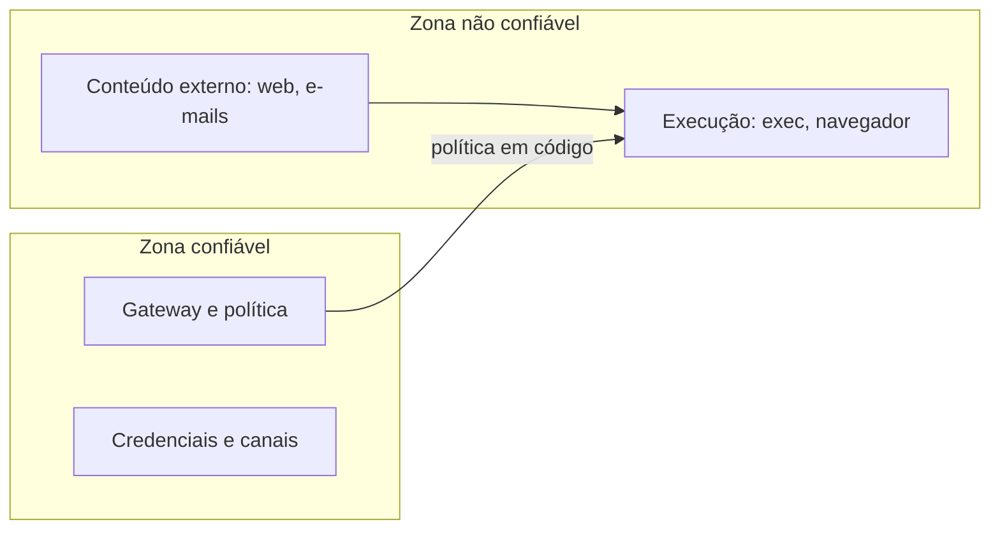

# Fronteiras de confiança na arquitetura

## Objetivo

Entender onde a documentação coloca as fronteiras de confiança do OpenClaw e por que "rodar numa VM" não é o mesmo que "ter fronteiras".

## Explicação

A página "Why OpenClaw" defende um desenho de **Gateway confiável e execução não confiável**: o Gateway, que decide quem fala com o agente e aplica a política, fica separado da execução (comandos, navegador), que pode ser movida para outro lugar e tratada como não confiável.

Ela contrasta isso com um **envelope de confiança único**, em que o laço do agente, as conexões de canal, as credenciais e o shell compartilham um mesmo usuário do sistema operacional. Colocar essa aplicação inteira em uma VM isola o host, mas **não separa os componentes entre si**: uma injeção bem-sucedida no agente alcança as credenciais dos canais.

Pontos que a documentação destaca:

| Tema | O que dizem as páginas oficiais |
|---|---|
| Política | Faz diferença se a regra é aplicada em código ou só pedida no prompt; o desenho se apoia em código |
| Sandbox | Está desligado por padrão; os comparativos descrevem arquiteturas configuradas, não o padrão |
| Workspace | É o diretório de trabalho, não um sandbox rígido: caminhos absolutos podem alcançar outros locais do host se não houver sandbox |
| Autorização no Gateway | O Gateway autoriza cada requisição; papéis só de sessão não carregam certas superfícies |
| Dados | Estado é versionado e migrado, o que permite substituir uma instalação |



> [!warning] Leia as páginas de segurança
> O detalhamento (auditoria, modos de permissão, sandbox, exposição de rede) está em `docs.openclaw.ai/gateway/security` e nas subpáginas. A pasta [[MOC - Segurança e Hardening|Segurança e Hardening]] percorre esses controles.

## Exemplo prático

Um exercício de modelagem para a sua instalação: desenhe duas caixas, "o que eu confio" e "o que não confio", e coloque nelas cada peça (Gateway, runtime, shell, navegador, skills de terceiros, mensagens de grupo, páginas web). Para cada seta entre as caixas, escreva qual controle aplica a política **em código**.

```markdown
Seta: página web -> agente
Controle em código: ______ (ex.: aprovação de comandos, sandbox, política de ferramentas)
Se não houver controle em código: risco aceito? [sim/não]
```

## Armadilhas comuns

- Achar que uma VM resolve a separação entre componentes.
- Depender de instruções no system prompt como controle de segurança.
- Esquecer que o workspace não é um sandbox.

## Resumo

- Desenho recomendado: Gateway confiável, execução não confiável.
- Envelope único de confiança: uma injeção alcança tudo no mesmo usuário.
- Sandbox é desligado por padrão e o workspace não é um sandbox.
- Controles valem quando aplicados em código, não no prompt.

## Relacionados

- [[Arquitetura em camadas do OpenClaw]]
- [[Gateway, clientes e nodes]]
- [[Onde o OpenClaw guarda estado em disco]]
- [[Confiança, permissões e riscos de agentes]]
- [[MOC - Ameaças e Riscos|Ameaças e Riscos]]

## Exercícios

1. O que é um envelope de confiança único e por que é um problema?
2. Por que uma VM não separa os componentes do agente entre si?
3. O workspace do agente é um sandbox? Justifique.
4. Cite um controle aplicado em código e um apenas pedido no prompt.
