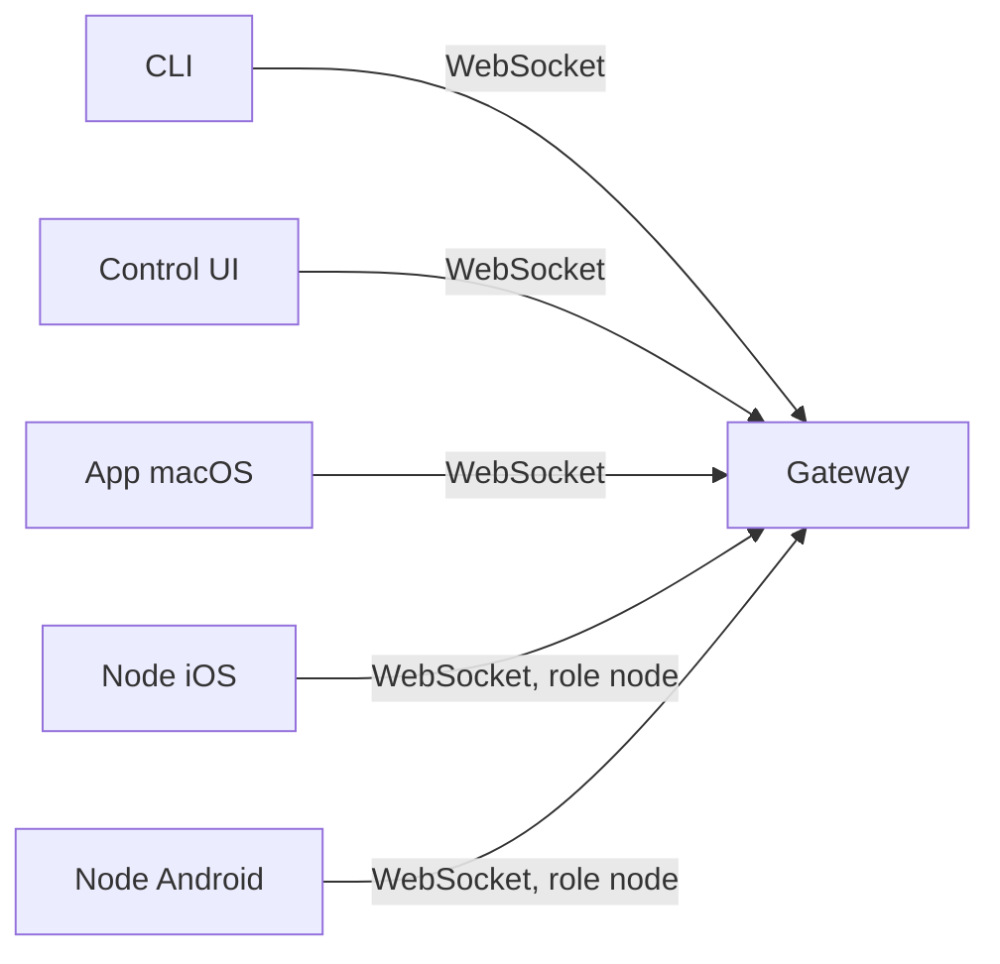

# Gateway, clientes e nodes

## Objetivo

Distinguir os três tipos de participante conectados ao Gateway: o próprio Gateway, os clientes e os nodes.

## Explicação

Segundo a página de arquitetura:

- **Gateway (daemon).** Mantém as conexões com os provedores de mensagens, expõe uma **API WebSocket tipada** (requisições, respostas e eventos enviados pelo servidor), valida os quadros de entrada contra um esquema JSON e emite eventos como `agent`, `chat`, `presence`, `health`, `heartbeat` e `cron`.
- **Clientes** (app macOS, CLI, administração web). Cada cliente mantém **uma conexão WebSocket** e envia requisições como `health`, `status`, `send`, `agent` e `system-presence`, além de assinar eventos como `tick`, `agent`, `presence` e `shutdown`.
- **Nodes** (macOS, iOS, Android e headless). Conectam ao mesmo servidor WebSocket com `role: node`, informam uma identidade de dispositivo no `connect`, e o **pareamento é por dispositivo**, com aprovação guardada no armazém de pareamentos. Expõem comandos como `camera.*`, `screen.record` e `location.get`; o app macOS também expõe `canvas.*`, do painel de widgets.
- **WebChat.** Interface estática que usa a mesma API do Gateway para histórico e envio.

| Participante | Papel | Exemplo de uso |
|---|---|---|
| Gateway | Servidor e dono do estado | Serviço em segundo plano |
| Cliente | Operador humano | `openclaw dashboard`, CLI, app macOS |
| Node | Dispositivo que oferece capacidades | Foto pela câmera do celular, localização |



A página também afirma que **apenas um Gateway roda por host** e que ele é o único componente que abre a sessão do WhatsApp. O painel de widgets é servido por HTTP na mesma porta, no caminho `/__openclaw__/canvas/`.

## Exemplo prático

Para listar o que está conectado ao seu Gateway, a CLI tem grupos de comandos de nodes e dispositivos (consulte `openclaw nodes --help` e a seção de referência da CLI para o conjunto exato nesta versão):

```bash
openclaw nodes --help
openclaw devices --help
```

> [!warning] Confirme os subcomandos
> Os grupos `nodes` e `devices` aparecem na referência da CLI, mas os subcomandos mudam entre versões. Leia a ajuda embutida antes de usar.

## Armadilhas comuns

- Aprovar o pareamento de um dispositivo desconhecido: nodes têm acesso a câmera, tela e localização.
- Rodar dois Gateways no mesmo host sem isolar portas e estado.
- Achar que o app macOS é o "servidor": ele é só mais um cliente (e pode hospedar o Gateway em seu modo embutido).

## Resumo

- O Gateway é o servidor; clientes operam; nodes oferecem capacidades de dispositivo.
- Tudo conversa por WebSocket tipado com validação de esquema.
- Um Gateway por host; pareamento de nodes é por dispositivo.

## Relacionados

- [[Arquitetura em camadas do OpenClaw]]
- [[O protocolo WebSocket do Gateway]]
- [[Control UI e dashboard]]
- [[Fronteiras de confiança na arquitetura]]

## Exercícios

1. Qual a diferença entre cliente e node?
2. Que eventos o Gateway emite?
3. Como é feito o pareamento de um node?
4. Quantos Gateways podem rodar em um host?
