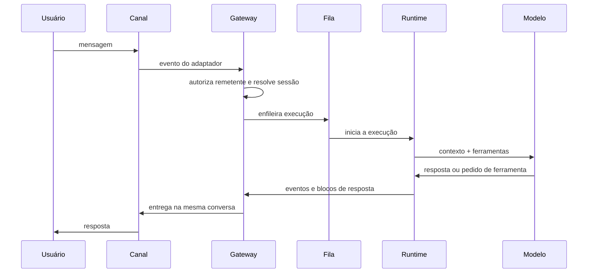

# O caminho de uma mensagem do chat à resposta

## Objetivo

Seguir uma mensagem do momento em que você a envia no chat até a resposta chegar de volta, nomeando cada etapa.

## Explicação



Em prosa:

1. **Chegada.** O adaptador do canal recebe a mensagem e a entrega ao Gateway.
2. **Autorização.** Mensagens diretas passam por lista de permissão e pareamento; grupos são ativados por menção, segundo a documentação de recursos.
3. **Sessão e roteamento.** O Gateway decide a qual sessão e a qual agente a mensagem pertence; veja [[Sessões e chaves de sessão]] e [[Roteamento multiagente e bindings]].
4. **Fila.** As execuções passam por uma fila em processo, para que duas execuções não colidam na mesma sessão; veja [[Streaming de respostas e fila de comandos]].
5. **Execução.** O runtime monta o contexto, chama o modelo e executa ferramentas em laço, como em [[Anatomia do loop do agente no OpenClaw]].
6. **Resposta.** Blocos de texto são enviados ao canal à medida que ficam prontos.

**Regra importante de roteamento.** A página de roteamento afirma que o modelo **não escolhe o canal de resposta**: as respostas voltam ao canal de origem, por regras fixas controladas pela configuração do host. Isso impede que um texto malicioso peça ao agente "responda em outro canal" e redirecione dados por conta própria.

## Exemplo prático

Para observar o fluxo na prática, acompanhe os registros enquanto envia uma mensagem de teste. A documentação usa:

```bash
openclaw logs --follow
```

Você deve ver a chegada, a execução e a entrega. Em caso de falha, o ponto em que os registros param indica a etapa problemática.

## Armadilhas comuns

- Confundir "bot não responde" com falha do modelo: a mensagem pode ter sido barrada na autorização ou no roteamento.
- Esperar resposta imediata durante outra execução na mesma sessão: ela entra na fila.
- Supor que o agente pode enviar a resposta a qualquer canal só por pedir.

## Resumo

- Etapas: chegada, autorização, sessão e roteamento, fila, execução, resposta.
- Respostas voltam ao canal de origem por regras fixas do host.
- Os registros mostram em que etapa algo parou.

## Relacionados

- [[Arquitetura em camadas do OpenClaw]]
- [[Sessões e chaves de sessão]]
- [[Anatomia do loop do agente no OpenClaw]]
- [[Streaming de respostas e fila de comandos]]
- [[MOC - Canais e Mensageria|Canais e Mensageria]]

## Exercícios

1. Liste as seis etapas do caminho de uma mensagem.
2. Quem decide o canal de resposta: o modelo ou a configuração do host?
3. Por que uma fila é necessária entre o Gateway e o runtime?
4. Que comando você usa para acompanhar o fluxo em tempo real?
