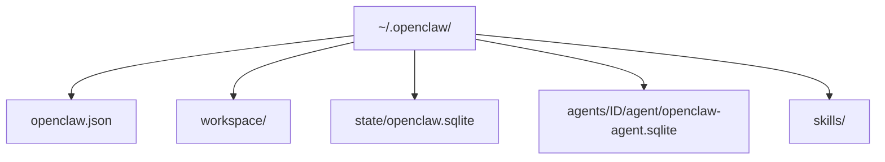

# Onde o OpenClaw guarda estado em disco

## Objetivo

Saber onde ficam configuração, credenciais, sessões e workspace, para fazer backup, auditar segredos e diagnosticar problemas.

## Explicação

Pela documentação, o diretório de estado padrão é `~/.openclaw/`, que guarda configuração, credenciais e sessões. Dentro e ao redor dele:

| Caminho | Conteúdo | Observação |
|---|---|---|
| `~/.openclaw/openclaw.json` | Configuração principal em JSON5 | Substituída atomicamente nas escritas do próprio OpenClaw |
| `~/.openclaw/workspace/` | Workspace padrão do agente | Pode mudar com `agents.defaults.workspace` |
| `~/.openclaw-<perfil>/workspace` | Workspace de um perfil | Quando `OPENCLAW_PROFILE` não é `default` |
| `~/.openclaw/state/openclaw.sqlite` | Estado de setup e atestação | Arquivos JSON antigos são importados por `openclaw doctor --fix` |
| `~/.openclaw/agents/<agentId>/agent/openclaw-agent.sqlite` | Histórico de sessões e estado de roteamento de cada agente | Um `agentDir` por agente |
| `~/.openclaw/skills` | Raiz compartilhada de skills | Filtrada pela lista de skills do agente |

Variáveis de ambiente relevantes: `OPENCLAW_CONFIG_PATH` (caminho do arquivo de configuração), `OPENCLAW_WORKSPACE_DIR` (sobrescreve o workspace) e `OPENCLAW_PROFILE` (perfil).



> [!warning] O armazenamento evolui
> Versões anteriores guardavam sessões e metadados em arquivos JSON; a documentação atual fala em SQLite e em migração por `openclaw doctor --fix`. A documentação mantém páginas "Where things live on disk" e "Storage locations" que não foram lidas por inteiro nesta sessão; confirme o layout exato da sua versão nelas antes de automatizar backups.

**Por que isso importa para a segurança.** Credenciais e transcrições de conversas vivem nesse diretório. Quem lê `~/.openclaw/` lê suas chaves e suas conversas. Veja [[MOC - Segurança e Hardening|Segurança e Hardening]].

## Exemplo prático

Inspecione o que existe no seu estado e quem pode lê-lo:

```bash
ls -la ~/.openclaw/
```

Verifique se as permissões do diretório e do arquivo de configuração são restritas ao seu usuário. O comando de auditoria de segurança do OpenClaw (`openclaw security audit`) também examina esse tipo de problema.

## Armadilhas comuns

- Fazer backup só do `openclaw.json` e esquecer sessões e credenciais.
- Versionar o workspace em um repositório público com segredos dentro.
- Usar um `agentDir` compartilhado entre agentes: causa colisão de autenticação e sessões, segundo a documentação.

## Resumo

- Estado padrão em `~/.openclaw/`; workspace em `~/.openclaw/workspace`.
- Configuração em JSON5; sessões e estado em SQLite nas versões atuais.
- Credenciais e conversas ficam no mesmo host: proteja o diretório.

## Relacionados

- [[Arquivos do workspace do agente]]
- [[Configuração do Gateway em openclaw.json]]
- [[Sessões e chaves de sessão]]
- [[Fronteiras de confiança na arquitetura]]
- [[MOC - Operação e Manutenção|Operação e Manutenção]]

## Exercícios

1. Onde fica o workspace padrão do agente?
2. Que variável de ambiente sobrescreve o caminho do workspace?
3. Por que `~/.openclaw/` deve ter permissões restritas?
4. O que acontece com arquivos JSON antigos quando você roda `openclaw doctor --fix`?
