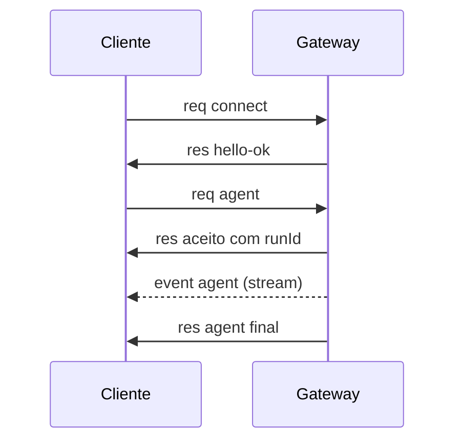

# O protocolo WebSocket do Gateway

## Objetivo

Conhecer a forma dos quadros do protocolo, o handshake e a autenticação, para escrever um cliente simples ou entender o que a CLI e a Control UI fazem por baixo.

## Explicação

Segundo a página de arquitetura:

- O transporte é **WebSocket com quadros de texto JSON**.
- O **primeiro quadro deve ser `connect`**.
- Os quadros têm três formas:

```json
{ "type": "req", "id": "1", "method": "connect", "params": {} }
{ "type": "res", "id": "1", "ok": true, "payload": {} }
{ "type": "event", "event": "agent", "payload": {}, "seq": 1, "stateVersion": 1 }
```

Os campos `seq` e `stateVersion` dos eventos são opcionais. Os valores acima são ilustrativos; `params` do `connect` carrega identidade de cliente ou de dispositivo e credenciais.

- O handshake responde `hello-ok`, com um instantâneo de presença e saúde. `hello-ok.features.methods` e `events` são metadados de descoberta, **não uma lista completa** de rotas chamáveis.
- O Gateway valida todos os quadros de entrada contra um **esquema JSON**.

**Fluxo típico de uma execução do agente:**



**Autenticação.** O segredo compartilhado vai em `connect.params.auth.token` ou em `connect.params.auth.password`. A chave de configuração `gateway.auth.mode` escolhe **qual valor configurado vale** (`gateway.auth.token` ou `gateway.auth.password`); ela não define o campo na rede. Modos que carregam identidade, como `gateway.auth.allowTailscale: true` (Tailscale Serve) ou `gateway.auth.mode: "trusted-proxy"` em hosts não-loopback, autenticam a partir de cabeçalhos da requisição.

> [!warning] O protocolo é versionado e cresce
> A documentação mantém páginas separadas para handshake, papéis, escopos de operador, métodos RPC e versionamento do protocolo. Para um cliente próprio, siga essas páginas e a página "Building a Gateway client"; não copie estruturas de exemplos antigos.

## Exemplo prático

Para chamar um método de saúde sem escrever um cliente, a documentação oferece a CLI. Veja as opções em:

```bash
openclaw gateway --help
```

Para estudar o protocolo de ponta a ponta, abra as ferramentas de desenvolvedor do navegador na Control UI e observe os quadros WebSocket trocados com o Gateway.

## Armadilhas comuns

- Mandar qualquer quadro antes de `connect`.
- Presumir que `hello-ok.features` lista todos os métodos disponíveis.
- Confundir `gateway.auth.mode` (qual segredo vale) com o campo enviado na conexão.

## Resumo

- WebSocket, JSON, três tipos de quadro: `req`, `res`, `event`.
- Primeiro quadro: `connect`; resposta: `hello-ok`.
- Segredo por token ou senha, escolhido por `gateway.auth.mode`; há modos baseados em identidade.
- Execução do agente: `req agent`, aceite com `runId`, eventos em fluxo, `res` final.

## Relacionados

- [[Gateway, clientes e nodes]]
- [[Anatomia do loop do agente no OpenClaw]]
- [[Configuração do Gateway em openclaw.json]]
- [[O processo Gateway e a porta 18789]]

## Exercícios

1. Qual deve ser o primeiro quadro enviado ao Gateway?
2. Quais são os três tipos de quadro?
3. O que `gateway.auth.mode` controla?
4. O que `hello-ok.features.methods` representa?
