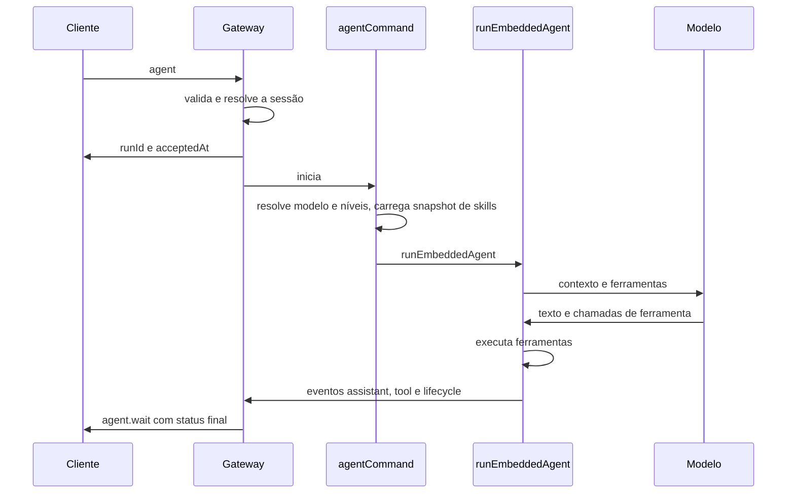

# Anatomia do loop do agente no OpenClaw

## Objetivo

Mapear o padrão [[O padrão ReAct]] sobre as etapas reais de uma execução do agente no OpenClaw: montagem de contexto, chamada ao modelo, ferramentas e streaming.

## Explicação

A página do laço do agente descreve a sequência a partir de dois pontos de entrada: a RPC `agent` e `agent.wait` do Gateway, e o comando `openclaw agent` da CLI.



| Etapa | O que acontece |
|---|---|
| 1. RPC `agent` | Valida parâmetros, resolve a sessão (`sessionKey` ou `sessionId`), grava metadados e **responde de imediato** com `{ runId, acceptedAt }` |
| 2. `agentCommand` | Resolve modelo e padrões de raciocínio, verbosidade e rastreio, carrega o **snapshot de skills** e chama `runEmbeddedAgent` |
| 3. `runEmbeddedAgent` | Reserva o turno do controlador de sessão antes de entrar na capacidade global; resolve modelo e perfil de autenticação; monta a sessão; assina eventos; faz streaming de deltas do assistente e das ferramentas; aplica **timeout** à tentativa do modelo; devolve cargas e uso |
| 4. `subscribeEmbeddedAgentSession` | Mapeia eventos do runtime para o fluxo `agent`: `stream: "tool"`, `"assistant"` e `"lifecycle"` (fases `start`, `finishing`, `end`, `error`) |
| 5. `agent.wait` | Espera o resultado final de um `runId`: `ok`, `error` ou `timeout`, com `startedAt`, `endedAt` e, opcionalmente, `error` |

**Correspondência com ReAct.** "Pensar" é a chamada ao modelo (etapa 3); "agir" é a execução de ferramentas; "observar" é o retorno do resultado ao contexto; o laço repete até o modelo concluir, até um limite ou até o timeout.

**Detalhe de continuação (OpenAI Responses).** Um evento `response.completed` encerra uma resposta do modelo. Se o provedor enviar `end_turn: false`, o laço pede **outra resposta**, mesmo que a anterior seja só texto. Cancelamento, decisões de parada do host e término intencional por ferramenta continuam valendo.

**Resultado terminal.** O resultado da espera inclui `terminalReply` e, quando disponível, `terminalReceipt`; um recibo com `sourceReplyDelivered: true` confirma que a resposta final chegou à conversa de origem. Execuções por RPC também esperam a publicação do resultado terminal, o que permite a uma requisição duplicada **reexibir** o desfecho.

> [!warning] Página parcialmente lida
> As seções de filas e concorrência, hooks, execução de ferramentas e tempos limite da página do laço apareciam só como títulos na leitura desta sessão. Confirme em `docs.openclaw.ai/concepts/agent-loop`.

## Exemplo prático

Disparar uma execução pela CLI e ver o ciclo completo. A forma exata dos argumentos está em `openclaw agent --help`:

```bash
openclaw agent --help
```

Acompanhe os eventos nos registros (`openclaw logs --follow`) enquanto o agente trabalha e confirme o desfecho: `ok`, `error` ou `timeout`.

## Armadilhas comuns

- Confundir o aceite da RPC (`runId`) com a conclusão do trabalho: o resultado vem de `agent.wait` e dos eventos.
- Ignorar o timeout: tarefas longas podem terminar como `timeout`.
- Esperar que "pensar" apareça sempre como texto: depende do modelo.

## Resumo

- Cinco etapas: RPC `agent`, `agentCommand`, `runEmbeddedAgent`, assinatura de eventos e `agent.wait`.
- O aceite devolve `runId` imediatamente; o desfecho final é `ok`, `error` ou `timeout`.
- Eventos de assistente, ferramenta e ciclo de vida alimentam o streaming.
- ReAct = modelo (pensar), ferramentas (agir), resultado no contexto (observar).

## Relacionados

- [[O padrão ReAct]]
- [[O agent runtime embutido]]
- [[Streaming de respostas e fila de comandos]]
- [[O protocolo WebSocket do Gateway]]

## Exercícios

1. O que a RPC `agent` devolve imediatamente?
2. Quais são os fluxos de eventos do runtime e as fases do ciclo de vida?
3. Como cada etapa do ReAct aparece nesse laço?
4. O que acontece quando o provedor envia `end_turn: false`?
5. Quais são os resultados finais possíveis de `agent.wait`?
