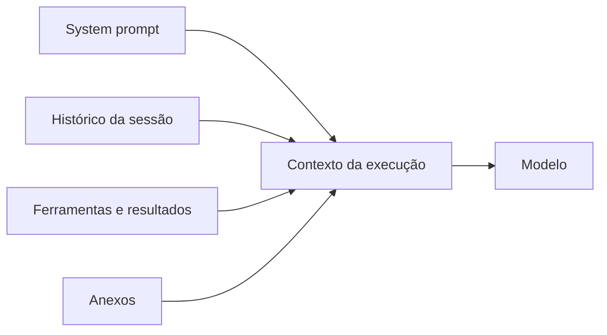

# Montagem de contexto e o comando context

## Objetivo

Saber o que entra no contexto a cada execução e como inspecionar o tamanho de cada parte.

## Explicação

A documentação define **contexto** como "tudo o que o OpenClaw envia ao modelo em uma execução", limitado pela janela de contexto do modelo. Ele inclui:

| Parte | Conteúdo |
|---|---|
| System prompt | Regras do OpenClaw, ferramentas, lista de skills, hora e runtime, arquivos do workspace injetados |
| Histórico da conversa | Suas mensagens e as do assistente na sessão |
| Chamadas e resultados de ferramentas, anexos | Saída de comandos, leituras de arquivos, imagens e áudio |

Contexto **não é memória**: memória é guardada em disco e recarregada depois; contexto é o que está na janela agora. Veja [[Memória e contexto em agentes]].



**Comandos de inspeção (no chat):**

| Comando | O que mostra |
|---|---|
| `/context list` | O que foi injetado, com tamanhos aproximados por arquivo e totais |
| `/context detail` | Acrescenta tamanhos por arquivo, por esquema de ferramenta e por skill, o tamanho do system prompt e a contagem de mensagens compactáveis |
| `/context map` | Imagem em treemap dos contribuintes do contexto da sessão |
| `/status` | Visão rápida de quão cheia está a janela e das configurações da sessão |
| `/usage tokens` | Rodapé de uso de tokens a cada resposta |
| `/compact` | Resume o histórico antigo para liberar espaço |

**Orçamento.** Se os metadados do catálogo do modelo não estiverem disponíveis, o denominador aparece como `?` (e `null` no JSON de listagem de sessões); os relatórios não substituem por uma janela genérica. O medidor da Control UI chama a estimativa de **Prompt budget (last run)**; ultrapassá-la pode disparar redução de resultados de ferramentas ou compactação.

## Exemplo prático

Antes de culpar o modelo por uma resposta ruim, olhe o contexto:

```markdown
/status
/context list
/context detail
```

Se um arquivo do workspace ou a lista de skills consome uma fatia grande, enxugue-o. Se o histórico domina, use `/compact` ou abra uma sessão nova com `/new`.

## Armadilhas comuns

- Achar que a janela do modelo é toda sua: ela é dividida com o system prompt e as ferramentas.
- Deixar muitas skills e ferramentas habilitadas e pagar por isso em toda execução.
- Confundir `/compact` (resumir a sessão) com apagar memória persistente.

## Resumo

- Contexto = system prompt + histórico + ferramentas + anexos, limitado pela janela.
- `/context list`, `/context detail` e `/context map` mostram o consumo.
- `/status` e `/usage tokens` acompanham ocupação e custo.
- `/compact` libera espaço resumindo o histórico.

## Relacionados

- [[Montagem do system prompt]]
- [[Modelos de linguagem, tokens e janela de contexto]]
- [[Memória e contexto em agentes]]
- [[Streaming de respostas e fila de comandos]]
- [[MOC - Memória e Contexto|Memória e Contexto]]

## Exercícios

1. O que compõe o contexto de uma execução?
2. Em que `/context list` difere de `/context detail`?
3. Por que o denominador do contexto pode aparecer como `?`
4. O que o comando `/compact` faz?
