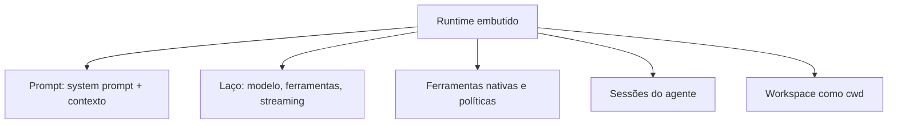

# O agent runtime embutido

## Objetivo

Entender o que é o runtime de agente embutido do OpenClaw, o que ele gerencia e quais ferramentas básicas traz.

## Explicação

Segundo a documentação, o OpenClaw traz **um runtime embutido** que cuida do laço do agente, da ligação das ferramentas e da montagem do prompt. Ele não delega os turnos a um processo externo. Cada agente configurado tem **seu próprio workspace, seus arquivos de bootstrap e seu armazém de sessões**.

> [!info] Harnesses opcionais
> A documentação também lista plugins de "harness" (por exemplo para Codex) como alternativas de execução. Este vault trata o runtime embutido, que é o caminho padrão; consulte a página "Agent runtimes" se for usar outro.

**O workspace é o diretório de trabalho.** Cada agente usa **um** diretório de workspace como seu único `cwd`, definido por `agents.defaults.workspace` ou, por agente, `agents.entries.*.workspace`. Se `agents.defaults.sandbox` estiver ligado, sessões que não são a principal podem usar workspaces por sessão sob `agents.defaults.sandbox.workspaceRoot`. A documentação recomenda `openclaw setup` para criar o `openclaw.json` e inicializar o workspace.

**Ferramentas nativas.** As ferramentas centrais (`read`, `exec`, `edit`, `write` e outras de sistema) estão sempre disponíveis, **sujeitas à política de ferramentas**. A `apply_patch` vem ligada por padrão para modelos da OpenAI e é controlada por `tools.exec.applyPatch` (`enabled`, `workspaceOnly`, `allowModels`). A seção `## Tools` do `AGENTS.md` é só orientação: não decide quais ferramentas existem.



**Estado de bootstrap.** Estado de configuração e atestação ficam em SQLite, em `~/.openclaw/state/openclaw.sqlite`; arquivos JSON e `.attested` antigos não são lidos em execução, e `openclaw doctor --fix` os importa.

## Exemplo prático

Criar a configuração e o workspace pela primeira vez, como a documentação recomenda:

```bash
openclaw setup
```

Depois, abra o diretório e veja os arquivos iniciais; eles são o assunto de [[Arquivos do workspace do agente]].

```bash
ls ~/.openclaw/workspace
```

## Armadilhas comuns

- Achar que a seção `## Tools` do `AGENTS.md` liga ou desliga ferramentas.
- Tratar o workspace como sandbox: ele é só o `cwd`; veja [[Fronteiras de confiança na arquitetura]].
- Esquecer que cada agente tem workspace e sessões próprios.

## Resumo

- Runtime embutido: laço, ferramentas e prompt, sem processo externo.
- Um workspace por agente, usado como `cwd`.
- Ferramentas centrais sempre disponíveis, sujeitas à política de ferramentas.
- Estado de bootstrap em SQLite.

## Relacionados

- [[Anatomia do loop do agente no OpenClaw]]
- [[Arquivos do workspace do agente]]
- [[Montagem do system prompt]]
- [[Fronteiras de confiança na arquitetura]]

## Exercícios

1. O que o runtime embutido gerencia?
2. Que chaves definem o workspace global e por agente?
3. A seção `## Tools` do `AGENTS.md` decide quais ferramentas existem? Explique.
4. Para que serve `openclaw setup`?
