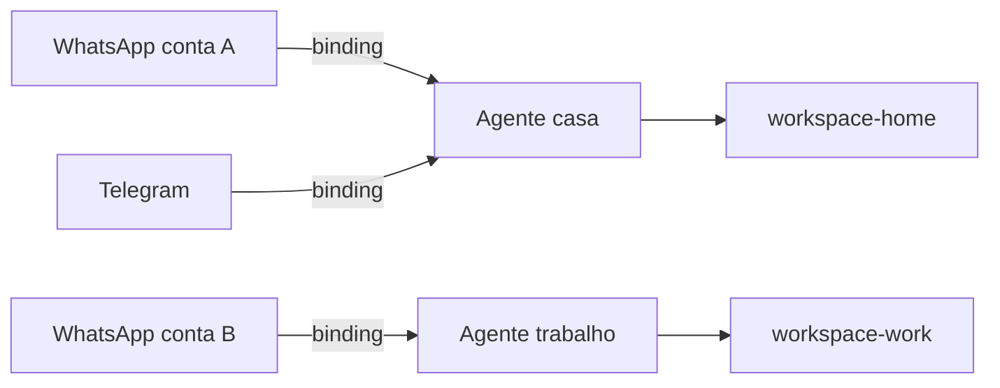

# Roteamento multiagente e bindings

## Objetivo

Usar vários agentes isolados em um mesmo Gateway e entender como as mensagens chegam ao agente certo.

## Explicação

Um único processo Gateway pode executar **vários agentes isolados**, cada um com seu workspace, seu diretório de estado (`agentDir`) e seu histórico de sessões em SQLite. Também é possível conectar **várias contas de canal** (por exemplo, dois números de WhatsApp). Os **bindings** mapeiam uma conta de canal a um agente e roteiam as mensagens de entrada.

**O que cada agente contém:**

| Parte | Conteúdo |
|---|---|
| Workspace | `AGENTS.md`, `SOUL.md`, `USER.md`, notas e regras de persona |
| `agentDir` | Perfis de autenticação, registro de modelos e configuração por agente |
| Armazém de sessões | Histórico de chat e estado de roteamento em `<agentDir>/openclaw-agent.sqlite` (padrão `~/.openclaw/agents/<agentId>/agent/openclaw-agent.sqlite`) |



**Regras e avisos da documentação:**

- **Nunca reutilize o `agentDir`** entre agentes: gera colisão de autenticação e de sessões.
- Se a credencial OAuth de um agente secundário expirar, ele lê a do dono da herança de autenticação para o mesmo perfil, **sem copiar o token de atualização**. Para uma conta OAuth totalmente independente, entre pela conta desse agente.
- Cópias manuais devem se limitar a perfis estáticos portáteis (`api_key` ou `token`), e um perfil pode ser liberado com `copyToAgents`.
- **Skills** carregam do workspace de cada agente e de raízes compartilhadas como `~/.openclaw/skills`, filtradas pela lista de skills efetiva do agente. `agents.defaults.skills` define a base; `agents.entries.*.skills` **substitui** (não mescla) a do agente.
- `sessions_history` oferece recuperação limitada entre sessões, removendo parte da marcação e truncando por tamanho.
- Por padrão, a escolha do agente segue regras de roteamento fixas controladas pela configuração do host; o modelo não escolhe o canal de resposta.

> [!warning] Precedência de bindings
> A ordem de precedência entre bindings, e os exemplos completos de configuração, estavam fora do trecho lido. Consulte `docs.openclaw.ai/concepts/agent-bindings` e use `openclaw agents --help` para os comandos nesta versão.

## Exemplo prático

O `skill.md` oficial mostra como criar workspaces separados para dois agentes:

```bash
mkdir -p ~/.openclaw/workspace-work ~/.openclaw/workspace-home
```

Depois, configure cada agente para apontar para o seu workspace (`agents.entries.<id>.workspace`), crie o binding da conta de canal desejada e valide:

```bash
openclaw config validate
openclaw gateway restart
```

## Armadilhas comuns

- Compartilhar `agentDir` ou credenciais entre agentes "para economizar".
- Esperar que skills do agente padrão sejam herdadas por mesclagem: a lista do agente substitui a padrão.
- Dar a um agente de trabalho acesso ao workspace pessoal.

## Resumo

- Vários agentes isolados em um Gateway, cada um com workspace, `agentDir` e sessões próprios.
- Bindings ligam contas de canal a agentes.
- Não compartilhe `agentDir`; listas de skills por agente substituem as padrão.
- Confirme a precedência de bindings na documentação.

## Relacionados

- [[Sessões e chaves de sessão]]
- [[Arquivos do workspace do agente]]
- [[Onde o OpenClaw guarda estado em disco]]
- [[O agent runtime embutido]]
- [[MOC - Canais e Mensageria|Canais e Mensageria]]

## Exercícios

1. O que contém cada agente isolado?
2. Para que servem os bindings?
3. Por que nunca reutilizar o `agentDir` entre agentes?
4. A lista de skills de um agente se mescla com a padrão ou a substitui?
