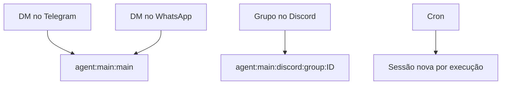

# Sessões e chaves de sessão

## Objetivo

Entender como o OpenClaw decide a qual conversa (sessão) cada mensagem pertence e como isso afeta privacidade e contexto.

## Explicação

O **Gateway é dono de todo o estado de sessão**; clientes de interface apenas consultam. Cada origem de mensagem se mapeia a um tipo de sessão:

| Origem | Sessão |
|---|---|
| Mensagem direta (DM) | Compartilhada, por padrão: a "sessão principal" |
| Grupo, sala ou canal | Isolada por grupo, por sala |
| Webhook | Isolada por gancho |
| Tarefa agendada (cron) | Sessão nova a cada execução |

**Forma das chaves.** Por padrão, DMs de **todos os canais** caem na sessão principal do agente, com chave como `agent:<agentId>:main` (por exemplo `agent:main:main`). Grupos usam `agent:<agentId>:<canal>:group:<id>` e salas, `agent:<agentId>:<canal>:channel:<id>`.

**Chaves de configuração:**

| Chave | Valores |
|---|---|
| `session.dmScope` | `main` (padrão), `per-peer`, `per-channel-peer`, `per-account-channel-peer` |
| `session.groupScope` | `per-group` (padrão) ou `main` |
| `bindings[].session.dmScope` | Sobrescreve o escopo de DM para os pares daquela rota |



Outros detalhes da documentação: IDs de catálogo, de salas e de threads do Matrix e de grupos do Signal diferenciam maiúsculas de minúsculas; `/new` e `/reset` colocam sua confirmação em uma sessão nova e deixam a antiga intacta; e entradas de login, pareamento e valores sensíveis de `/config set` e `/debug set` são redigidas antes de serem gravadas.

> [!warning] Privacidade com mais de uma pessoa
> Como o padrão junta DMs de todos os canais em uma sessão principal, **se mais de uma pessoa puder escrever por DM ao agente**, elas compartilham histórico. Nesse caso, considere `per-channel-peer` ou `per-peer`. Esta é uma recomendação deste vault, baseada nos escopos descritos; a página "Multi-user mode" da documentação trata o cenário em detalhe.

## Exemplo prático

Para que cada contato tenha sua própria conversa, ajuste o escopo e valide:

```bash
openclaw config set session.dmScope "per-channel-peer"
openclaw config validate
```

Depois, mande mensagens de dois contatos e use `openclaw sessions list` para ver sessões separadas (confirme os subcomandos em `docs.openclaw.ai/cli/sessions`).

## Armadilhas comuns

- Esperar que a conversa do Telegram e a do WhatsApp sejam separadas: por padrão não são.
- Ligar o bot em grupos sem exigir menção e deixar o agente reagir a tudo.
- Presumir que `/reset` apaga o histórico antigo: ele só abre uma sessão nova.

## Resumo

- Gateway é dono das sessões; DMs compartilham a principal, grupos são isolados.
- Escopos: `session.dmScope` e `session.groupScope`.
- Cron cria sessão nova por execução.
- Para vários usuários, use escopo por par para evitar vazamento de contexto.

## Relacionados

- [[Roteamento multiagente e bindings]]
- [[O caminho de uma mensagem do chat à resposta]]
- [[Memória e contexto em agentes]]
- [[Streaming de respostas e fila de comandos]]
- [[MOC - Canais e Mensageria|Canais e Mensageria]]

## Exercícios

1. Qual é a chave de sessão padrão para DMs?
2. Que valores aceita `session.dmScope`?
3. Por que DMs de vários usuários na sessão principal são um risco?
4. O que `/new` faz com a sessão anterior?
