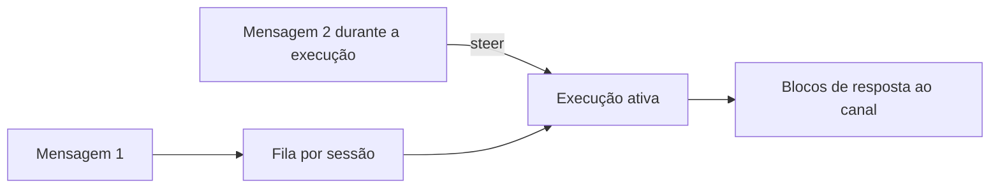

# Streaming de respostas e fila de comandos

## Objetivo

Entender como as respostas são entregues aos canais em blocos e como a fila evita execuções concorrentes na mesma sessão.

## Explicação

### Streaming

Há **duas camadas independentes**:

- **Block streaming**: envia aos canais blocos **completos** à medida que o assistente escreve.
- **Preview streaming**: atualiza uma mensagem de prévia temporária durante a geração, em Telegram, Discord, Slack, Matrix, Mattermost e MS Teams.

A página afirma que **não há streaming verdadeiro de deltas de token para mensagens de canal**. Os eventos do modelo alimentam um fracionador (`EmbeddedBlockChunker`) com limites mínimo e máximo e preferências de quebra; `blockStreamingBreak` define se o fracionador esvazia em `text_end` ou `message_end`, e `blockStreamingDefault` fica em `agents.defaults`. Deltas rápidos são coalescidos em ciclos de **75 ms**. A resposta final e as transcrições guardadas mantêm o texto completo. Na Control UI, um status grosseiro (preparo do workspace, ambiente, contexto, partida do modelo) aparece até o primeiro texto ou atividade de ferramenta.

### Fila de comandos

Uma fila **em processo** serializa as execuções de resposta automática entre canais, para que não colidam (são caras e disputam estado de sessão, registros e entrada da CLI), mas permite paralelismo **entre sessões**.

| Item | Padrão ou comportamento |
|---|---|
| Modo `steer` (padrão) | Injeta o prompt do solicitante no turno ativo, inclusive durante a execução de ferramentas, sem iniciar uma segunda execução; se o turno não aceitar, o prompt espera o fim |
| Modos `collect` e `followup` | Citados como modos de agrupamento que dividem a mesma espera (debounce) de 500 ms; o comportamento não foi detalhado no trecho lido |
| `/queue` | Define, por mensagem, o que mensagens normais fazem durante uma execução ativa |
| Faixa global `main` | Padrão `max(8, paralelismo de CPU × 4)`, limitada por `agents.defaults.maxConcurrent` |
| Subagentes | 8 por sessão que os cria (`agents.defaults.subagents.maxConcurrent`) |
| Coletores de swarm | 32 por grupo (`tools.swarm.maxConcurrent`) |
| Outros padrões | `cap: 20`, `drop: "summarize"`, `mode: "steer"` |

Execuções em andamento **nunca são preemptadas**; trabalho em primeiro plano pode ultrapassar o normal em até 15 s, e o de segundo plano, em até 30 s.

> [!warning] Caminhos exatos das chaves
> Os caminhos completos das chaves `mode`, `cap` e `drop` não estavam visíveis na leitura. Procure por elas em `docs.openclaw.ai/concepts/queue` ou com `openclaw config schema`.

## Exemplo prático

Você manda um pedido longo e, no meio, acrescenta "use só a pasta de downloads". Com o modo `steer`, essa correção entra no turno em andamento em vez de abrir outra execução. Se não houver como aceitar a correção, ela espera o fim.

## Armadilhas comuns

- Esperar o texto aparecendo letra a letra nos canais: o envio é por blocos.
- Aumentar a concorrência sem considerar custo de API e limites do provedor.
- Mandar muitas mensagens seguidas e achar que foram ignoradas: elas podem estar na fila.

## Resumo

- Block streaming envia blocos completos; preview streaming atualiza uma prévia.
- Não há streaming de deltas de token para mensagens de canal.
- A fila serializa execuções por sessão; `steer` é o modo padrão.
- Execuções ativas não são preemptadas.

## Relacionados

- [[Anatomia do loop do agente no OpenClaw]]
- [[Sessões e chaves de sessão]]
- [[O caminho de uma mensagem do chat à resposta]]
- [[Montagem de contexto e o comando context]]

## Exercícios

1. Qual a diferença entre block streaming e preview streaming?
2. Por que a fila serializa execuções?
3. O que o modo `steer` faz com uma mensagem nova durante uma execução?
4. Como os limites de concorrência de subagentes são definidos?
