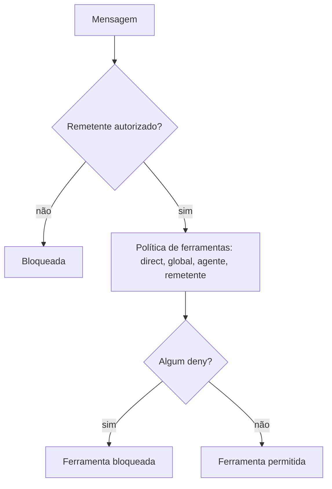

# Allowlists e política de ferramentas por chat

## Objetivo

Restringir não só **quem** fala com o agente, mas **o que** o agente pode fazer em cada conversa.

## Explicação

**`allowFrom` no Telegram.** Aceita IDs numéricos de usuário; os prefixos `telegram:` e `tg:` são normalizados. Configurações antigas podem ter `@username`; `openclaw doctor --fix` tenta resolvê-los para IDs numéricos (exige o token do bot). Em configurações com várias contas, um `channels.telegram.allowFrom` restritivo no topo funciona como barreira de segurança: um `allowFrom: ["*"]` em uma conta **não** a torna pública se a lista efetiva mesclada não tiver um curinga explícito.

Para bots de um só dono, a documentação recomenda `allowlist` com IDs numéricos explícitos.

**Dono de comandos.** Aprovar pareamento dá acesso só a DM. Comandos exclusivos do dono exigem `commands.ownerAllowFrom` com `telegram:<seu id>`.

**Política de ferramentas por chat.** Em `channels.telegram.direct.<chatId>.tools` define-se a política das ferramentas internas para uma DM; `toolsBySender` escolhe uma política por remetente com chaves como `channel:telegram:<userId>` ou `id:<userId>`. Regras de combinação:

- Uma entrada de `toolsBySender` que bate **substitui** `tools` naquela DM.
- Uma entrada exata de chat substitui a entrada `"*"` inteira, sem herdar campos.
- A política de `direct` de uma conta substitui o mapa raiz quando presente.
- As políticas de `direct`, global, por agente e `toolsBySender` **se intersectam**: um `deny` em qualquer camada bloqueia a ferramenta.

Exemplo da documentação:

```json5
{
  channels: {
    telegram: {
      direct: {
        "*": { tools: { deny: ["write", "edit"] } },
        "603767951": { tools: {} },
      },
    },
  },
}
```

Aqui, por padrão nenhuma DM pode usar `write` e `edit`, e o chat `603767951` (o dono, por exemplo) fica sem essa restrição.



> [!tip] Mínimo privilégio por conversa
> Dê a pessoas de confiança menor, mas útil, acesso (por exemplo leitura), e reserve ferramentas de escrita e execução ao dono. Veja [[Confiança, permissões e riscos de agentes]].

## Exemplo prático

Quer que um colega consulte o agente, mas sem editar arquivos? Coloque o ID dele em `allowFrom` e uma política `deny: ["write", "edit"]` para o chat dele (nomes das ferramentas conforme a documentação de ferramentas; confirme com a sua versão), mantendo o seu chat sem restrição. Valide com `openclaw config validate`.

## Armadilhas comuns

- Deixar `@username` antigos sem converter para IDs.
- Esquecer que um `deny` em qualquer camada vence.
- Supor que `allowFrom: ["*"]` numa conta isolada a deixa pública quando o nível superior é restritivo.

## Resumo

- `allowFrom` usa IDs numéricos; `allowlist` é o modo mais restrito.
- Dono de comandos exige `commands.ownerAllowFrom`.
- Políticas de ferramentas por chat se intersectam; `deny` vence.

## Relacionados

- [[Pareamento e política de DM]]
- [[Grupos - menção obrigatória e groupPolicy]]
- [[Uso de ferramentas e tool calling]]
- [[Confiança, permissões e riscos de agentes]]

## Exercícios

1. Que formato de ID `allowFrom` do Telegram espera?
2. Como as políticas de ferramentas de várias camadas se combinam?
3. O que `commands.ownerAllowFrom` controla?
4. Escreva uma política que bloqueie `write` e `edit` para todas as DMs, exceto um chat.
