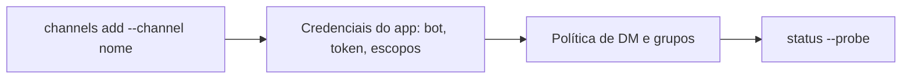

# Discord, Slack, Signal e iMessage - o que a doc oferece

## Objetivo

Saber onde está a documentação de cada canal popular além de Telegram e WhatsApp, e o que ela garante, sem inventar passos que não foram verificados.

> [!warning] Cobertura limitada desta nota
> Nesta sessão, só as páginas de visão geral de Discord e as listas de navegação foram lidas por completo. Chaves e passos específicos de Slack, Signal e iMessage **não foram verificados**; siga as páginas oficiais indicadas abaixo.

## Explicação

| Canal | O que foi confirmado | Onde aprofundar |
|---|---|---|
| **Discord** | Conecta como bot pelo gateway oficial; suporta DMs e canais de servidores; **DMs usam pareamento por padrão** | `channels/discord/setup`, `access-control`, `troubleshooting` |
| **Slack** | Existe com páginas de setup, transportes, Enterprise Grid, manifesto e escopos, controle de acesso, threads e sessões | `channels/slack/...` |
| **Signal** | Listado como canal oficial; cada canal Signal tem IDs de grupo que diferenciam maiúsculas | `channels/signal` |
| **iMessage** | Existe uma página de setup e um caminho `imsg` com API privada; a documentação anuncia a remoção do BlueBubbles e uma página de migração | `channels/imessage/...`, `announcements/bluebubbles-imessage` |

**Discord.** A documentação indica as áreas: instalar o app, convidar o bot, parear e preparar um workspace de servidor; controle de acesso (política de DM, allowlists de servidor, menção obrigatória, roteamento por papéis e portões de ação); comandos nativos (página de comandos de barra); e solução de problemas (mensagens bloqueadas, erros de intents, timeouts do gateway, loops de bots). Uma chave citada na página de grupos: `channels.discord.guilds.<id>.requireMention`.

**Slack.** A chave citada na página de grupos: `channels.slack.requireMention`.

**Regras comuns a todos.** O que se aprendeu nas notas anteriores vale aqui: política de DM, `allowFrom`, menção em grupos e política de ferramentas ([[Pareamento e política de DM]], [[Grupos - menção obrigatória e groupPolicy]]). A configuração específica de cada canal fica em `channels.<canal>` no `openclaw.json`.



## Exemplo prático

Roteiro seguro para qualquer canal novo:

```markdown
1. Abra a página oficial do canal em docs.openclaw.ai/channels/<canal>
2. Crie o app/bot em conta de TESTE, com o mínimo de escopos
3. Rode: openclaw channels add (escolha o canal) e siga o assistente
4. Confira: openclaw channels status --probe
5. Mantenha dmPolicy em "pairing" e aprove só o seu usuário
6. Só depois ligue grupos, com menção obrigatória
```

## Armadilhas comuns

- Conceder escopos amplos ao app do Slack ou intents desnecessárias ao bot do Discord "para funcionar logo".
- Deixar bots em canais públicos sem menção obrigatória.
- Usar a configuração do BlueBubbles em guias antigos: a documentação atual trata do caminho `imsg`.

## Resumo

- Discord: DMs em pareamento por padrão, páginas dedicadas de setup e acesso.
- Slack, Signal e iMessage têm páginas próprias; confirme chaves e passos lá.
- As regras de acesso das notas anteriores se aplicam a todos os canais.

## Relacionados

- [[Visão geral dos canais e instalação sob demanda]]
- [[Pareamento e política de DM]]
- [[Grupos - menção obrigatória e groupPolicy]]
- [[Pontos de extensão - plugins, skills e hooks]]

## Exercícios

1. Qual é a política de DM padrão do Discord?
2. Em que chave se liga a menção obrigatória no Slack, segundo a página de grupos?
3. Por que seguir um guia antigo de iMessage com BlueBubbles pode ser um problema?
4. Descreva os seis passos do roteiro seguro para um canal novo.
