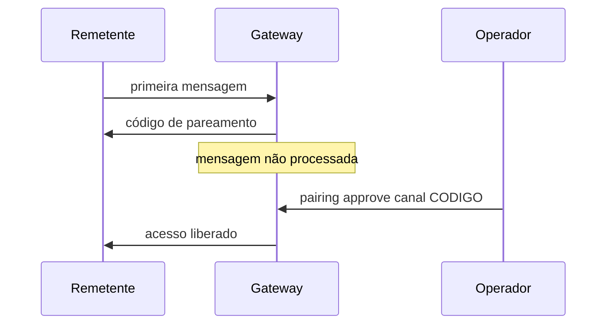

# Pareamento e política de DM

## Objetivo

Entender como o OpenClaw decide se um remetente desconhecido pode falar com o agente em mensagem direta.

## Explicação

Cada canal tem uma **política de DM** (`dmPolicy`). Os valores citados na documentação:

| Valor | Efeito |
|---|---|
| `pairing` (padrão) | Remetente desconhecido recebe um **código curto**; a mensagem só é processada depois que você aprova |
| `allowlist` | Só IDs em `allowFrom`; uma lista vazia é rejeitada pela validação |
| `open` | Aberto, mas só é público quando a lista efetiva inclui `"*"`; serve só a bots intencionalmente públicos com ferramentas muito restritas |
| `disabled` | DMs desligadas |

**Como o pareamento funciona:**

- Códigos têm **8 caracteres**, em maiúsculas, sem caracteres ambíguos (`0O1I`).
- **Expiram em 1 hora**; a mensagem de pareamento é enviada só quando um novo pedido é criado (cerca de uma vez por hora por remetente).
- No máximo **3 pedidos pendentes** por conta de canal; os extras são ignorados até um expirar ou ser aprovado.



**Comandos:**

```bash
openclaw pairing list telegram
openclaw pairing approve telegram <CODIGO> --notify
openclaw pairing approve telegram <CODIGO> --account <id>
```

`--notify` avisa o solicitante no mesmo canal; `--account <id>` serve a canais com várias contas. Também é possível aprovar em **Settings > Channels > DM access requests** na Control UI; dispensar um pedido não é bloqueio permanente.

**Importante:** aprovar dá acesso **somente a DM**, não a grupos. Se ainda não houver dono de comandos, a CLI define `commands.ownerAllowFrom` automaticamente (por exemplo `telegram:123456789`); aprovações seguintes concedem só acesso a DM, e remetentes colocados à mão na allowlist não viram donos automaticamente.

> [!info] Pareamento de nodes
> Existe também o pareamento de dispositivos (iOS, Android, macOS, headless), com aprovação própria; é outro mecanismo, tratado nas páginas de nodes e em [[Gateway, clientes e nodes]].

## Exemplo prático

Para um bot de uso individual, prefira `allowlist` com seu ID numérico. Para testar com um amigo, mantenha `pairing`, peça que ele escreva ao bot e aprove o código que aparecer em `openclaw pairing list`.

## Armadilhas comuns

- Usar `open` com `"*"` em um agente com ferramentas poderosas.
- Aprovar códigos que você não viu ser criados por alguém que você conhece.
- Achar que aprovar em DM libera também o grupo.

## Resumo

- `pairing` é o padrão seguro; `allowlist` é o mais restrito para uso pessoal; `open` exige cuidado extremo.
- Códigos de 8 caracteres, validade de 1 hora, limite de 3 pendentes.
- Aprovação vale só para DM.

## Relacionados

- [[Allowlists e política de ferramentas por chat]]
- [[Telegram - configurar o bot passo a passo]]
- [[WhatsApp - vínculo por QR e cuidados]]
- [[Confiança, permissões e riscos de agentes]]
- [[Sessões e chaves de sessão]]

## Exercícios

1. Quais são os quatro valores de `dmPolicy`?
2. Qual a validade de um código de pareamento e quantos pedidos pendentes são permitidos?
3. Aprovar um pedido de DM libera o acesso a grupos? Explique.
4. Em que situação `open` seria aceitável?
