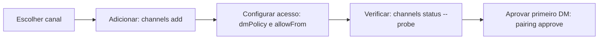

# Visão geral dos canais e instalação sob demanda

## Objetivo

Saber o que é um canal, quais existem, o que vem no núcleo e como adicionar o primeiro.

## Explicação

Um **canal** é o adaptador entre um app de chat e o Gateway. A documentação resume: texto funciona em todos os canais; mídia e reações variam por canal.

**Três categorias de instalação:**

| Categoria | Significado |
|---|---|
| Incluído no núcleo | Já vem na instalação (exemplos visíveis: A2A e Reef; a página de recursos também cita Telegram e WebChat) |
| Plugin oficial | Instalado com `openclaw plugins install @openclaw/<id>`, ou sob demanda durante `openclaw onboard` e `openclaw channels add` |
| Plugin externo | Mantido fora do repositório do OpenClaw |

A lista (parcial na página lida) inclui Discord, Feishu, Google Chat, iMessage, IRC, LINE, Matrix, Mattermost, Microsoft Teams, Nextcloud Talk, Nostr, QQ bot, Signal, Slack, SMS, Telegram, WhatsApp, X/Twitter, Zalo, Twitch e outros. Mudanças de plugins se aplicam a um Gateway em execução.

**Qual canal primeiro?** A documentação recomenda o **Telegram**: só precisa de um token de bot, sem instalar plugin. O WhatsApp exige pareamento por QR e guarda mais estado em disco.



## Exemplo prático

Adicionar e verificar um canal (comandos da documentação):

```bash
openclaw channels add --channel telegram --token <token-do-bot>
openclaw channels status --probe
```

`openclaw channels add` sem opções abre uma lista para escolher. Se o Gateway estiver desligado, inicie-o antes de rodar `status --probe`.

> [!warning] Lista de canais muda
> A lista completa e quais itens são núcleo ou plugin podem mudar entre versões. Confira em `docs.openclaw.ai/channels`.

## Armadilhas comuns

- Supor que todo canal vem pré-instalado.
- Começar por um canal que exige muito estado (WhatsApp) sem testar o fluxo no Telegram.
- Conectar sua conta pessoal principal em vez de uma conta de teste.

## Resumo

- Canal = adaptador entre app de chat e Gateway.
- Núcleo, plugin oficial e plugin externo.
- Telegram é a recomendação para começar.
- `channels add` e `channels status --probe` são os comandos básicos.

## Relacionados

- [[Telegram - configurar o bot passo a passo]]
- [[WhatsApp - vínculo por QR e cuidados]]
- [[Pareamento e política de DM]]
- [[Arquitetura em camadas do OpenClaw]]
- [[MOC - Canais e Mensageria|MOC da pasta]]

## Exercícios

1. O que é um canal no OpenClaw?
2. Quais são as três categorias de instalação de canais?
3. Por que a documentação recomenda o Telegram como primeiro canal?
4. Que comando verifica o estado dos canais e testa a conexão?
