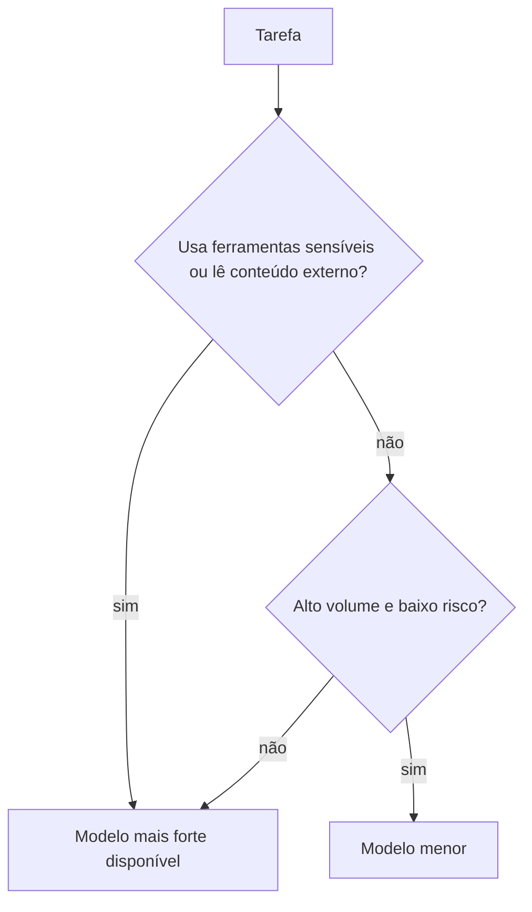

# Custo e escolha de modelo

## Objetivo

Entender o que faz o custo subir, como medir e reduzir, e como escolher modelo sem sacrificar a segurança.

## Explicação

**O que impulsiona o custo** (página oficial de uso de tokens):

- **Tamanho do contexto**: system prompt, histórico, chamadas e resultados de ferramentas, anexos e resumos de compactação contam como entrada **a cada execução**.
- **Saída e escrita de cache**: saída é cobrada à parte; na Anthropic, escrita de cache custa mais que entrada normal e leitura custa menos.
- **Laços de ferramentas**: o uso do provedor soma **todas** as chamadas ao modelo em um turno, então uma resposta pode custar mais do que o tamanho do contexto sugere.
- **Preço de contexto longo**: para alguns modelos da OpenAI, entrada acima de 272.000 tokens aciona preço maior para a requisição inteira.

**Como reduzir:**

| Alavanca | Detalhe |
|---|---|
| Heartbeat | Com TTL de cache de 1 h, intervalo um pouco menor (por exemplo `55m`) mantém o cache aquecido; cada heartbeat ainda gasta tokens |
| Cache | `cacheRetention` em `agents.defaults.models.<modelo>.params`; `"none"` para agentes esporádicos |
| Poda de contexto | Poda por TTL de cache em sessões ociosas (veja [[Poda de sessão e compactação]] na pasta de memória) |
| Prompt enxuto | `/compact`; reduzir saídas grandes e descrições de skills; `agents.defaults.imageMaxDimensionPx` (padrão `1200`); `agents.defaults.bootstrapMaxChars` (padrão `20000`) e `bootstrapTotalMaxChars` (padrão `60000`) |
| Escolha de modelo | Modelos menores para trabalho verboso ou exploratório |

**Como medir (comandos de chat e CLI):**

```markdown
/status
/usage tokens
/usage full
/usage cost
/usage reset
```

`/status` mostra modelo, uso de contexto, tokens da última resposta e custo. `/usage off|tokens|full` adiciona rodapé por resposta (`full` inclui custo; persiste por sessão). `/usage cost` dá um resumo local a partir dos registros de sessão. Na CLI:

```bash
openclaw status --usage
```

mostra janelas de cota do provedor em percentual restante (não o custo por resposta).

**Preços.** Defina em `models.providers.<provedor>.models[].cost` (USD por 1M de tokens: `input`, `output`, `cacheRead`, `cacheWrite`); omitir `cost` (ou `{}`) herda o preço do catálogo. `models.catalogRefresh.enabled: false` bloqueia atualizações de preço hospedadas em redes offline ou restritas.

**Escolha e segurança.** A documentação aconselha, para melhor qualidade e segurança, **usar o modelo mais forte e recente disponível**. Economizar com modelo fraco pode sair caro em segurança, já que modelos fracos seguem instruções maliciosas com mais facilidade. Uma estratégia razoável: modelo forte como padrão, modelo menor só em tarefas de baixo risco e sem ferramentas sensíveis.



## Exemplo prático

Meça antes de otimizar: ative `/usage full` por um dia, anote o custo das tarefas típicas, depois ajuste uma alavanca por vez (por exemplo, `/compact` mais cedo ou cache `long`) e compare.

## Armadilhas comuns

- Otimizar sem medir.
- Deixar um agente de segundo plano com heartbeat curto e contexto grande.
- Trocar para modelo fraco em tarefas que leem e-mails ou páginas da web.

## Resumo

- Custo = contexto reenviado a cada rodada + saída + laços de ferramentas.
- Meça com `/status`, `/usage` e `openclaw status --usage`.
- Alavancas: cache, heartbeat, poda, prompt enxuto, escolha de modelo.
- Segurança pede o modelo mais forte nas tarefas sensíveis.

## Relacionados

- [[Thinking e cache de prompt]]
- [[Failover de modelos e fallbacks]]
- [[Modelos de linguagem, tokens e janela de contexto]]
- [[Montagem de contexto e o comando context]]
- [[MOC - Operação e Manutenção|Operação e Manutenção]]

## Exercícios

1. Cite três fatores que elevam o custo de um agente.
2. Que comandos mostram o consumo de tokens e o custo?
3. Qual a recomendação da documentação sobre a força do modelo e por quê?
4. Onde se definem preços personalizados por modelo?
