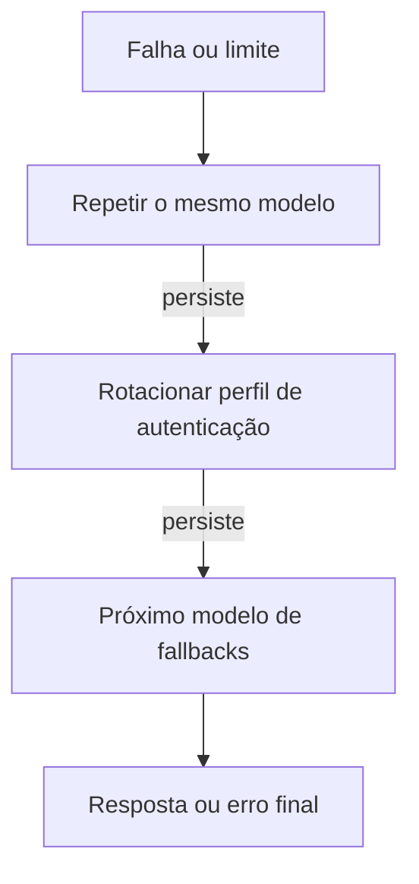

# Failover de modelos e fallbacks

## Objetivo

Entender o que o OpenClaw faz quando um modelo ou provedor falha, e como configurar um plano B.

## Explicação

A página de failover descreve **dois estágios**, depois de uma tentativa de repetição no mesmo modelo:

0. **Repetição no mesmo modelo** para limites temporários e falhas do provedor, mantendo a transcrição e exibindo um status de repetição com espera e número da tentativa.
1. **Rotação de perfis de autenticação** dentro do provedor atual.
2. **Fallback de modelo** para o próximo modelo em `agents.defaults.model.fallbacks`.



**Limites de taxa.** O esgotamento explícito de tokens por minuto (TPM) da organização é rastreado **por modelo**. Requisições ao mesmo endpoint, conta e modelo esperam o piso de repetição do provedor, e cabeçalhos `Retry-After` são respeitados. Com fallback disponível, o esgotamento compartilhado de TPM permite **no máximo duas repetições no mesmo modelo em 15 segundos** antes de passar ao fallback. Turnos interativos têm prioridade sobre subagentes e trabalho em segundo plano.

**Configuração.** A única chave confirmada nesta leitura é `agents.defaults.model.fallbacks`. Pela CLI:

```bash
openclaw models fallbacks add <modelo>
openclaw models fallbacks clear
openclaw models status
```

(`add`, `remove` e `clear` existem para o grupo `fallbacks`; confirme a sintaxe com `openclaw models fallbacks --help`.)

> [!warning] Partes não lidas
> Cooldowns, desativação por cobrança e "stickiness" de sessão aparecem na página apenas como títulos na leitura desta sessão, e as chaves `auth.order` e `auth.cooldowns` não foram confirmadas. Consulte `docs.openclaw.ai/concepts/model-failover` antes de depender desses detalhes.

**Cuidado de segurança e custo.** Um fallback para um modelo **mais fraco ou mais barato** muda o comportamento: modelos fracos tendem a seguir instruções maliciosas com mais facilidade (a documentação aconselha usar o modelo mais forte e recente). Escolha fallbacks de classe semelhante, e saiba que cada troca altera o cache de prompt e o preço.

## Exemplo prático

Defina um modelo principal e um fallback de mesma categoria, e simule a falha removendo temporariamente a chave do principal em ambiente de teste. Verifique, em `openclaw logs --follow`, a mensagem de repetição e a troca.

```json5
{
  agents: {
    defaults: {
      model: {
        primary: "anthropic/claude-opus-5",
        fallbacks: ["openai/<modelo-da-sua-lista>"],
      },
    },
  },
}
```

O segundo nome é um marcador: use um ID que apareça em `openclaw models list`.

## Armadilhas comuns

- Escolher fallbacks muito mais fracos que o principal sem avaliar o risco.
- Não testar o fallback: só se descobre que a chave do segundo provedor está errada na hora do incidente.
- Esquecer que a troca de provedor também troca onde seus dados vão.

## Resumo

- Ordem: repetir no mesmo modelo, rotacionar perfil, usar fallback.
- Chave confirmada: `agents.defaults.model.fallbacks`.
- Limites de TPM são por modelo, com `Retry-After` respeitado.
- Escolha fallbacks com qualidade e política de dados compatíveis.

## Relacionados

- [[Provedores, referências de modelo e a CLI models]]
- [[Custo e escolha de modelo]]
- [[Anthropic - chave de API, Claude CLI e setup-token]]
- [[Anatomia do loop do agente no OpenClaw]]

## Exercícios

1. Quais são os estágios do failover, em ordem?
2. Qual chave define os modelos de fallback?
3. O que acontece com limites de TPM quando há fallback disponível?
4. Por que um fallback mais fraco pode ser um risco de segurança?
