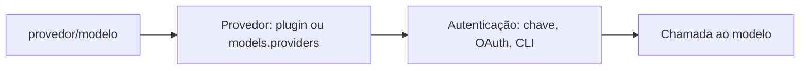

# Provedores, referências de modelo e a CLI models

## Objetivo

Entender como o OpenClaw nomeia modelos e usar a CLI `openclaw models` para ver, escolher e ajustar o modelo padrão.

## Explicação

O OpenClaw não traz modelo próprio: ele usa **provedores** (hospedados ou locais). Cada modelo é referenciado no formato **`provedor/modelo`** (por exemplo `anthropic/claude-opus-5`, usado em exemplos da documentação). Um `provedor/modelo` explícito que corresponde a um modelo configurado mantém sua identidade exata, mesmo que outro modelo tenha um apelido colidindo; apelidos simples também resolvem.

**Comandos da CLI:**

```bash
openclaw models status
openclaw models list
openclaw models list --provider anthropic
openclaw models refresh
openclaw models set <modelo-ou-apelido>
openclaw models set-image <modelo-ou-apelido>
openclaw models scan
```

`openclaw models` sozinho equivale a `openclaw models status`. Os grupos `aliases`, `fallbacks` e `image-fallbacks` aceitam `add`, `remove` e `clear`. A flag `--json` dá saída para máquinas, e `--agent <id>` (em `status`, `list` e `auth`) mira um agente específico; as mudanças de `set`, `set-image`, `scan`, `refresh`, apelidos e fallbacks valem para os **padrões globais** e rejeitam `--agent`.

| Chave de configuração | Significado |
|---|---|
| `agents.defaults.model` | Modelo padrão (com `primary` e `fallbacks`) |
| `agents.defaults.imageModel` | Modelo para imagens |

`models set` exige um **provedor conhecido** (plugin instalado, apelido de provedor em execução ou entrada em `models.providers`): provedor desconhecido sai com erro, sem mudar a configuração. Se o modelo de um provedor conhecido não estiver no catálogo local, ele apenas avisa. Escrever `agents.defaults.model` com `openclaw config set` é **mais estrito**: rejeita referências que não se resolvem.



> [!warning] Nomes de modelo mudam
> IDs como `claude-opus-5` aparecem em exemplos da documentação lida e podem mudar. Liste o que a sua instalação enxerga com `openclaw models list` antes de copiar um nome.

## Exemplo prático

```bash
openclaw models list --provider anthropic
openclaw models set anthropic/claude-opus-5
openclaw models status
```

Se `set` falhar por provedor desconhecido, instale o plugin do provedor ou faça o onboarding (veja [[Anthropic - chave de API, Claude CLI e setup-token]]) e tente de novo.

## Armadilhas comuns

- Copiar um nome de modelo de um blog antigo.
- Usar `--agent` com `models set` (é rejeitado: o padrão é global).
- Editar `agents.defaults.model` à mão com valor que não existe e impedir o Gateway de validar.

## Resumo

- Referências no formato `provedor/modelo`.
- `openclaw models status|list|set|set-image|scan|refresh` e os grupos de apelidos e fallbacks.
- Chaves: `agents.defaults.model` e `agents.defaults.imageModel`.
- `models set` exige provedor conhecido.

## Relacionados

- [[Diretório de provedores e como ler a lista]]
- [[Anthropic - chave de API, Claude CLI e setup-token]]
- [[Failover de modelos e fallbacks]]
- [[Configuração do Gateway em openclaw.json]]

## Exercícios

1. Qual é o formato de uma referência de modelo?
2. Que comando lista os modelos de um provedor específico?
3. Por que `models set` rejeita `--agent`?
4. Qual a diferença de rigor entre `models set` e `config set agents.defaults.model`?
