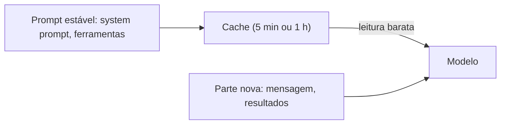

# Thinking e cache de prompt

## Objetivo

Controlar o esforço de raciocínio do modelo e o cache de prompt, dois botões que afetam qualidade e custo.

## Explicação

**Thinking (níveis de raciocínio).** A página da Anthropic descreve padrões por modelo (valem para os IDs citados lá; confirme os atuais):

| Modelo citado | Padrão |
|---|---|
| `anthropic/claude-opus-5` | Raciocínio adaptativo em `high` |
| `claude-opus-4-8` | Desligado; `/think high`, `xhigh` ou `max` liga o adaptativo |
| `claude-opus-4-6` e `claude-sonnet-4-6` | `adaptive` |
| `claude-fable-5` e `claude-mythos-5` | Sempre adaptativo, padrão `high`; `/think off` e `/think minimal` mapeiam para `low` |

No chat: `/think off` desliga; `/think xhigh` ou `/think max` aumentam o esforço. Padrão por modelo na configuração:

```json5
{
  agents: {
    defaults: {
      models: {
        "anthropic/claude-opus-5": { params: { thinking: "high" } },
      },
    },
  },
}
```

**Cache de prompt (só com chave de API na Anthropic).** `cacheRetention` aceita `"short"` (padrão, 5 minutos), `"long"` (1 hora) e `"none"`:

```json5
{
  agents: {
    defaults: {
      models: {
        "anthropic/claude-opus-4-6": { params: { cacheRetention: "long" } },
      },
    },
  },
}
```

Sobrescritas por agente ficam em `agents.entries.*.params`, casadas pelo `id` do agente, e vencem os parâmetros do modelo para aquele agente.

**Por que importa.** Segundo a página de custos, em caches da Anthropic a **escrita** custa mais que a entrada normal e a **leitura** custa menos. Com TTL de 1 hora, um intervalo de heartbeat um pouco menor (por exemplo, `55m`) mantém o cache aquecido, mas cada heartbeat ainda gasta tokens. Agentes de alertas esporádicos podem usar `"none"`.



> [!info] Raciocínio mais alto não é sempre melhor
> Esforço alto aumenta tokens de saída, latência e custo. Reserve-o para tarefas difíceis.

## Exemplo prático

No chat, para uma tarefa de planejamento complexa:

```markdown
/think high
Planeje a migração do meu blog para outro servidor, listando riscos.
/think off
```

Depois volte ao padrão. Para ver o impacto, use `/usage tokens` (veja [[Custo e escolha de modelo]]).

## Armadilhas comuns

- Deixar `max` ligado em todas as conversas.
- Mudar o prompt estável (por exemplo, o `AGENTS.md`) com frequência e perder o benefício do cache.
- Supor que `cacheRetention` vale para qualquer forma de autenticação: aqui, só para chave de API.

## Resumo

- `/think` ajusta o raciocínio; padrões variam por modelo.
- `cacheRetention`: `short`, `long` ou `none`; só com chave de API.
- Cache aquecido reduz custo; escrita custa mais que leitura.

## Relacionados

- [[Anthropic - chave de API, Claude CLI e setup-token]]
- [[Custo e escolha de modelo]]
- [[Montagem do system prompt]]
- [[Modelos de linguagem, tokens e janela de contexto]]

## Exercícios

1. Que comandos de chat mudam o nível de raciocínio?
2. Quais são os valores de `cacheRetention` e suas durações?
3. Por que mudar o prompt estável com frequência prejudica o cache?
4. Onde se sobrescreve o cache por agente?
