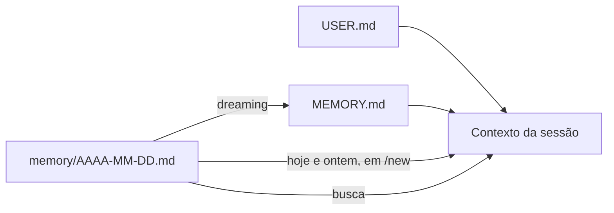

# Arquivos de memória em Markdown

## Objetivo

Saber quais arquivos formam a memória persistente do OpenClaw, quando cada um entra no contexto e como inspecioná-los.

## Explicação

A página de visão geral da memória afirma o princípio central: a memória é **Markdown simples no workspace do agente** (padrão `~/.openclaw/workspace`), e "o modelo só lembra o que foi salvo em disco; não há estado oculto". Os arquivos:

| Arquivo | Conteúdo |
|---|---|
| `USER.md` (opcional) | Preferências estáveis, estilo de comunicação, relações e contexto de projetos ativos, escritos como diretivas |
| `MEMORY.md` | Fatos e decisões duráveis que não são de perfil |
| `memory/AAAA-MM-DD.md` (ou `memory/AAAA-MM-DD-<slug>.md`) | Notas diárias e contexto corrente |
| `DREAMS.md` (opcional) | Diário de "dreaming" e resumos de varreduras, para revisão humana |

**Quando entram no contexto:**

- `USER.md` e `MEMORY.md` são carregados no **início da sessão**; o `USER.md` tem um orçamento pequeno próprio.
- As notas de **hoje e de ontem** são carregadas automaticamente em um `/new` ou `/reset` simples.
- Notas diárias **não** são injetadas a cada turno; chegam por busca (veja [[Ferramentas de memória e busca]]).
- Se o `MEMORY.md` exceder o orçamento de bootstrap, o arquivo fica **intacto no disco**, mas a cópia injetada é truncada. `/context list`, `/context detail` e `openclaw doctor` mostram tamanhos brutos e injetados.

**Manutenção.** A varredura padrão de "dreaming" destila material útil das notas diárias para o `MEMORY.md`. A manutenção de memória diária exige UTF-8 válido. A Control UI importa memória existente do Codex, do Claude Code e do Hermes em **Settings > Import Memory**.



> [!warning] Detalhes que variam por versão
> Uma cópia mais antiga da documentação (pacote de terceiros de abril de 2026) descrevia o `MEMORY.md` como carregado **só na sessão principal privada, nunca em contextos de grupo**. A página atual lida não repete essa afirmação nem a contradiz; confirme na página "Memory overview" da sua versão antes de contar com isso para privacidade.

## Exemplo prático

Inspecione a memória do seu agente como qualquer pasta de texto:

```bash
ls ~/.openclaw/workspace/ ~/.openclaw/workspace/memory/
wc -c ~/.openclaw/workspace/MEMORY.md
```

No chat, compare o tamanho bruto com o injetado:

```markdown
/context detail
```

Se o `MEMORY.md` estiver sendo truncado, enxugue-o: mova detalhes para notas e deixe só o essencial.

## Armadilhas comuns

- Despejar tudo no `MEMORY.md` e perder trechos por truncamento.
- Guardar segredos em qualquer desses arquivos.
- Editar com um editor que não grava UTF-8.

## Resumo

- Memória = arquivos Markdown no workspace; sem estado oculto.
- `USER.md` e `MEMORY.md` entram no início da sessão; notas diárias de hoje e ontem em `/new`.
- Truncamento afeta só a cópia injetada.
- Importação e "dreaming" ajudam a manter a memória.

## Relacionados

- [[Ferramentas de memória e busca]]
- [[Arquivos do workspace do agente]]
- [[Memória e contexto em agentes]]
- [[Boas práticas de memória e janela de contexto]]

## Exercícios

1. Quais são os quatro tipos de arquivo de memória citados?
2. Quais arquivos entram no início da sessão e quais chegam por busca?
3. O que acontece quando o `MEMORY.md` excede o orçamento?
4. Que comando mostra tamanhos brutos e injetados?
