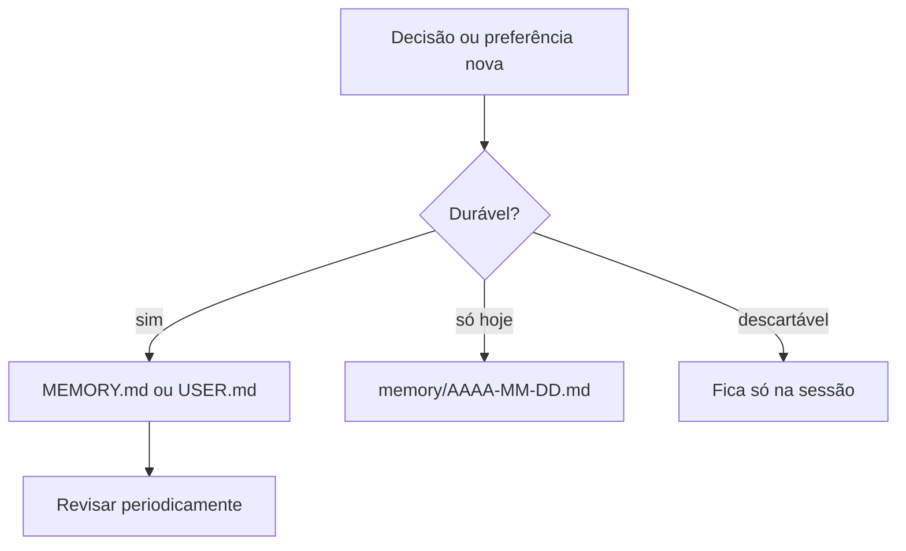

# Boas práticas de memória e janela de contexto

## Objetivo

Reunir hábitos que mantêm o agente útil, barato e previsível ao longo de semanas de uso.

## Explicação

Princípios derivados das páginas de memória, compactação e custos:

1. **Se importa, está em arquivo.** O modelo só lembra o que foi salvo em disco. Peça ao agente, ou escreva você mesmo, as decisões e preferências duráveis no `MEMORY.md` e no `USER.md`.
2. **Memória curada, não despejada.** `USER.md` para preferências estáveis (como diretivas), `MEMORY.md` para fatos e decisões, notas diárias para o fluxo do dia. Se o `MEMORY.md` estourar o orçamento, a cópia injetada é truncada.
3. **Sessões com propósito.** Use `/new` ao trocar de assunto: contexto limpo é mais barato e menos confuso. O `/new` carrega hoje e ontem das notas diárias.
4. **Compacte cedo, não tarde.** Compactar perto do limite perde detalhes; antes de tarefas longas, rode `/compact` e confirme a ocupação com `/status`.
5. **Separe contextos.** Um agente para trabalho e outro pessoal, cada um com workspace e memória próprios ([[Roteamento multiagente e bindings]]).
6. **Revise a memória.** Leia seus arquivos de vez em quando: remova o desatualizado, o errado e o sensível.
7. **Backup do workspace.** A documentação do workspace indica backup em Git **privado**, sem commitar segredos.
8. **Meça.** `/context detail` e `/usage tokens` mostram para onde vai o orçamento.



**Checklist rápido:**

```markdown
- [ ] MEMORY.md e USER.md cabem no orçamento (/context list)
- [ ] Nenhum segredo nos arquivos de memória
- [ ] /new ao mudar de assunto; /compact antes de tarefas longas
- [ ] Backup privado do workspace
- [ ] Revisão mensal do que o agente "sabe" sobre mim
```

## Exemplo prático

Peça ao agente, ao final de uma tarefa importante:

```markdown
Registre em memória, em no máximo 5 linhas, a decisão que tomamos e o motivo.
```

Depois abra o arquivo, corrija o que estiver impreciso e confirme que não há dados sensíveis.

## Armadilhas comuns

- Confiar que "o agente lembra" de conversas antigas sem registro.
- Deixar o agente escrever livremente na memória a partir de conteúdo da web ou de e-mails, sem revisão.
- Manter uma sessão única e gigantesca por semanas.

## Resumo

- Salve o que importa em arquivo; mantenha a memória curta e revisada.
- `/new`, `/compact` e `/context` são as ferramentas de higiene.
- Separe contextos por agente e faça backup privado.

## Relacionados

- [[Arquivos de memória em Markdown]]
- [[Poda de sessão e compactação]]
- [[Orçamento de bootstrap e tamanho do contexto]]
- [[Roteamento multiagente e bindings]]
- [[Memória como superfície de ataque e privacidade]]

## Exercícios

1. Por que registrar decisões em arquivo e não confiar na conversa?
2. Quando usar `/new` e quando usar `/compact`?
3. Que cuidado ter com conteúdo da web gravado na memória?
4. Monte o seu checklist mensal de revisão da memória.
