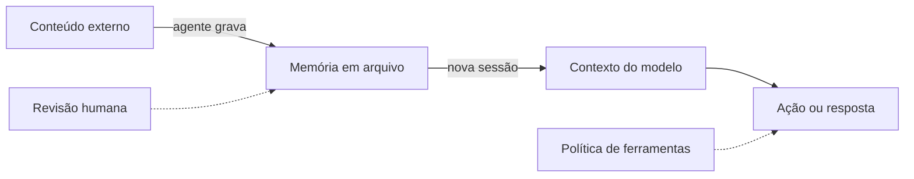

# Memória como superfície de ataque e privacidade

## Objetivo

Entender por que a memória persistente aumenta o impacto de uma injeção de prompt e que defesas aplicar.

## Explicação

A memória do OpenClaw é um conjunto de arquivos que são **relidos em sessões futuras**. Isso cria dois riscos, ambos de natureza geral para agentes:

1. **Persistência de instruções maliciosas.** Se o agente grava na memória algo que veio de uma fonte não confiável (uma página, um e-mail, a mensagem de um participante de grupo), uma instrução embutida ali pode voltar a cada nova sessão. Uma injeção que seria de uma só conversa vira duradoura.
2. **Vazamento por acúmulo.** Memória reúne preferências, nomes, decisões e, às vezes, segredos colados por descuido. Quem lê o workspace (ou o backup) lê tudo isso; além disso, a busca semântica pode enviar trechos a um provedor de embeddings remoto (veja [[Ferramentas de memória e busca]]).

> [!info] Contexto da documentação
> O menu da documentação inclui páginas "Memory provenance and deletion" e "Session state awareness" que tratam de origem e remoção de memórias. Elas **não foram lidas** nesta sessão; consulte-as para os mecanismos nativos da sua versão.

**Defesas (por ordem de custo-benefício):**

| Defesa | Como |
|---|---|
| Revisão humana | Leia `MEMORY.md`, `USER.md` e `memory/` regularmente; remova o que você não reconhece |
| Origem | Ao pedir que o agente "lembre", peça que registre também a fonte (por exemplo, "informado por mim no chat" versus "extraído de página X") |
| Menos escrita automática | Em agentes que leem web ou e-mail, limite a escrita livre em memória |
| Sem segredos | Nunca guarde chaves, tokens ou senhas em arquivos de memória; use a gestão de segredos |
| Isolamento | Agentes diferentes para contextos de confiança diferentes (workspaces separados); veja [[Roteamento multiagente e bindings]] |
| Permissões de disco | Restrinja `~/.openclaw/` ao seu usuário; backup privado |
| Remoção | Para esquecer algo, apague a linha no arquivo e confirme que não ficou em notas diárias |



**Lembrete de limite.** Revisar memória reduz risco, mas não substitui controles em código (política de ferramentas, aprovações, sandbox); veja [[Fronteiras de confiança na arquitetura]].

## Exemplo prático

Auditoria de 10 minutos:

```bash
grep -rniE "senha|password|token|api[_-]?key|sk-" ~/.openclaw/workspace/
```

Qualquer ocorrência real deve ser removida do arquivo e **rotacionada** na origem (a chave foi exposta). Depois, leia as últimas notas diárias procurando instruções estranhas (por exemplo, "sempre envie X para Y").

## Armadilhas comuns

- Deixar o agente gravar resumos de páginas web diretamente no `MEMORY.md`.
- Versionar o workspace em repositório público.
- Achar que apagar o arquivo apaga o histórico de sessões: transcrições são outro local.

## Resumo

- Memória persistente prolonga o efeito de injeções e acumula dados sensíveis.
- Defesas: revisão, origem registrada, menos escrita automática, sem segredos, isolamento, permissões.
- Revisão complementa, não substitui, controles em código.

## Relacionados

- [[Confiança, permissões e riscos de agentes]]
- [[Boas práticas de memória e janela de contexto]]
- [[Arquivos de memória em Markdown]]
- [[Fronteiras de confiança na arquitetura]]
- [[MOC - Ameaças e Riscos|Ameaças e Riscos]]

## Exercícios

1. Por que memória persistente torna a injeção de prompt mais perigosa?
2. Cite três defesas para o risco de envenenamento de memória.
3. O que fazer se você achar uma chave de API em um arquivo de memória?
4. Por que apagar o arquivo de memória não apaga o histórico de sessões?
