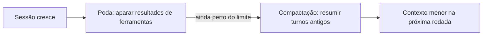

# Poda de sessão e compactação

## Objetivo

Distinguir os dois mecanismos que mantêm a sessão dentro da janela de contexto: compactação (resumir) e poda (aparar resultados de ferramentas).

## Explicação

### Compactação

O OpenClaw compacta a conversa **quando ela se aproxima da janela de contexto do modelo**. Turnos antigos são resumidos em uma entrada compacta salva na transcrição, e as mensagens recentes ficam intactas. Detalhes da página:

- **Segurança de chamadas**: ao escolher onde cortar, cada chamada de ferramenta do assistente fica junto do seu resultado; se o corte cair no meio de um bloco, a fronteira é movida.
- **Entrada do resumidor**: cerca de **40.000 tokens** (160.000 caracteres) por requisição, ou menos se a janela do resumidor for menor. Dentro desse teto, as mensagens mais novas ficam literais, as mensagens antigas do usuário (pedidos, decisões, correções) ganham um quarto do orçamento, e o restante vem das mais antigas e de amostras espaçadas. Lacunas são marcadas com o número de mensagens omitidas.
- **Requisições extras**: um turno dividido adiciona uma requisição, e cada tentativa corretiva após uma auditoria de qualidade reprovada adiciona outra.
- **Histórico completo preservado**: a transcrição inteira fica em disco; a compactação só muda o que o modelo vê no próximo turno.
- Resumos cortados pelo limite de saída são rejeitados.
- Para sessões diretas com chave de API da OpenAI, o endpoint `/responses/compact` pode devolver mensagens retidas mais um checkpoint criptografado, que o OpenClaw mantém entre requisições e reinícios.

O comando `/compact` pede a compactação manual.

### Poda de sessão

A poda **remove resultados antigos de ferramentas** (saída de `exec`, leituras de arquivo, buscas) do contexto do modelo. O texto normal da conversa **não é reescrito**, e o histórico completo é preservado.

```json5
{
  agents: {
    defaults: {
      contextPruning: { mode: "cache-ttl" },
    },
  },
}
```

No modo `cache-ttl`: em requisições diretas com chave de API da Anthropic, a poda é delegada à limpeza de resultados de ferramentas no servidor (mantém os **três usos de ferramenta mais recentes**; o `ttl` não se aplica nesse caminho); em outras rotas elegíveis, a poda roda localmente depois que o TTL do cache expira. A visão podada fica em memória e registrada em um marcador oculto `openclaw.cache-ttl` na transcrição, restaurável após reinício; as entradas originais não são alteradas.

| | Compactação | Poda |
|---|---|---|
| O que faz | Resume histórico antigo | Remove resultados antigos de ferramentas |
| Altera texto da conversa | Sim (por resumo) | Não |
| Gatilho | Perto do limite da janela | Cache-TTL expirado (modo `cache-ttl`) |
| Histórico em disco | Preservado | Preservado |



> [!warning] Partes não lidas
> As páginas foram truncadas: as chaves de `agents.defaults.compaction` (incluindo o "memory flush" antes da compactação, visto só em uma cópia antiga) e outras chaves da poda, como o TTL, **não foram confirmadas**. Consulte as páginas "Compaction" e "Session pruning".

## Exemplo prático

```markdown
/status
/compact
/status
```

Compare a ocupação da janela antes e depois. Para investigar o que foi resumido, abra a transcrição em disco: o original continua lá.

## Armadilhas comuns

- Achar que compactar apaga o histórico: ele permanece em disco.
- Confiar que um detalhe importante sobreviverá ao resumo: grave decisões em arquivo de memória (veja [[Arquivos de memória em Markdown]]).
- Ligar a poda sem entender que ela só afeta resultados de ferramentas.

## Resumo

- Compactação resume turnos antigos perto do limite; poda apara resultados de ferramentas.
- Ambas preservam o histórico completo em disco.
- Modo de poda confirmado: `agents.defaults.contextPruning.mode: "cache-ttl"`.
- Decisões importantes devem ir para a memória em arquivo.

## Relacionados

- [[Montagem de contexto e o comando context]]
- [[Orçamento de bootstrap e tamanho do contexto]]
- [[Custo e escolha de modelo]]
- [[Arquivos de memória em Markdown]]

## Exercícios

1. Qual a diferença entre compactação e poda?
2. O que acontece com o histórico original após a compactação?
3. Como a compactação evita separar uma chamada de ferramenta do seu resultado?
4. Que chave liga a poda por TTL de cache?
