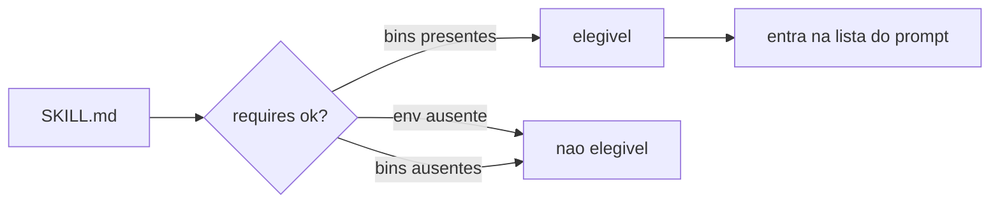

# Anatomia do SKILL.md e requisitos de elegibilidade

## Objetivo

Conhecer cada parte de um `SKILL.md`, os campos de frontmatter confirmados na documentação do ClawHub e como os *requisitos* decidem se uma skill fica elegível.

## Explicação

O formato de skill do ClawHub exige um arquivo `SKILL.md` (também aceito `skill.md`; o legado `skills.md` ainda funciona). Arquivos de apoio comuns são opcionais, e há um `.clawhubignore` (legado `.clawdhubignore`) para padrões ignorados na publicação; o `.gitignore` também é respeitado.

### Campos de frontmatter confirmados

| Campo | Função |
|---|---|
| `name` | Nome da skill; para skills portáveis deve casar com o diretório e usar 1 a 64 letras minúsculas, números ou hífens |
| `description` | Resumo curto, usado pela interface e pela busca (ideal em uma linha, abaixo de 160 caracteres) |
| `version` | Versão da skill |
| `metadata.openclaw` | Requisitos de execução (aliases `metadata.clawdbot` e `metadata.clawdis` também funcionam) |

Dentro de `metadata.openclaw`:

| Chave | Significado |
|---|---|
| `requires.env` | Variáveis de ambiente que precisam existir |
| `requires.bins` | Binários de CLI que precisam estar **todos** instalados |
| `requires.anyBins` | Binários dos quais **pelo menos um** deve existir |
| `requires.config` | Caminhos de configuração que a skill lê |
| `primaryEnv` | Variável principal de credencial |
| `envVars` | Metadados por variável, inclusive opcionais com `required: false` |

> [!warning] Limites e tipos de arquivo
> Os limites de tamanho e os tipos de arquivo permitidos ficam em seções que a leitura não alcançou (a página truncou). Antes de publicar, consulte `docs.openclaw.ai/clawhub/skill-format`. Chaves adicionais como instaladores (`install`) aparecem no índice da página `tools/skills`, mas **não foram confirmadas** aqui.

## Exemplo prático

Uma skill hipotética que depende do binário `jq` e de uma chave de API:

```markdown
---
name: relatorio-clima
description: Consulta a previsão do tempo e resume em tres linhas.
version: 0.1.0
metadata:
  openclaw:
    requires:
      bins: [curl, jq]
      env: [WEATHER_API_KEY]
    primaryEnv: WEATHER_API_KEY
---

# Relatorio de clima

Quando o usuario pedir a previsao do tempo:
1. Use a ferramenta `exec` para chamar a API com curl.
2. Filtre o JSON com jq.
3. Responda em no maximo tres linhas, sem inventar dados.
```

Se `jq` não estiver instalado, a skill aparece como não elegível; `openclaw skills check` mostra inventário, prontidão e visibilidade (veja [[A CLI openclaw skills]]).



## Armadilhas comuns

- Nome do diretório diferente de `name`: quebra a portabilidade.
- Descrição longa demais: infla o prompt e piora a escolha da skill.
- Colocar segredo no corpo do `SKILL.md`: o texto vai para o contexto do modelo. Use `env` e referências de segredo (veja [[Configuração de skills em openclaw.json]]).
- Pedir ao agente "instale o que faltar" dentro da skill sem passar por aprovação de execução (veja [[Aprovações de exec e allowlists]]).

## Resumo

- `name`, `description`, `version` e `metadata.openclaw` são os campos confirmados.
- `requires.bins`, `requires.anyBins`, `requires.env` e `requires.config` decidem a elegibilidade.
- Limites de publicação: verificar na doc.

## Relacionados

- [[O que são skills e como o OpenClaw as carrega]]
- [[Configuração de skills em openclaw.json]]
- [[Criar a primeira skill - hello-world]]
- [[ClawHub - publicar, versões e verificação]]
- [[A CLI openclaw skills]]

## Exercícios

1. Qual a diferença entre `requires.bins` e `requires.anyBins`?
2. Que alias de `metadata.openclaw` a documentação aceita?
3. Por que nunca se deve colocar uma chave de API no corpo do `SKILL.md`?
4. O que acontece com uma skill cujo binário exigido não está instalado?
