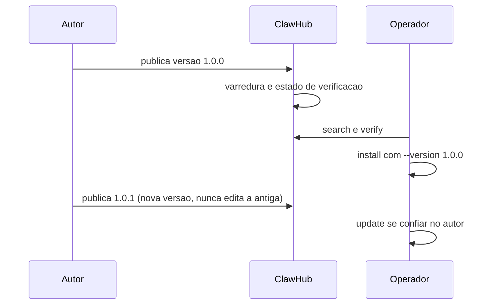

# ClawHub - publicar, versões e verificação

## Objetivo

Entender o ciclo de publicação e consumo no ClawHub: versões imutáveis, verificação de instalação e o comando de publicação que já foi usado como referência nesta série.

## Explicação

O ClawHub é o registro público de skills e plugins (veja [[ClawHub, plugins e o ecossistema]]). Nas páginas lidas, as características confirmadas são:

- Versões são **imutáveis**: publicar de novo exige uma nova versão.
- Cada versão tem estado de **verificação/varredura** visível.
- O consumidor pode fixar versão (`--version`) e verificar (`openclaw skills verify`).
- A publicação usa a CLI separada `clawhub` (por exemplo `clawhub skill publish ./diretorio`).

> [!warning] Publicação não detalhada
> A seção "Publishing to ClawHub" da página `creating-skills` foi truncada na leitura. O comando `clawhub skill publish ./dir` aparece em material anterior desta série; flags, login e metadados exigidos **não foram confirmados**. Rode `clawhub --help` e leia a doc antes de publicar.

### Ciclo de vida



## Exemplo prático

Checklist de publicação:

```bash
# 1. confira o conteudo
ls skills/minha-skill
cat skills/minha-skill/.clawhubignore
# 2. teste localmente
openclaw skills install ./skills/minha-skill --as minha-skill
openclaw skills check
# 3. publique (confirme a sintaxe na doc antes)
clawhub skill publish ./skills/minha-skill
```

Do lado do consumidor:

```bash
openclaw skills verify @autor/minha-skill --card
openclaw skills install @autor/minha-skill --version 1.0.0
```

## Armadilhas comuns

- Incluir segredos ou arquivos locais: use `.clawhubignore`.
- Confiar em estrelas ou downloads como prova de segurança.
- Atualizar com `update --all` sem revisar o que mudou.
- Pensar que "verificado" significa "seguro": a verificação reduz risco, não o elimina.

## Resumo

- Versões imutáveis, varredura por versão, consumo com versão fixa.
- Publicação pela CLI `clawhub`; detalhes a confirmar na doc.
- Revise antes de instalar e antes de atualizar.

## Relacionados

- [[ClawHub, plugins e o ecossistema]]
- [[A CLI openclaw skills]]
- [[Anatomia do SKILL.md e requisitos de elegibilidade]]
- [[Criar a primeira skill - hello-world]]
- [[Nomes antigos, domínios falsos e como verificar a fonte]]

## Exercícios

1. Por que versões imutáveis ajudam na segurança da cadeia de suprimentos?
2. Qual flag fixa a versão instalada?
3. Que arquivo evita publicar arquivos locais por engano?
4. Por que "verificado" não equivale a "seguro"?
