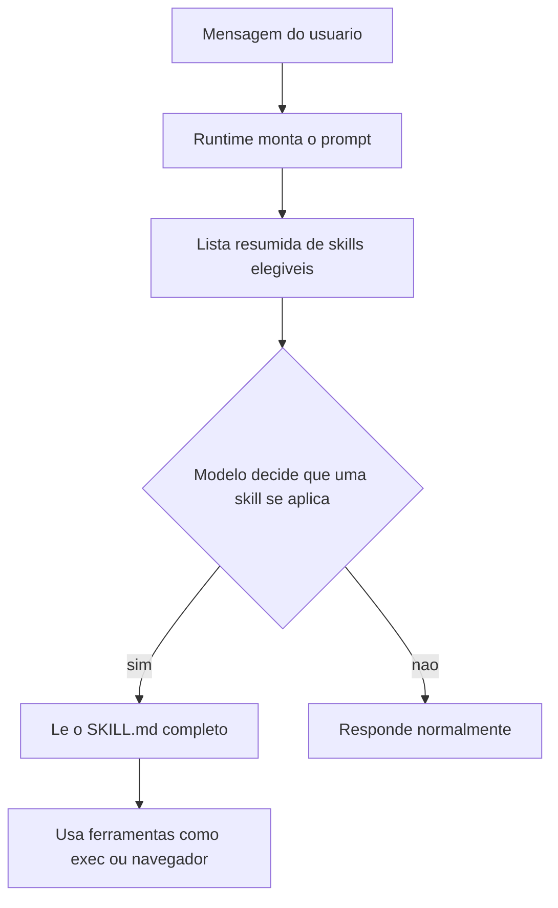

# O que são skills e como o OpenClaw as carrega

## Objetivo

Entender o que é uma *skill* no OpenClaw, onde ela mora no disco, quem vence quando duas skills têm o mesmo nome e por que skills são o jeito mais barato de ensinar algo novo ao agente.

## Explicação

Segundo a documentação oficial, skills são "arquivos de instrução em Markdown que ensinam o agente como e quando usar ferramentas". Cada skill é um **diretório com um arquivo `SKILL.md`**: um frontmatter YAML (metadados) seguido do corpo em Markdown com as instruções. Uma skill **não executa código por conta própria**; ela orienta o modelo, que então usa as ferramentas que já existem (por exemplo `exec`, navegador ou arquivos). Isso a diferencia de um plugin, que adiciona capacidades novas em código (veja [[Pontos de extensão - plugins, skills e hooks]]).

O OpenClaw carrega as skills incluídas na instalação (*bundled*) mais as suas, e **filtra no momento do carregamento** conforme ambiente, configuração e presença de binários. Uma skill que exige um binário ausente simplesmente não fica elegível.

### Onde as skills são procuradas

A tabela segue a documentação; quando o mesmo nome aparece em mais de um lugar, **vence a fonte de maior prioridade**.

| Prioridade | Fonte | Caminho |
|---|---|---|
| 1 | Skills do workspace | `<workspace>/skills` |
| 2 | Skills de agente do projeto | `<workspace>/.agents/skills` |
| 3 | Skills pessoais do agente | `~/.agents/skills` (somente estado padrão) |
| 4 | Skills gerenciadas/locais | `<state-dir>/skills` |
| 5 | Skills do Workshop | `<state-dir>/agents/<agentId>/agent/workshop-skills` |
| 6 | Bundled e Custodian | Vêm na instalação |
| 7 | Diretórios extras | `skills.load.extraDirs` e skills de plugins |



> [!info] Custo em tokens
> A página oficial lista uma seção sobre o "impacto em tokens" das skills, mas o texto lido foi truncado antes dela. Trate como regra prática: quanto mais skills elegíveis, maior a lista injetada no prompt. Confira o consumo real com `/context list` (veja [[Montagem de contexto e o comando context]]).

> [!warning] Cobertura parcial
> A página `tools/skills` tem mais de 100 mil caracteres e a leitura parou antes das seções de frontmatter, gating e allowlists por agente. Os detalhes dessas seções vêm de `clawhub/skill-format` e `tools/skills-config`, tratadas nas próximas notas.

## Exemplo prático

Para ver o que o seu agente enxerga agora:

```bash
openclaw skills list
openclaw skills list --eligible
```

A segunda forma mostra só as skills elegíveis (as que passaram pelo filtro de binários, variáveis e configuração).

## Armadilhas comuns

- Achar que skill é código: ela é texto que o modelo interpreta, então pode ser ignorada ou mal seguida.
- Criar a skill em `skills/` de outro workspace e estranhar que ela não aparece.
- Duplicar um nome de skill bundled e esquecer que a versão do workspace **sobrescreve** a original.
- Instalar skills de terceiros sem ler: o texto delas vira instrução para o agente (veja [[Confiança, permissões e riscos de agentes]]).

## Resumo

- Skill = pasta + `SKILL.md` (frontmatter + instruções).
- Carregamento em camadas, workspace primeiro.
- Filtragem por binários, ambiente e configuração.
- Não executa nada sozinha; usa as ferramentas do agente.

## Relacionados

- [[Pontos de extensão - plugins, skills e hooks]]
- [[Arquivos do workspace do agente]]
- [[Montagem do system prompt]]
- [[ClawHub, plugins e o ecossistema]]
- [[Anatomia do SKILL.md e requisitos de elegibilidade]]

## Exercícios

1. Qual a diferença essencial entre uma skill e um plugin?
2. Duas skills chamadas `resumo` existem: uma em `<workspace>/skills` e outra em `<state-dir>/skills`. Qual vence e por quê?
3. Que comando lista apenas as skills elegíveis?
4. Por que instalar muitas skills pode aumentar o custo de cada turno?
