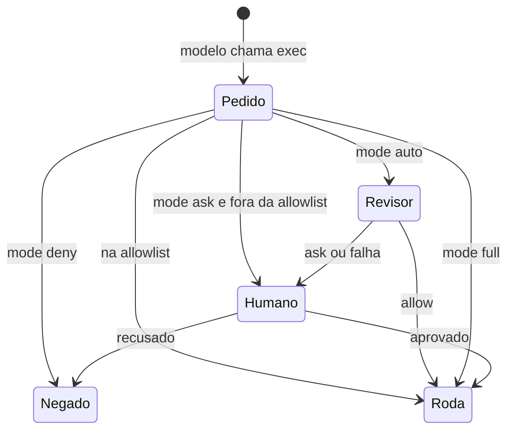

# A ferramenta exec e os modos de permissão

## Objetivo

Entender a ferramenta `exec` (rodar comandos no host) e o seletor de modo `tools.exec.mode`, que decide *como* a execução é aprovada.

## Explicação

A ferramenta `exec` executa comandos de shell. Parâmetros confirmados: `command` (obrigatório; comandos hospedados no Gateway com caractere NUL literal retornam erro antes de rodar) e `workdir` (padrão: diretório atual). `timeout`, `background` e `pty` **não foram confirmados** (a leitura truncou). Execuções no Gateway, no sandbox ou locais ao worker suportam primeiro e segundo plano via ferramenta `process`; `host=node` roda de forma síncrona via `system.run` e nunca cria sessão de `process`.

### Modos de permissão (`tools.exec.mode`)

| Modo | Comportamento |
|---|---|
| `deny` | Bloqueia exec no host |
| `allowlist` | Roda só o que está na allowlist; nega o resto em silêncio |
| `ask` | Roda o que está na allowlist e **pergunta a um humano** nos demais |
| `auto` | Allowlist + um revisor automático que devolve `allow`, `deny` ou `ask` |
| `full` | Roda sem prompts de política |

No modo `auto`, um `allow` libera uma execução de risco baixo ou médio; falhas do revisor e veredictos `ask` vão para um humano, e **três negações consecutivas** no gateway escalam para um humano. Invólucros de shell de login/interativos pulam o revisor e exigem aprovação humana. A doc recomenda `auto` para agentes de código que precisam de acesso útil sem prompt a cada miss.

Separação importante: `tools.exec.host` escolhe **onde** o comando roda; `tools.exec.mode` escolhe **como** é aprovado.

## Exemplo prático

```bash
openclaw config set tools.exec.mode ask
openclaw gateway restart
openclaw exec-policy show
openclaw approvals get
```

`exec-policy show` e `approvals get` mostram a política pedida, a origem e o resultado efetivo, o que confirma que a mudança pegou onde você esperava.



> [!danger] Modo full
> `full` remove os prompts ordinários. Num agente que lê e-mails, páginas ou mensagens de terceiros, qualquer injeção indireta passa a ter um shell (veja [[Confiança, permissões e riscos de agentes]]).

> [!warning] Padrão não confirmado
> O modo padrão exato e a relação com sandbox ficaram na parte truncada da página. Verifique com `openclaw exec-policy show` na sua instalação.

## Armadilhas comuns

- Mudar o modo e não reiniciar o Gateway.
- Confundir `host` com `mode`.
- Usar `full` por conveniência em canais abertos.
- Supor que o modo `auto` é infalível: é um revisor, não um limite de segurança.

## Resumo

- `exec` roda comandos; `tools.exec.mode` define a aprovação.
- Cinco modos: `deny`, `allowlist`, `ask`, `auto`, `full`.
- Confirme sempre com `exec-policy show`.

## Relacionados

- [[Perfis e política de ferramentas]]
- [[Aprovações de exec e allowlists]]
- [[Confiança, permissões e riscos de agentes]]
- [[Fronteiras de confiança na arquitetura]]
- [[Visão geral das ferramentas do agente]]

## Exercícios

1. Que diferença há entre `tools.exec.host` e `tools.exec.mode`?
2. O que acontece com um comando fora da allowlist nos modos `allowlist` e `ask`?
3. Quando o modo `auto` escala para um humano?
4. Que comandos confirmam a política efetiva?
