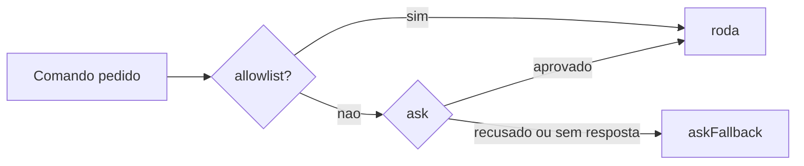

# Aprovações de exec e allowlists

## Objetivo

Entender a camada de aprovações de execução: onde atua, como se combina com `tools.exec.*` e o que ela **não** garante.

## Explicação

As aprovações de exec são uma proteção no **host de execução**: o Gateway (processo `openclaw`) ou um host de node (veja [[Gateway, clientes e nodes]]). Valem por cima da política de ferramentas e do modo elevado. A regra da doc: "comandos só rodam quando política + allowlist + (opcionalmente) aprovação do usuário concordam".

### Modelo de confiança

- Quem se autentica no Gateway é tratado como operador confiável; nodes pareados estendem essa confiança ao host do node.
- Aprovações reduzem o risco de execução **acidental**. Não são fronteira de autenticação por usuário nem política de sistema de arquivos somente leitura.
- Em runs aprovados num node, ficam amarrados o cwd, o `argv` exato, o ambiente (se houver) e o executável fixado.

### Precedência

- A política efetiva é a **mais restritiva** entre `tools.exec.*` e os padrões de aprovação: aprovações podem endurecer, nunca afrouxar.
- Campo omitido nas aprovações usa o valor de `tools.exec`.
- Um `ask: "always"` local ao host mantém o prompt mesmo que a sessão peça `on-miss`.
- Em nodes, a política do destino é checada antes do despacho.

### Chaves citadas na página

| Chave | Observação |
|---|---|
| `tools.exec.mode` | Seletor de modo |
| `exec.security` e `exec.ask` | Valores subjacentes (os modos mapeiam para eles) |
| `askFallback` | Comportamento quando não há quem aprove |
| `tools.exec.strictInlineEval` | Endurece avaliação inline |
| `tools.exec.commandHighlighting` | Destaque de comandos no prompt |

> [!warning] Detalhes não lidos
> Formato do arquivo de aprovações, local de armazenamento, sintaxe da allowlist (incluindo `argPattern` para restringir argumentos) e concessões permanentes para automações aparecem apenas como títulos. Leia `tools/exec-approvals.md` antes de escrever regras. Nenhum formato de arquivo foi inventado aqui.

## Exemplo prático

Verificação de rotina, sem editar nenhum arquivo à mão:

```bash
openclaw approvals get
openclaw exec-policy show
openclaw security audit
```

Boa prática de allowlist (conceitual): permitir comandos de leitura e específicos (`git status`, `ls`), negar interpretadores genéricos (`bash -c`, `python -c`) e shells de login, porque contornam qualquer lista de nomes.



## Armadilhas comuns

- Allowlistar `bash`, `sh` ou `python`: vira "permitir tudo".
- Tratar aprovações como separação entre usuários: não são.
- Aprovar por reflexo no celular sem ler o comando completo.
- Esquecer o `askFallback` em execuções sem humano (automações).

## Resumo

- Camada no host de execução, acima da política de ferramentas.
- Só endurece, nunca afrouxa.
- Reduz acidentes; não substitui sandbox nem isolamento.

## Relacionados

- [[A ferramenta exec e os modos de permissão]]
- [[Gateway, clientes e nodes]]
- [[Fronteiras de confiança na arquitetura]]
- [[Confiança, permissões e riscos de agentes]]
- [[Perfis e política de ferramentas]]

## Exercícios

1. Por que aprovações "nunca afrouxam" a política?
2. O que fica amarrado numa execução aprovada em um node?
3. Por que allowlistar `bash` é um erro?
4. O que `askFallback` decide?
