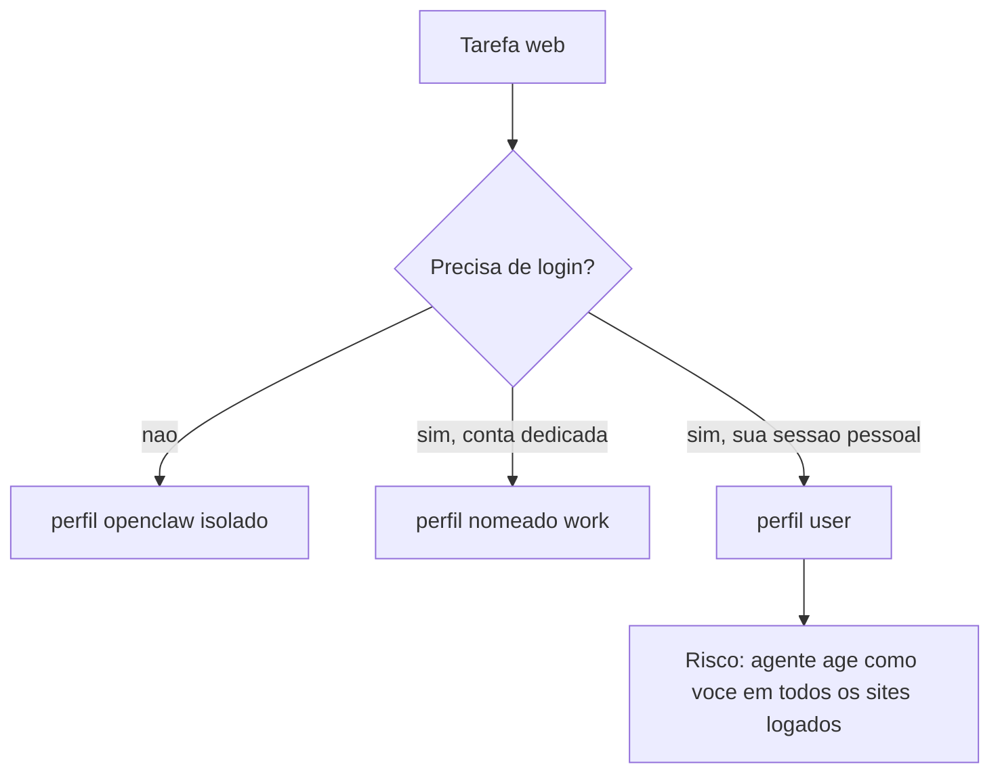

# Navegador gerenciado pelo agente

## Objetivo

Entender o navegador que o agente controla, a diferença entre o perfil isolado e o perfil que anexa à sua sessão real, e os riscos de cada um.

## Explicação

A ferramenta de navegador usa um perfil dedicado de Chrome, Brave, Edge ou Chromium, controlado por um pequeno serviço local dentro do Gateway, **ligado apenas ao loopback** e isolado do seu navegador pessoal. É um navegador "só do agente", não o seu de uso diário.

| Perfil | O que é |
|---|---|
| `openclaw` | Perfil gerenciado padrão; nunca toca no seu perfil pessoal |
| `user` | Perfil embutido que **anexa à sua sessão real do Chrome**, já logada, via Chrome DevTools MCP |
| nomeados (`work`, `remote`) | Perfis extras opcionais |

Capacidades: controle de abas (listar, abrir, focar, fechar), ações (clicar, digitar, arrastar, selecionar), snapshots, screenshots, PDFs, perguntas sobre o texto legível da página sem devolver snapshot completo, e downloads salvos no diretório gerenciado com metadados `{ url, suggestedFilename, path }`. Com o plugin de navegador ligado há uma skill bundled `browser-automation`.

> [!warning] Chaves e comandos não confirmados
> A página lida é um índice: não confirma `browser.enabled`, modo headless nem comandos `openclaw browser`. Setup, configuração e argumentos ficam em páginas filhas (Browser setup, Browser configuration, Browser agent tools). Consulte-as antes de escrever configuração.

## Exemplo prático

Regra de decisão para escolher o perfil:

```text
Tarefa so le paginas publicas?        -> perfil openclaw
Precisa logar em um servico?          -> perfil openclaw + login manual unico
Precisa da sua sessao ja logada?      -> perfil user (maior risco)
```



## Armadilhas comuns

- Anexar o perfil `user` e deixar o agente ler páginas arbitrárias: uma injeção numa página pode agir com seus cookies (veja [[Confiança, permissões e riscos de agentes]]).
- Copiar cookies do sistema para o perfil gerenciado sem necessidade (existe no macOS, de forma explícita).
- Esquecer que downloads vão para um diretório gerenciado que também precisa de higiene.
- Expor o serviço de controle fora do loopback.

## Resumo

- Perfil `openclaw` isolado por padrão; `user` anexa à sessão real.
- Controle local, só no loopback.
- Prefira contas dedicadas a sessões pessoais.

## Relacionados

- [[Visão geral das ferramentas do agente]]
- [[Perfis e política de ferramentas]]
- [[Fronteiras de confiança na arquitetura]]
- [[Memória como superfície de ataque e privacidade]]
- [[Confiança, permissões e riscos de agentes]]

## Exercícios

1. Qual a diferença entre os perfis `openclaw` e `user`?
2. Por que o serviço de controle do navegador fica no loopback?
3. Qual o maior risco de usar o perfil `user`?
4. Quais informações sobre `browser.*` não foram confirmadas nesta nota?
