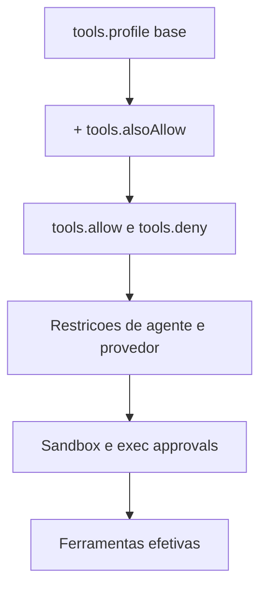

# Perfis e política de ferramentas

## Objetivo

Aplicar o princípio do menor privilégio às ferramentas: escolher um perfil base e refinar com `allow` e `deny`.

## Explicação

Segundo a página `tool-policy`, `tools.profile` define uma **lista base** aplicada antes de `tools.allow` e `tools.deny`.

| Perfil | Conteúdo (resumo da doc) |
|---|---|
| `minimal` | `session_status` e `gateway` (apenas manutenção) |
| `coding` | `group:fs`, `group:runtime`, `group:web`, `group:sessions`, `group:memory`, mais `cron`, `ask_user`, `progress_card`, ferramentas de goal e de geração de mídia |
| `messaging` | `group:messaging`, ferramentas de sessão e conversa, `subagents`, `session_status`, `gateway` (manutenção), `ask_user` |
| `full` | Sem filtragem de ferramentas core; também seleciona ferramentas opcionais de plugins |

Detalhes importantes:

- `coding` e `messaging` incluem a ferramenta de tema e permitem implicitamente `bundle-mcp`.
- `tts` não está em nenhum perfil restrito: use `tools.alsoAllow`.
- Perfil não definido deixa as ferramentas core sem filtro, mas não habilita ferramentas opcionais de plugins.
- O onboarding local define `full` quando não há perfil; configurações existentes não são migradas.
- Escolher `full` **não concede** permissão de execução total: isso é controlado à parte (veja [[A ferramenta exec e os modos de permissão]]).
- Restrições globais, de agente, de provedor, de proprietário, de sistema de arquivos, de sandbox e de execução continuam valendo por cima.

> [!warning] Sintaxe de allow e deny
> O texto lido não descreveu a sintaxe detalhada de `tools.allow` e `tools.deny`, nem `tools.byProvider`, `tools.toolsBySender` e `tools.elevated` (só aparecem no índice). O exemplo abaixo é **ilustrativo**: valide com `openclaw config validate` e `openclaw config schema`.

## Exemplo prático

Um agente de mensagens que não deve tocar em shell nem arquivos:

```json5
{
  tools: {
    profile: "messaging",
    deny: ["group:runtime", "group:fs"],   // ilustrativo; confirme na doc
    alsoAllow: ["tts"],
  },
}
```

```bash
openclaw config validate
openclaw gateway restart
```



## Armadilhas comuns

- Deixar o perfil `full` do onboarding em um agente exposto a grupos (veja [[Grupos - menção obrigatória e groupPolicy]]).
- Achar que `deny` no prompt substitui política: política em código vale mais que instrução em texto.
- Esquecer que MCP passa pela mesma política (veja [[MCP - conectar servidores externos]]).
- Pensar que `full` libera exec sem aprovação.

## Resumo

- Perfil base + `alsoAllow`/`allow`/`deny`.
- `minimal`, `coding`, `messaging`, `full`.
- Menor privilégio: comece restrito e abra o necessário.

## Relacionados

- [[Visão geral das ferramentas do agente]]
- [[Allowlists e política de ferramentas por chat]]
- [[A ferramenta exec e os modos de permissão]]
- [[Roteamento multiagente e bindings]]
- [[MCP - conectar servidores externos]]

## Exercícios

1. O que o perfil `messaging` inclui que `minimal` não inclui?
2. Escolher `full` libera execução de comandos sem aprovação? Justifique.
3. Como habilitar `tts` em um agente com perfil `coding`?
4. Por que perfil e política de ferramentas ficam acima do que se escreve no prompt?
