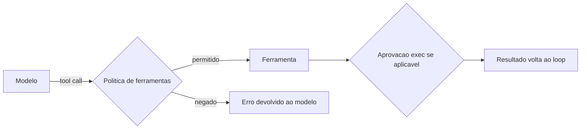

# Visão geral das ferramentas do agente

## Objetivo

Ter um mapa das ferramentas que o agente pode chamar, entender que *ferramenta* é diferente de *skill* e saber onde a política que liga e desliga cada uma é definida.

## Explicação

No loop do agente (veja [[Anatomia do loop do agente no OpenClaw]]), o modelo decide chamar ferramentas via *tool calling* (conceito geral em [[Uso de ferramentas e tool calling]]). O OpenClaw expõe um catálogo amplo. A página `tools` é majoritariamente navegação; as categorias abaixo vêm da barra lateral e **não são uma lista completa**.

| Categoria | Exemplos citados |
|---|---|
| Execução de código e aprovações | `apply_patch`, Code execution, Elevated mode, Exec tool, Exec approvals, Permission modes, Secrets |
| Mídia e documentos | geração de imagem, música e vídeo, PDF, TTS |
| Catálogos e fluxos | Code Mode, Auto Review, LLM task, Lobster, conectar servidores MCP, Tool Search |
| Contexto e raciocínio | detecção de loops de ferramenta, níveis de thinking, Tokenjuice |
| Chat e UI | Ask user, BTW, Progress card, Reactions, Show widget |
| Web | Browser, Firecrawl, Web fetch, Web search (Brave, DuckDuckGo, Exa, Gemini, Tavily e outros) |
| Coordenação | Agent send, Goal, Steer, Sub-agents, Swarm, ACP agents |

A política (perfis, `allow`, `deny`, grupos) está documentada em "Tools and custom providers" (`gateway/config-tools`), e não na página de visão geral.



> [!info] Skills versus ferramentas
> Skill é texto que ensina *quando* usar uma ferramenta. Ferramenta é a capacidade em si. Remover uma ferramenta da política torna inútil qualquer skill que dependa dela.

## Exemplo prático

Perguntar ao agente quais ferramentas ele tem não prova nada: ele pode alucinar. Prefira ver o contexto real:

```text
/context list
/context detail
```

O primeiro lista o que entra no prompt, incluindo os esquemas de ferramentas (veja [[Montagem de contexto e o comando context]]).

## Armadilhas comuns

- Presumir que uma ferramenta existe porque o agente a citou.
- Liberar o perfil `full` "só para testar" e deixá-lo em produção.
- Esquecer que o esquema de cada ferramenta ocupa tokens do contexto.
- Misturar política de ferramentas (o que existe) com aprovação de exec (o que roda).

## Resumo

- Catálogo grande, agrupado por finalidade.
- Política vive em `gateway/config-tools`.
- Ferramenta ≠ skill; ambas pesam no contexto.

## Relacionados

- [[Uso de ferramentas e tool calling]]
- [[Perfis e política de ferramentas]]
- [[A ferramenta exec e os modos de permissão]]
- [[MCP - conectar servidores externos]]
- [[Montagem de contexto e o comando context]]

## Exercícios

1. Qual a diferença entre uma ferramenta e uma skill?
2. Onde a política de ferramentas é documentada?
3. Que comando mostra o que realmente entra no contexto?
4. Cite duas categorias de ferramentas e um exemplo de cada.
