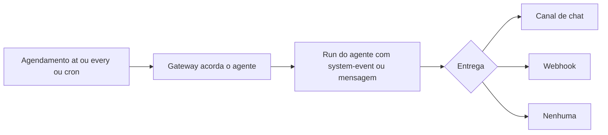

# Automações e cron - agendar tarefas do agente

## Objetivo

Criar e inspecionar tarefas agendadas no agendador interno do OpenClaw, escolhendo o tipo de agendamento correto e entendendo fuso horário e escalonamento.

## Explicação

As **automações** são o agendador embutido: persistem os jobs, acordam o agente na hora marcada e podem entregar a saída para um canal de chat, um webhook ou lugar nenhum. A CLI é `openclaw automations`; **`openclaw cron` é um alias** dos mesmos comandos.

### Tipos de agendamento

| Tipo | Flag | Exemplo |
|---|---|---|
| Uma vez (`at`) | `--at` | ISO 8601 ou relativo como `20m` |
| Intervalo (`every`) | `--every` | `10m`, `1h`, `1d` |
| Cron (`cron`) | `--cron` (+ `--tz`) | expressão de 5 ou 6 campos |
| Ao sair (`on-exit`) | `--on-exit` | dispara quando um comando observado termina |
| Stream | `--stream-command` | dispara a partir de saída em lote de um comando supervisionado |

### Fuso horário e escalonamento

- Timestamps sem offset são tratados como **UTC**.
- `--tz America/Sao_Paulo` (qualquer zona IANA) vale para `--at` sem offset e para expressões cron.
- Cron sem `--tz` usa o fuso do host do Gateway.
- `--tz` não é válido com `--every` nem `--on-exit`.
- Expressões recorrentes "no topo da hora" são escalonadas em até 5 minutos; `--exact` força precisão e `--stagger 30s` define janela explícita (só cron).

> [!warning] Subcomandos e destino
> Foram confirmados `create`, `list`, `get`, `show`, `runs` e `edit`. A existência de `run` e `remove`, as regras de alvo de sessão (`main` versus isolada), entrega e payloads estão em páginas filhas não lidas. Use `openclaw automations --help` para ver o que sua versão oferece.

## Exemplo prático

Lembrete único, exemplo da documentação (adaptado):

```bash
openclaw automations create "2027-02-01T16:00:00Z" \
  --name "Lembrete" \
  --session main \
  --system-event "Lembrete: revisar o rascunho da doc de automacoes" \
  --wake now \
  --delete-after-run

openclaw automations list
openclaw automations get <job-id>
openclaw automations runs <job-id>
```

Converter um job existente para disparar quando um script termina:

```bash
openclaw automations edit <job-id> --on-exit "./watch.sh" --on-exit-cwd /srv/app
```



## Armadilhas comuns

- Esquecer o fuso: `--at "2027-02-01T16:00:00"` sem offset é UTC, não o seu horário.
- Agendar tarefas que usam `exec` sem humano para aprovar: a execução trava ou é negada (veja [[Aprovações de exec e allowlists]]).
- Jobs a cada minuto com modelo caro: o custo escala (veja [[Custo e escolha de modelo]]).
- Gateway desligado na hora marcada: o job não roda enquanto o serviço estiver parado (veja [[O Gateway como serviço em segundo plano]]).

## Resumo

- `openclaw automations` (alias `cron`) gerencia jobs persistentes.
- `at`, `every`, `cron`, `on-exit` e `stream` cobrem os gatilhos.
- Sempre declare o fuso e planeje aprovações.

## Relacionados

- [[Sessões e chaves de sessão]]
- [[Anatomia do loop do agente no OpenClaw]]
- [[Standing orders - autoridade permanente do agente]]
- [[Hooks internos e webhooks HTTP de entrada]]
- [[O Gateway como serviço em segundo plano]]

## Exercícios

1. Qual flag define um lembrete que dispara uma só vez em 20 minutos?
2. Qual fuso vale para um `--at` sem offset e sem `--tz`?
3. Por que `--tz` não combina com `--every`?
4. O que o escalonamento automático de até 5 minutos evita?
