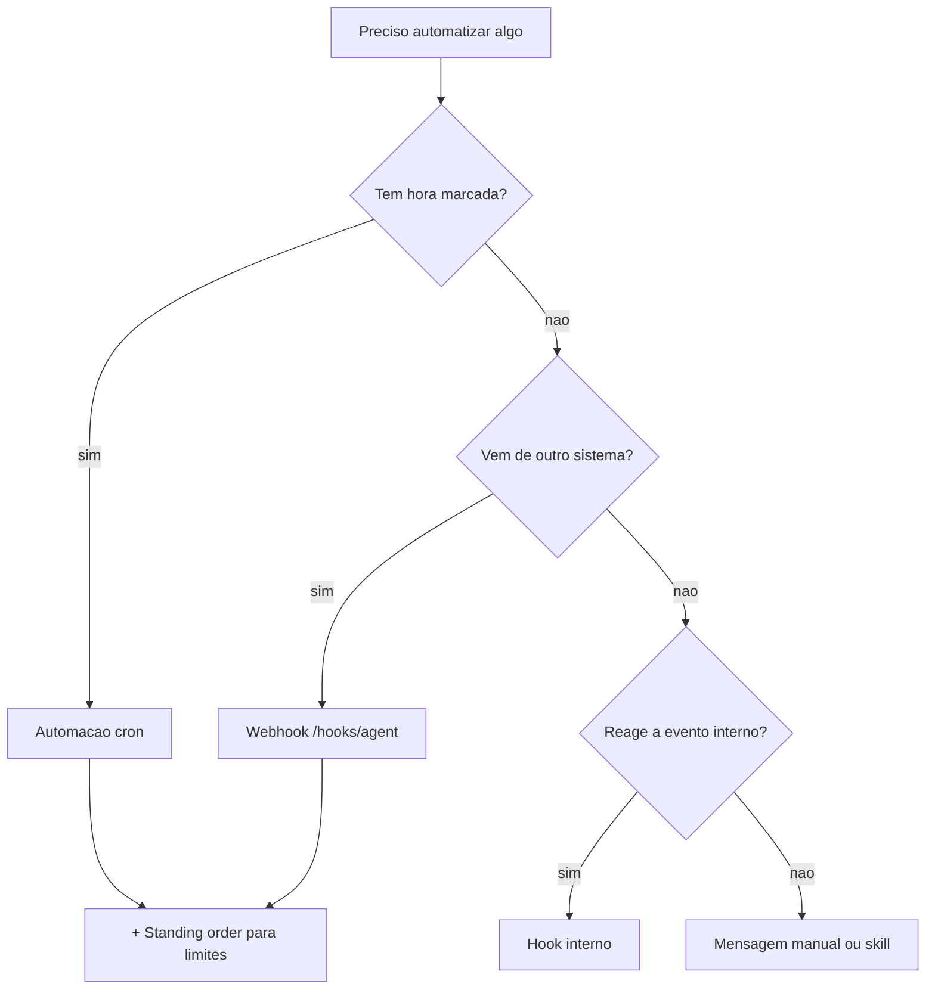

# Escolher entre cron, hooks, webhooks e standing orders

## Objetivo

Decidir qual mecanismo de automação usar para cada necessidade, combinando-os quando preciso.

## Explicação

Os quatro mecanismos respondem a perguntas diferentes:

| Mecanismo | Quem dispara | Onde roda | Melhor para |
|---|---|---|---|
| Automação (cron) | O relógio ou o fim de um comando | Gateway acorda o agente | Rotinas com hora, lembretes, relatórios |
| Hook interno | Um evento do próprio OpenClaw | Dentro do processo do Gateway | Registrar comandos, salvar contexto, efeitos curtos |
| Webhook de entrada | Serviço externo via HTTP | Gateway admite um run | CI, formulários, alertas de monitoramento |
| Standing order | Nenhum: é regra | Prompt (via `AGENTS.md`) | Definir limites e escalonamento de um programa |



### Combinações típicas

- **Cron + standing order:** relatório semanal com regras de escalonamento.
- **Webhook + aprovação:** alerta externo aciona o agente; ações destrutivas pedem aval humano (veja [[Aprovações de exec e allowlists]]).
- **Hook interno + webhook:** o hook registra, o webhook recebe; ambos sem expor tokens.

## Exemplo prático

Cenário: "avisar no Telegram se o backup noturno falhar".

1. O script de backup chama o webhook `/hooks/agent` com `deliver` apropriado quando falha.
2. Uma standing order diz: "só relate falhas; não tente reparar sem aprovação".
3. Um cron diário às 08h confirma que houve backup nas últimas 24h (verificação "dead man's switch").

```bash
openclaw hooks list
openclaw automations list
```

## Armadilhas comuns

- Usar cron quando o evento já existe (polling desnecessário gasta tokens).
- Criar hook interno para algo que um webhook resolveria sem rodar código no Gateway.
- Dar a automações o mesmo acesso de uma conversa interativa: não há humano para aprovar.
- Esquecer de listar e revisar automações antigas.

## Resumo

- Hora → cron; sistema externo → webhook; evento interno → hook; limites → standing order.
- Combine, mas mantenha o menor privilégio.
- Revise periodicamente o que está ativo.

## Relacionados

- [[Automações e cron - agendar tarefas do agente]]
- [[Hooks internos e webhooks HTTP de entrada]]
- [[Standing orders - autoridade permanente do agente]]
- [[Pontos de extensão - plugins, skills e hooks]]
- [[Aprovações de exec e allowlists]]

## Exercícios

1. Qual mecanismo usar para "toda segunda às 9h, resumir a agenda"?
2. Qual usar para reagir a um alerta de monitoramento externo?
3. Por que cron + standing order é uma combinação comum?
4. Que risco existe ao dar a uma automação acesso total a ferramentas?
