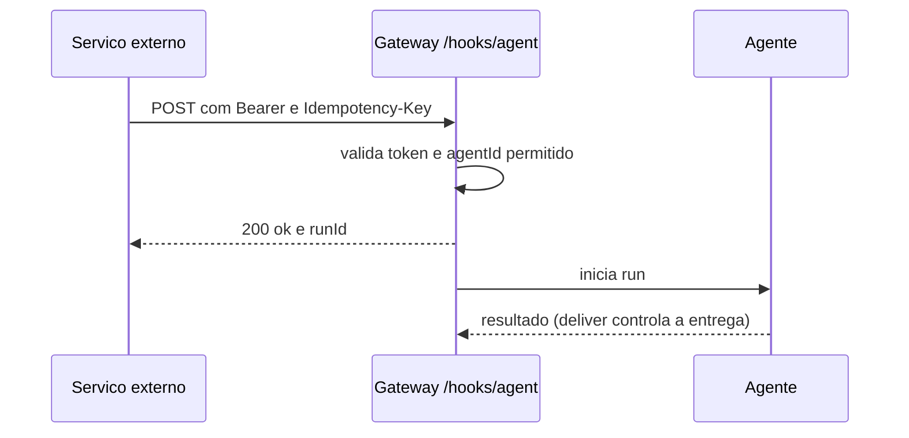

# Hooks internos e webhooks HTTP de entrada

## Objetivo

Distinguir **hooks internos** (código que roda dentro do Gateway em eventos) de **webhooks de entrada** (serviços externos acionando o agente por HTTP) e configurar ambos com o mínimo de risco.

## Explicação

A documentação separa quatro superfícies:

| Superfície | Para que serve |
|---|---|
| Hooks internos | Handlers JS/TS no processo do Gateway reagindo a eventos de sessão e mensagem |
| Hooks de plugin (`api.on(...)`) | Modificar prompts, interceptar ferramentas, controlar respostas |
| Webhooks | Outro serviço inicia trabalho via HTTP |
| Eventos de diagnóstico | Exportar telemetria sem mudar comportamento |

`hooks.internal` configura os hooks internos; `hooks.enabled` configura a **entrada HTTP**. Nomes de evento internos (`message:received`) não são os mesmos dos tipos de plugin (`message_received`).

> [!danger] Hooks internos são código confiável, sem sandbox
> Têm acesso ao sistema de arquivos, à rede e ao ambiente do processo do Gateway. Leia o código antes de ativar, sobretudo de pacotes baixados.

### Hooks internos: CLI

```bash
openclaw hooks list
openclaw hooks info command-logger
openclaw hooks enable command-logger
openclaw hooks disable command-logger
openclaw hooks check
```

`hooks check` valida requisitos, mas não prova que um handler rodou. Com recarga `hybrid` (padrão) mudanças aplicam sem reinício; com recarga `off`, reinicie. Teste do `command-logger`: envie `/new` ou `/reset` e procure uma linha JSON com `"action":"new"` em `~/.openclaw/logs/commands.log`.

### Webhooks de entrada

Desativados por padrão. Configuração confirmada:

```json5
{
  hooks: {
    enabled: true,
    token: "<token longo e aleatorio, exclusivo dos hooks>",
    path: "/hooks",
    allowedAgentIds: ["main"],
    allowRequestSessionKey: false,
  },
}
```

Use um token **exclusivo** dos hooks, nunca o token ou senha do Gateway. Depois: `openclaw config validate` e `openclaw gateway restart`.

Endpoint `/hooks/agent` (POST), cabeçalho `Authorization: Bearer <token>`; campos: `message`, `name`, `agentId`, `deliver`, `waitForCompletion`. Envie `Idempotency-Key` para reenviar com segurança. Resposta `200` com `{ "ok": true, "runId": ... }` significa **admitido**, não concluído nem entregue.

## Exemplo prático

```bash
curl -sS -X POST http://127.0.0.1:18789/hooks/agent \
  -H "Authorization: Bearer $HOOK_TOKEN" \
  -H "Idempotency-Key: build-1234" \
  -H "Content-Type: application/json" \
  -d '{"message":"Resuma o resultado do build 1234","name":"ci","agentId":"main","deliver":false}'
```



> [!warning] Não lido
> `/hooks/wake`, mapeamentos de payload, diretórios de descoberta de hooks, formato `HOOK.md` e lista de eventos ficaram fora da leitura. Não use nomes que não estejam na doc.

## Armadilhas comuns

- Expor `/hooks` na internet sem TLS e limite de taxa (veja [[Acesso remoto - SSH, Tailscale e modos de bind]]).
- Reutilizar o token do Gateway nos hooks.
- Habilitar `allowRequestSessionKey` sem necessidade: o chamador escolhe a sessão.
- Tratar o conteúdo de `message` vindo de terceiros como confiável (injeção indireta).

## Resumo

- Hooks internos = código confiável no Gateway; webhooks = entrada HTTP com token próprio.
- `200` significa admitido, não concluído.
- Restrinja `allowedAgentIds` e mantenha `allowRequestSessionKey: false`.

## Relacionados

- [[Pontos de extensão - plugins, skills e hooks]]
- [[O protocolo WebSocket do Gateway]]
- [[Acesso remoto - SSH, Tailscale e modos de bind]]
- [[Fronteiras de confiança na arquitetura]]
- [[Automações e cron - agendar tarefas do agente]]

## Exercícios

1. Que diferença há entre `hooks.internal` e `hooks.enabled`?
2. Por que o token dos webhooks deve ser diferente do token do Gateway?
3. O que significa uma resposta `200` de `/hooks/agent`?
4. Para que serve o cabeçalho `Idempotency-Key`?
